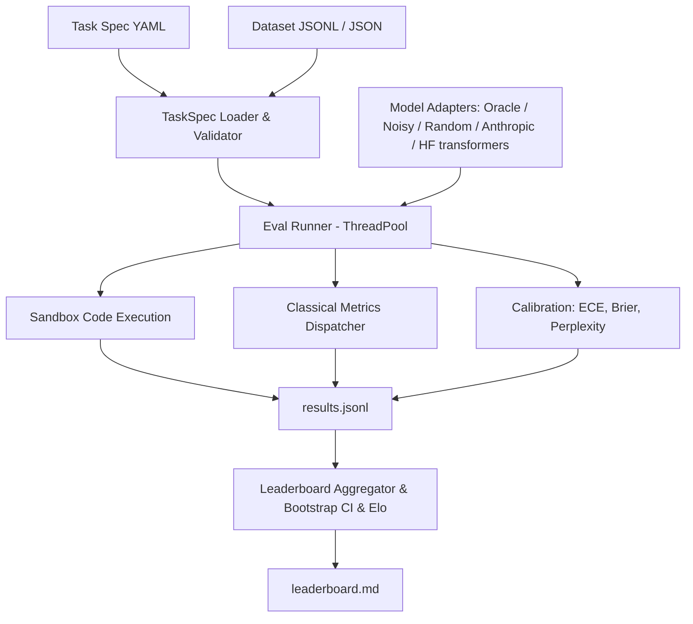

# evalkit

Evaluation runner and benchmark harness built from first principles (lessons 70–75).

## Problem

Evaluating LLMs accurately requires consistent metric definitions, reproducible sandboxed execution, statistical confidence estimation, and standardized task specifications. Without rigorous harnesses, benchmark results diverge across libraries due to hidden tokenization assumptions, uncalibrated confidence scores, and flawed aggregation.

`evalkit` provides an end-to-end evaluation runner with:
1. Pydantic v2 YAML task specifications with variable validation
2. Pure Python implementations of classical metrics (exact match, token F1, BLEU-4, ROUGE-L, chrF, accuracy)
3. Subprocess code execution sandbox with CPU/memory limits and unbiased Codex pass@k
4. Perplexity and Expected Calibration Error (ECE) with reliability diagrams
5. Bootstrap confidence intervals, deterministic Elo ratings (interleaved match order), and a resolvability layer (paired randomisation test, Holm correction, minimum detectable effect, sample size for 80% power, leaderboard tie groups)
6. Resumable multi-threaded evaluation runner with automated markdown leaderboard generation

## Architecture



## Quickstart

```bash
# Run evaluations across bundled tasks
uv run evalkit run --tasks tasks --models oracle,noisy:0.3,random --out runs/demo

# View leaderboard
uv run evalkit leaderboard runs/demo

# Paired comparison of two models on the same examples
uv run evalkit compare runs/demo/results.jsonl --a noisy:0.3 --b random

# All model pairs: randomisation p, Holm correction, minimum detectable effect, n for 80% power
uv run evalkit compare runs/demo/results.jsonl --all-pairs

# Real local models (needs the [hf] extra: torch + transformers)
uv run --extra hf evalkit run --tasks tasks --models oracle,random,hf:Qwen/Qwen2.5-0.5B-Instruct --workers 1
```

## Results

Benchmark results on bundled evaluation tasks (35 arithmetic, 35 trivia MCQ, 10 HumanEval-style, 35 sentiment; 345 example×model pairs):

| Rank | Model | Macro Mean | 95% CI | Win Rate | Elo Rating | ECE (15 bins) | Brier Score | Tie group |
|------|-------|------------|--------|----------|------------|---------------|-------------|-----------|
| 1 | oracle | 1.000 | [1.000, 1.000] | 0.772 | 1145.2 | 0.010 | 0.000 | 1 |
| 2 | noisy:0.3 | 0.714 | [0.614, 0.800] | 0.543 | 1044.5 | 0.098 | 0.210 | 2 |
| 3 | random | 0.179 | [0.129, 0.236] | 0.185 | 810.3 | 0.124 | 0.183 | 3 |

Per-task means:

| Model | arithmetic_qa | code_humaneval | sentiment | trivia_mcq |
|-------|---------------|----------------|-----------|------------|
| oracle | 1.000 | 1.000 | 1.000 | 1.000 |
| noisy:0.3 | 0.714 | 0.800 | 0.657 | 0.686 |
| random | 0.000 | 0.000 | 0.514 | 0.200 |

Random sits at chance on the 2-label sentiment task (0.514) and the 4-option MCQ (0.200). The Tie group column is described under "Resolvability". Rerunning the same command reports `Evaluated: 0, Skipped: 345` (full resume), and a fresh run reproduces `leaderboard.md` byte for byte.

Headline: **oracle macro mean = 1.000 > noisy:0.3 = 0.714 > random = 0.179**.

### Paired comparison

The leaderboard CIs are per model. Whether two models differ is a paired question: both answered the same examples, so `evalkit compare` resamples the per-example differences (10,000 resamples) and adds an exact two-sided sign test on wins/losses (ties dropped).

`evalkit compare runs/demo/results.jsonl --a noisy:0.3 --b random`:

| Task | n | A | B | A - B | 95% CI (paired bootstrap) | W / L / T | sign p |
|---|---|---|---|---|---|---|---|
| arithmetic_qa | 35 | 0.714 | 0.000 | +0.714 | [+0.571, +0.857] | 25 / 0 / 10 | 5.96e-08 |
| code_humaneval | 10 | 0.800 | 0.000 | +0.800 | [+0.500, +1.000] | 8 / 0 / 2 | 0.00781 |
| sentiment | 35 | 0.657 | 0.514 | +0.143 | [-0.086, +0.371] | 12 / 7 / 16 | 0.359 |
| trivia_mcq | 35 | 0.686 | 0.200 | +0.486 | [+0.257, +0.686] | 20 / 3 / 12 | 0.000488 |
| ALL | 115 | 0.696 | 0.217 | +0.478 | [+0.357, +0.591] | 65 / 10 / 40 | 5.15e-11 |

On sentiment the 0.14 gap between noisy:0.3 and random is not distinguishable from zero at n = 35 (CI crosses 0, p = 0.36), although the leaderboard shows 0.657 vs 0.514. p-values are not corrected for the four tasks.

### Resolvability: all pairs, Holm correction, power

Smucker, Allan & Carterette (2007, [CIKM](https://ciir-publications.cs.umass.edu/getpdf.php?id=744)) recommend the randomisation (permutation) test or the bootstrap over the sign test and Wilcoxon test for comparing systems on the same items: the sign test throws away the size of each difference and has poor power. `evalkit compare --all-pairs` therefore uses a paired randomisation test as the p-value that decides, and keeps the sign test only as a reported column. Miller (2024, [arXiv 2411.00640](https://arxiv.org/abs/2411.00640)) recommends paired differences and power analysis; the MDE and sample-size columns use that normal approximation.

Per pair (all examples both models were scored on, pooled over tasks, `A - B`):

- **Randomisation p**: two-sided sign-flip test on the per-example differences. Exact enumeration of all 2^k sign patterns when k (nonzero differences) <= 20; otherwise 10,000 seeded Monte Carlo draws with the (hits + 1) / (draws + 1) estimator, so the smallest value it can report is 1/10001 ≈ 0.0001 (printed `0.0001`, read it as "< 1e-4", not as an exact value).
- **Holm p**: Holm-Bonferroni over every pair printed (3 pairs for the demo, 10 for the five-model run), i.e. family-wise error control without independence assumptions.
- **MDE (80%)**: smallest true mean difference detectable with 80% power at alpha 0.05: `(z_0.975 + z_0.8) * SD(diffs) / sqrt(n)` = `2.8016 * SD / sqrt(n)`.
- **n for 80% power**: `ceil((2.8016 * SD / |effect|)^2)` for the observed |A - B| (or `--effect X`). SD is the sample SD of the per-example differences from this very run, so with few nonzero differences it is itself very noisy; treat n as an order of magnitude.
- **Verdict**: `resolved` if Holm p < 0.05, else `unresolved (needs n≈X)`; if the observed difference is exactly 0 no n makes it resolvable, so the verdict says `unresolved (observed diff = 0)` and `--effect X` gives the n needed to resolve a difference of X.

`uv run evalkit compare runs/demo/results.jsonl --all-pairs` (demo run regenerated with the Quickstart `run` command):

| A vs B | n | A - B | 95% CI (paired bootstrap) | W / L / T | sign p | randomisation p | Holm p | MDE (80%) | n for 80% power | verdict |
|---|---|---|---|---|---|---|---|---|---|---|
| oracle vs noisy:0.3 | 115 | +0.304 | [+0.226, +0.391] | 35 / 0 / 80 | 5.82e-11 | 0.0001 | 0.0003 | 0.121 | 19 | resolved |
| oracle vs random | 115 | +0.783 | [+0.704, +0.852] | 90 / 0 / 25 | 1.62e-27 | 0.0001 | 0.0003 | 0.108 | 3 | resolved |
| noisy:0.3 vs random | 115 | +0.478 | [+0.357, +0.591] | 65 / 10 / 40 | 5.15e-11 | 0.0001 | 0.0003 | 0.171 | 15 | resolved |

All three demo pairs are resolved.

**Tie groups** (leaderboard column): walking down the ranking, a model joins the group of the model ranked directly above it unless the randomisation test between the two is resolved (Holm over the adjacent pairs). Models that share a group are not separated by this data. The relation is not transitive (A ~ B and B ~ C does not imply A ~ C), and the test is on the pooled per-example difference while the ranking is by macro mean, so the two can disagree; the column is a warning against over-reading ranks, not a second ranking.

## Real local models (Hugging Face)

`hf:<model_id>[@<revision>]` loads a transformers causal LM (extra `[hf]`) and runs it through the same runner as the mock models. Everything below was produced by this one command (the three `@` hashes pin the exact weights; `oracle,random` are in the same run as reference):

```bash
uv run --extra hf evalkit run --tasks tasks --workers 1 --out runs/hf-leaderboard --models \
  "oracle,random,hf:Qwen/Qwen2.5-0.5B-Instruct@7ae557604adf67be50417f59c2c2f167def9a775,hf:Qwen/Qwen2.5-1.5B-Instruct@989aa7980e4cf806f80c7fef2b1adb7bc71aa306,hf:Qwen/Qwen2.5-3B-Instruct@aa8e72537993ba99e69dfaafa59ed015b17504d1"
```

Run on 2026-10-16: Apple M4 Pro, 24 GB, macOS 27.0.1, Python 3.12.14, torch 2.14.1 (MPS, bfloat16), transformers 5.20.0. Wall time: **2 min 04 s** for all 575 example×model pairs (115 examples × 5 models), including loading the three models from a warm local cache and running the generated code (`time` of the command above; a repeat took 1 min 57 s). Downloading weights is not included.

| Model | HF revision | Licence |
|---|---|---|
| Qwen/Qwen2.5-0.5B-Instruct | `7ae557604adf67be50417f59c2c2f167def9a775` | Apache-2.0 ([card](https://huggingface.co/Qwen/Qwen2.5-0.5B-Instruct)) |
| Qwen/Qwen2.5-1.5B-Instruct | `989aa7980e4cf806f80c7fef2b1adb7bc71aa306` | Apache-2.0 ([card](https://huggingface.co/Qwen/Qwen2.5-1.5B-Instruct)) |
| Qwen/Qwen2.5-3B-Instruct | `aa8e72537993ba99e69dfaafa59ed015b17504d1` | Qwen Research licence, non-commercial ([card](https://huggingface.co/Qwen/Qwen2.5-3B-Instruct)) |

Weights and generations are not committed (`runs/` is gitignored).

### Leaderboard

| Rank | Model | Macro Mean | 95% CI (stratified bootstrap) | Win Rate | Elo | ECE (15 bins) | Brier | Tie group |
|------|-------|------------|--------|----------|------|------|-------|-----------|
| 1 | oracle | 1.000 | [1.000, 1.000] | 0.628 | 1093.0 | 0.010 | 0.000 | 1 |
| 2 | hf:Qwen2.5-1.5B-Instruct | 0.986 | [0.964, 1.000] | 0.617 | 1091.8 | 0.019 | 0.015 | 1 |
| 3 | hf:Qwen2.5-3B-Instruct | 0.968 | [0.911, 1.000] | 0.617 | 1092.4 | 0.016 | 0.016 | 1 |
| 4 | hf:Qwen2.5-0.5B-Instruct | 0.829 | [0.771, 0.879] | 0.498 | 979.7 | 0.111 | 0.127 | 2 |
| 5 | random | 0.179 | [0.129, 0.236] | 0.139 | 743.1 | 0.124 | 0.183 | 3 |

Oracle, 1.5B and 3B share tie group 1 (`uv run evalkit leaderboard runs/hf-leaderboard --recompute`): the suite does not separate them, while 0.5B and random are each resolved from the model ranked above them.

Per task: score and, for the real models, the Wilson 95% interval of the pass rate (k/n). Sample sizes are 35 / 10 / 35 / 35.

| Model | arithmetic_qa (n=35) | code_humaneval (n=10) | sentiment (n=35) | trivia_mcq (n=35) |
|---|---|---|---|---|
| oracle | 1.000 | 1.000 | 1.000 | 1.000 |
| Qwen2.5-1.5B-Instruct | 0.971 (34/35) [0.855, 0.995] | 1.000 (10/10) [0.722, 1.000] | 1.000 (35/35) [0.901, 1.000] | 0.971 (34/35) [0.855, 0.995] |
| Qwen2.5-3B-Instruct | 0.971 (34/35) [0.855, 0.995] | 0.900 (9/10) [0.596, 0.982] | 1.000 (35/35) [0.901, 1.000] | 1.000 (35/35) [0.901, 1.000] |
| Qwen2.5-0.5B-Instruct | 0.686 (24/35) [0.520, 0.814] | 1.000 (10/10) [0.722, 1.000] | 0.971 (34/35) [0.855, 0.995] | 0.657 (23/35) [0.492, 0.792] |
| random | 0.000 | 0.000 | 0.514 | 0.200 |

(Wilson intervals: standard score-interval formula, z = 1.96, applied to the per-model, per-task `score` sums in `runs/hf-leaderboard/results.jsonl`.)

### Paired comparison of the two closest models

`uv run evalkit compare runs/hf-leaderboard/results.jsonl --a "hf:Qwen/Qwen2.5-1.5B-Instruct@989aa798" --b "hf:Qwen/Qwen2.5-3B-Instruct@aa8e7253"`:

| Task | n | A (1.5B) | B (3B) | A - B | 95% CI (paired bootstrap) | W / L / T | sign p |
|---|---|---|---|---|---|---|---|
| arithmetic_qa | 35 | 0.971 | 0.971 | +0.000 | [+0.000, +0.000] | 0 / 0 / 35 | 1 |
| code_humaneval | 10 | 1.000 | 0.900 | +0.100 | [+0.000, +0.300] | 1 / 0 / 9 | 1 |
| sentiment | 35 | 1.000 | 1.000 | +0.000 | [+0.000, +0.000] | 0 / 0 / 35 | 1 |
| trivia_mcq | 35 | 0.971 | 1.000 | -0.029 | [-0.086, +0.000] | 0 / 1 / 34 | 1 |
| ALL | 115 | 0.983 | 0.983 | +0.000 | [-0.026, +0.026] | 1 / 1 / 113 | 1 |

**Result: 1.5B vs 3B is unresolved.** 113 of 115 examples tie; the 1.5B model wins one (code_008, see below) and loses one (mcq_006), so the pooled difference is exactly 0 (randomisation p = 1, Holm p = 1) and the macro-mean ranking in the leaderboard (0.986 vs 0.968) comes only from the 10-example code task, where one failure moves the task mean by 0.1. Do not read "1.5B beats 3B" out of the leaderboard. Because the observed difference is 0, "n needed" has no value at the observed effect; for a stated effect, `--models <1.5B>,<3B> --effect 0.05` gives **n ≈ 56** and `--effect 0.02` gives **n ≈ 345** examples for 80% power (alpha 0.05), against n = 115 here (MDE at n = 115 is 0.035). Those n use the SD of the differences observed here (2 nonzero of 115), which is itself a rough estimate. Honest reading: the suite is too easy to produce disagreement between the two, so it cannot tell whether a 2-point gap exists.

### All pairs (Holm over 10 comparisons)

`uv run evalkit compare runs/hf-leaderboard/results.jsonl --all-pairs` (model names shortened: `0.5B` = `hf:Qwen/Qwen2.5-0.5B-Instruct@7ae55760`, `1.5B` = `...1.5B-Instruct@989aa798`, `3B` = `...3B-Instruct@aa8e7253`; the real output prints the full names):

| A vs B | n | A - B | 95% CI (paired bootstrap) | W / L / T | sign p | randomisation p | Holm p | MDE (80%) | n for 80% power | verdict |
|---|---|---|---|---|---|---|---|---|---|---|
| oracle vs random | 115 | +0.783 | [+0.704, +0.852] | 90 / 0 / 25 | 1.62e-27 | 0.0001 | 0.001 | 0.108 | 3 | resolved |
| oracle vs 0.5B | 115 | +0.209 | [+0.139, +0.287] | 24 / 0 / 91 | 1.19e-07 | 0.0001 | 0.001 | 0.107 | 31 | resolved |
| oracle vs 1.5B | 115 | +0.017 | [+0.000, +0.043] | 2 / 0 / 113 | 0.5 | 0.5 | 1 | 0.034 | 448 | unresolved (needs n≈448) |
| oracle vs 3B | 115 | +0.017 | [+0.000, +0.043] | 2 / 0 / 113 | 0.5 | 0.5 | 1 | 0.034 | 448 | unresolved (needs n≈448) |
| random vs 0.5B | 115 | -0.574 | [-0.678, -0.470] | 5 / 71 / 39 | 5.25e-16 | 0.0001 | 0.001 | 0.151 | 8 | resolved |
| random vs 1.5B | 115 | -0.765 | [-0.843, -0.687] | 1 / 89 / 25 | 1.47e-25 | 0.0001 | 0.001 | 0.116 | 3 | resolved |
| random vs 3B | 115 | -0.765 | [-0.835, -0.687] | 0 / 88 / 27 | 6.46e-27 | 0.0001 | 0.001 | 0.111 | 3 | resolved |
| 0.5B vs 1.5B | 115 | -0.191 | [-0.261, -0.122] | 0 / 22 / 93 | 4.77e-07 | 0.0001 | 0.001 | 0.103 | 34 | resolved |
| 0.5B vs 3B | 115 | -0.191 | [-0.270, -0.122] | 1 / 23 / 91 | 2.98e-06 | 0.0001 | 0.001 | 0.109 | 38 | resolved |
| 1.5B vs 3B | 115 | +0.000 | [-0.026, +0.026] | 1 / 1 / 113 | 1 | 1 | 1 | 0.035 | n/a | unresolved (observed diff = 0) |

0.5B is resolved from every other model (Holm p < 0.05 in all four of its pairs); 1.5B and 3B are not resolved from each other nor from the oracle: oracle vs either is 2 wins in 115, p = 0.5, and 448 examples would be needed to resolve a 1.7-point gap at the observed SD. The sign test and the randomisation test give the same resolved / unresolved call on every row. Randomisation p of `0.0001` is the Monte Carlo floor (k > 20), not an exact value. Reproduce 1.5B vs 3B with a target effect: `uv run evalkit compare runs/hf-leaderboard/results.jsonl --all-pairs --models "hf:Qwen/Qwen2.5-1.5B-Instruct@989aa798,hf:Qwen/Qwen2.5-3B-Instruct@aa8e7253" --effect 0.05`.

### How the adapter answers (`src/evalkit/hf.py`)

- **Prompting**: the task prompt is sent as one user turn through the model's chat template (Qwen's default system prompt is left as is), with a one-line instruction appended by the adapter: "Reply with only the final answer" (generation), "Complete the function above... single \`\`\`python code block" (code), or "Reply with exactly one of the following options: ..." (classification / MCQ). This instruction is part of what is being measured; a different wording would give different numbers.
- **Decoding**: greedy, no sampling, repetition penalty forced to 1.0 (Qwen's shipped `generation_config` sets 1.05), at most 48 new tokens (generation) or 384 (code).
- **Classification and MCQ** use the label set exactly like the mock models (`choices` of the example, or the dataset's label set): each option is scored as the assistant reply (sum of token log-probs) and the argmax is returned, so output is always on the label set and never needs parsing. MCQ options are the option *texts*; the A/B/C/D letters only appear in the task prompt.
- **Calibration fields come from real log-probs**: `logprobs` are the raw-logit log-probs of the emitted tokens, `token_nll` is their negated sum, `token_count` is the tokenizer's count. `confidence` is (a) for choice tasks, the softmax over the option scores, i.e. probability renormalised over the label set, not over the full vocabulary; (b) for generation/code, the geometric-mean token probability `exp(mean(logprob))`. Both are heuristics, not calibrated probabilities. The ECE column measures how far off they are. `token_nll` for choice tasks is the NLL of the chosen label only. The leaderboard does not report perplexity.
- **Not comparable with oracle/random ECE**: the mock models' confidences are fixed or synthetic constants (e.g. oracle always 0.99), not derived from anything.
- **`--workers 1`**: all workers would share one model instance, and torch/MPS calls on one model from several threads are not safe. The adapter holds a lock around every model call, so higher worker counts are still correct, but they only overlap the code-execution subprocesses and cannot speed up inference. `workers 1` avoids that illusion.

### Caveats

- **Tiny, easy task sets** (35 / 35 / 10 / 35). The 1.5B and 3B models sit near the ceiling, so this suite cannot separate them (see compare table). It is a harness demo, not a model ranking; these are not standard benchmarks and the numbers are not comparable to published scores. Whether the item sets appear in the models' training data has not been checked.
- **Strict exact-match scoring penalises format.** Of the misses: 0.5B answered `96 / 8 = 12` and `256 / 16 = 16` (correct number, wrong format; arith_004, arith_028); 3B answered `14.0` for `196 / 14` (arith_024); 1.5B answered `14.071428571428571` for the same item (a genuine error). These are scored 0 as measured; the metric was not loosened.
- **The one 3B code failure is a real behavioural miss, not an extraction bug**: for code_008 (`count_vowels`) it wrote `vowels = "aeiou"`, which fails the bundled test `count_vowels('AEIOU') == 5`. The docstring ("a, e, i, o, u") is ambiguous about case.
- **Generated code is really executed.** `code_humaneval` runs model output in the subprocess sandbox (`python -I`, temp cwd, 5 s CPU limit). That is not a security boundary: there is no network or filesystem isolation, and the 512 MB address-space limit is skipped on macOS. Only run it on models and tasks you trust.
- **Rank classification is not free generation**: on sentiment and MCQ the model cannot answer off the label set, which makes those tasks easier than a free-text protocol. Win Rate / Elo are relative to this set of five rows, with oracle and random included.
- **Reproducibility**: a repeat of the full command into a fresh directory gave a byte-identical `leaderboard.md` and 0 / 575 differing predictions (max confidence difference 0.0), on the same machine and library versions. bfloat16 on MPS is not guaranteed to match other hardware.

## Design Decisions

- **Zero-Dependency Core Metrics**: Metrics are implemented directly with NumPy and standard library to ensure mathematical transparency and prevent external library drift.
- **Subprocess Isolation**: Code execution runs with `python -I` under temporary working directories with POSIX CPU limits (5s) and address space limits (512MB) set by the child process itself before it runs candidate code (not via `preexec_fn`, which is unsafe in the threaded runner).
- **Unbiased pass@k**: Implemented using Chen et al. (2021) unbiased combinatoric formulation to prevent finite-sample estimation bias.
- **Strict Spec Invariants**: Template variables declared in prompt templates are strictly validated against dataset rows upon loading to eliminate runtime format errors.
- **Classification as constrained choice**: the label set is every distinct target in the dataset, and models pick from it the same way they pick MCQ options.
- **Per-prompt RNG in mock models**: each prediction seeds its own `random.Random(f"{seed}:{prompt}")`, so results don't depend on thread scheduling under the 4-worker pool.
- **CI matches the statistic**: the 95% CI is a stratified bootstrap of the macro mean (resample within each task, then average), not a pooled micro mean.
- **Randomisation over sign test for decisions**: the verdict uses a paired randomisation test with Holm correction (Smucker et al. 2007); the sign test stays as a reported column. Power numbers use the normal approximation (Miller 2024); no dependency beyond numpy (the normal quantile comes from `statistics.NormalDist`).
- **Elo over interleaved matches**: games are played in example order. Grouping them by model pair let `noisy` out-rate `oracle` purely because of the order the games were played.
