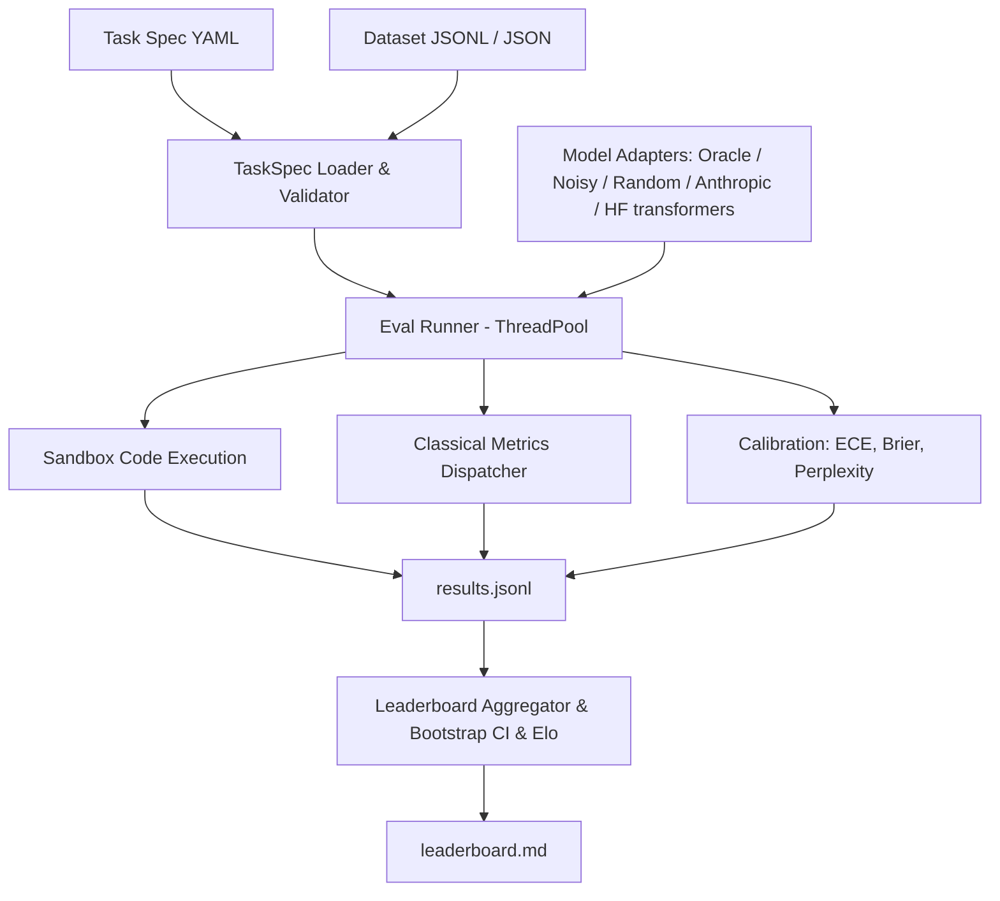

# evalkit

Evaluation runner and benchmark harness built from first principles (lessons 70–75).

## Problem

Evaluating LLMs accurately requires consistent metric definitions, reproducible sandboxed execution, statistical confidence estimation, and standardized task specifications. Without rigorous harnesses, benchmark results diverge across libraries due to hidden tokenization assumptions, uncalibrated confidence scores, and flawed aggregation.

`evalkit` provides an end-to-end evaluation runner with:
1. Pydantic v2 YAML task specifications with variable validation
2. Pure Python implementations of classical metrics (exact match, token F1, BLEU-4, ROUGE-L, chrF, accuracy)
3. Subprocess code execution sandbox with CPU/memory limits and unbiased Codex pass@k
4. Perplexity and Expected Calibration Error (ECE) with reliability diagrams
5. Bootstrap confidence intervals and deterministic Elo ratings (interleaved match order)
6. Resumable multi-threaded evaluation runner with automated markdown leaderboard generation

## Architecture



## Quickstart

```bash
# Run evaluations across bundled tasks
uv run evalkit run --tasks tasks --models oracle,noisy:0.3,random --out runs/demo

# View leaderboard
uv run evalkit leaderboard runs/demo

# Paired comparison of two models on the same examples
uv run evalkit compare runs/demo/results.jsonl --a noisy:0.3 --b random

# Real local models (needs the [hf] extra: torch + transformers)
uv run --extra hf evalkit run --tasks tasks --models oracle,random,hf:Qwen/Qwen2.5-0.5B-Instruct --workers 1
```

## Results

Benchmark results on bundled evaluation tasks (35 arithmetic, 35 trivia MCQ, 10 HumanEval-style, 35 sentiment; 345 example×model pairs):

| Rank | Model | Macro Mean | 95% CI | Win Rate | Elo Rating | ECE (15 bins) | Brier Score |
|------|-------|------------|--------|----------|------------|---------------|-------------|
| 1 | oracle | 1.000 | [1.000, 1.000] | 0.772 | 1145.2 | 0.010 | 0.000 |
| 2 | noisy:0.3 | 0.714 | [0.614, 0.800] | 0.543 | 1044.5 | 0.098 | 0.210 |
| 3 | random | 0.179 | [0.129, 0.236] | 0.185 | 810.3 | 0.124 | 0.183 |

Per-task means:

| Model | arithmetic_qa | code_humaneval | sentiment | trivia_mcq |
|-------|---------------|----------------|-----------|------------|
| oracle | 1.000 | 1.000 | 1.000 | 1.000 |
| noisy:0.3 | 0.714 | 0.800 | 0.657 | 0.686 |
| random | 0.000 | 0.000 | 0.514 | 0.200 |

Random sits at chance on the 2-label sentiment task (0.514) and the 4-option MCQ (0.200). Rerunning the same command reports `Evaluated: 0, Skipped: 345` (full resume), and a fresh run reproduces `leaderboard.md` byte for byte.

Headline: **oracle macro mean = 1.000 > noisy:0.3 = 0.714 > random = 0.179**.

### Paired comparison

The leaderboard CIs are per model. Whether two models differ is a paired question: both answered the same examples, so `evalkit compare` resamples the per-example differences (10,000 resamples) and adds an exact two-sided sign test on wins/losses (ties dropped).

`evalkit compare runs/demo/results.jsonl --a noisy:0.3 --b random`:

| Task | n | A | B | A - B | 95% CI (paired bootstrap) | W / L / T | sign p |
|---|---|---|---|---|---|---|---|
| arithmetic_qa | 35 | 0.714 | 0.000 | +0.714 | [+0.571, +0.857] | 25 / 0 / 10 | 5.96e-08 |
| code_humaneval | 10 | 0.800 | 0.000 | +0.800 | [+0.500, +1.000] | 8 / 0 / 2 | 0.00781 |
| sentiment | 35 | 0.657 | 0.514 | +0.143 | [-0.086, +0.371] | 12 / 7 / 16 | 0.359 |
| trivia_mcq | 35 | 0.686 | 0.200 | +0.486 | [+0.257, +0.686] | 20 / 3 / 12 | 0.000488 |
| ALL | 115 | 0.696 | 0.217 | +0.478 | [+0.357, +0.591] | 65 / 10 / 40 | 5.15e-11 |

On sentiment the 0.14 gap between noisy:0.3 and random is not distinguishable from zero at n = 35 (CI crosses 0, p = 0.36), although the leaderboard shows 0.657 vs 0.514. p-values are not corrected for the four tasks.

## Real local models (Hugging Face)

`hf:<model_id>[@<revision>]` loads a transformers causal LM (extra `[hf]`) and runs it through the same runner as the mock models. Everything below was produced by this one command (the three `@` hashes pin the exact weights; `oracle,random` are in the same run as reference):

```bash
uv run --extra hf evalkit run --tasks tasks --workers 1 --out runs/hf-leaderboard --models \
  "oracle,random,hf:Qwen/Qwen2.5-0.5B-Instruct@7ae557604adf67be50417f59c2c2f167def9a775,hf:Qwen/Qwen2.5-1.5B-Instruct@989aa7980e4cf806f80c7fef2b1adb7bc71aa306,hf:Qwen/Qwen2.5-3B-Instruct@aa8e72537993ba99e69dfaafa59ed015b17504d1"
```

Run on 2026-10-16: Apple M4 Pro, 24 GB, macOS 27.0.1, Python 3.12.14, torch 2.14.1 (MPS, bfloat16), transformers 5.20.0. Wall time: **2 min 04 s** for all 575 example×model pairs (115 examples × 5 models), including loading the three models from a warm local cache and running the generated code (`time` of the command above; a repeat took 1 min 57 s). Downloading weights is not included.

| Model | HF revision | Licence |
|---|---|---|
| Qwen/Qwen2.5-0.5B-Instruct | `7ae557604adf67be50417f59c2c2f167def9a775` | Apache-2.0 ([card](https://huggingface.co/Qwen/Qwen2.5-0.5B-Instruct)) |
| Qwen/Qwen2.5-1.5B-Instruct | `989aa7980e4cf806f80c7fef2b1adb7bc71aa306` | Apache-2.0 ([card](https://huggingface.co/Qwen/Qwen2.5-1.5B-Instruct)) |
| Qwen/Qwen2.5-3B-Instruct | `aa8e72537993ba99e69dfaafa59ed015b17504d1` | Qwen Research licence, non-commercial ([card](https://huggingface.co/Qwen/Qwen2.5-3B-Instruct)) |

Weights and generations are not committed (`runs/` is gitignored).

### Leaderboard

| Rank | Model | Macro Mean | 95% CI (stratified bootstrap) | Win Rate | Elo | ECE (15 bins) | Brier |
|------|-------|------------|--------|----------|------|------|-------|
| 1 | oracle | 1.000 | [1.000, 1.000] | 0.628 | 1093.0 | 0.010 | 0.000 |
| 2 | hf:Qwen2.5-1.5B-Instruct | 0.986 | [0.964, 1.000] | 0.617 | 1091.8 | 0.019 | 0.015 |
| 3 | hf:Qwen2.5-3B-Instruct | 0.968 | [0.911, 1.000] | 0.617 | 1092.4 | 0.016 | 0.016 |
| 4 | hf:Qwen2.5-0.5B-Instruct | 0.829 | [0.771, 0.879] | 0.498 | 979.7 | 0.111 | 0.127 |
| 5 | random | 0.179 | [0.129, 0.236] | 0.139 | 743.1 | 0.124 | 0.183 |

Per task: score and, for the real models, the Wilson 95% interval of the pass rate (k/n). Sample sizes are 35 / 10 / 35 / 35.

| Model | arithmetic_qa (n=35) | code_humaneval (n=10) | sentiment (n=35) | trivia_mcq (n=35) |
|---|---|---|---|---|
| oracle | 1.000 | 1.000 | 1.000 | 1.000 |
| Qwen2.5-1.5B-Instruct | 0.971 (34/35) [0.855, 0.995] | 1.000 (10/10) [0.722, 1.000] | 1.000 (35/35) [0.901, 1.000] | 0.971 (34/35) [0.855, 0.995] |
| Qwen2.5-3B-Instruct | 0.971 (34/35) [0.855, 0.995] | 0.900 (9/10) [0.596, 0.982] | 1.000 (35/35) [0.901, 1.000] | 1.000 (35/35) [0.901, 1.000] |
| Qwen2.5-0.5B-Instruct | 0.686 (24/35) [0.520, 0.814] | 1.000 (10/10) [0.722, 1.000] | 0.971 (34/35) [0.855, 0.995] | 0.657 (23/35) [0.492, 0.792] |
| random | 0.000 | 0.000 | 0.514 | 0.200 |

(Wilson intervals: standard score-interval formula, z = 1.96, applied to the per-model, per-task `score` sums in `runs/hf-leaderboard/results.jsonl`.)

### Paired comparison of the two closest models

`uv run evalkit compare runs/hf-leaderboard/results.jsonl --a "hf:Qwen/Qwen2.5-1.5B-Instruct@989aa798" --b "hf:Qwen/Qwen2.5-3B-Instruct@aa8e7253"`:

| Task | n | A (1.5B) | B (3B) | A - B | 95% CI (paired bootstrap) | W / L / T | sign p |
|---|---|---|---|---|---|---|---|
| arithmetic_qa | 35 | 0.971 | 0.971 | +0.000 | [+0.000, +0.000] | 0 / 0 / 35 | 1 |
| code_humaneval | 10 | 1.000 | 0.900 | +0.100 | [+0.000, +0.300] | 1 / 0 / 9 | 1 |
| sentiment | 35 | 1.000 | 1.000 | +0.000 | [+0.000, +0.000] | 0 / 0 / 35 | 1 |
| trivia_mcq | 35 | 0.971 | 1.000 | -0.029 | [-0.086, +0.000] | 0 / 1 / 34 | 1 |
| ALL | 115 | 0.983 | 0.983 | +0.000 | [-0.026, +0.026] | 1 / 1 / 113 | 1 |

**Result: no measurable difference.** 113 of 115 examples tie; the 1.5B model wins one (code_008, see below) and loses one (mcq_006). The macro-mean ranking in the leaderboard (0.986 vs 0.968) comes only from the 10-example code task, where one failure moves the task mean by 0.1; the micro average over all 115 examples is identical (0.983). Do not read "1.5B beats 3B" out of the leaderboard. For contrast, 0.5B vs 1.5B (`--a "hf:Qwen/Qwen2.5-0.5B-Instruct@7ae55760" --b "hf:Qwen/Qwen2.5-1.5B-Instruct@989aa798"`) is a real gap: ALL 0.791 vs 0.983, diff -0.191, CI [-0.261, -0.122], 0 / 22 / 93, sign p = 4.8e-07 (arithmetic_qa -0.286, trivia_mcq -0.314, both p < 0.01; p-values uncorrected).

### How the adapter answers (`src/evalkit/hf.py`)

- **Prompting**: the task prompt is sent as one user turn through the model's chat template (Qwen's default system prompt is left as is), with a one-line instruction appended by the adapter: "Reply with only the final answer" (generation), "Complete the function above... single \`\`\`python code block" (code), or "Reply with exactly one of the following options: ..." (classification / MCQ). This instruction is part of what is being measured; a different wording would give different numbers.
- **Decoding**: greedy, no sampling, repetition penalty forced to 1.0 (Qwen's shipped `generation_config` sets 1.05), at most 48 new tokens (generation) or 384 (code).
- **Classification and MCQ** use the label set exactly like the mock models (`choices` of the example, or the dataset's label set): each option is scored as the assistant reply (sum of token log-probs) and the argmax is returned, so output is always on the label set and never needs parsing. MCQ options are the option *texts*; the A/B/C/D letters only appear in the task prompt.
- **Calibration fields come from real log-probs**: `logprobs` are the raw-logit log-probs of the emitted tokens, `token_nll` is their negated sum, `token_count` is the tokenizer's count. `confidence` is (a) for choice tasks, the softmax over the option scores, i.e. probability renormalised over the label set, not over the full vocabulary; (b) for generation/code, the geometric-mean token probability `exp(mean(logprob))`. Both are heuristics, not calibrated probabilities. The ECE column measures how far off they are. `token_nll` for choice tasks is the NLL of the chosen label only. The leaderboard does not report perplexity.
- **Not comparable with oracle/random ECE**: the mock models' confidences are fixed or synthetic constants (e.g. oracle always 0.99), not derived from anything.
- **`--workers 1`**: all workers would share one model instance, and torch/MPS calls on one model from several threads are not safe. The adapter holds a lock around every model call, so higher worker counts are still correct, but they only overlap the code-execution subprocesses and cannot speed up inference. `workers 1` avoids that illusion.

### Caveats

- **Tiny, easy task sets** (35 / 35 / 10 / 35). The 1.5B and 3B models sit near the ceiling, so this suite cannot separate them (see compare table). It is a harness demo, not a model ranking; these are not standard benchmarks and the numbers are not comparable to published scores. Whether the item sets appear in the models' training data has not been checked.
- **Strict exact-match scoring penalises format.** Of the misses: 0.5B answered `96 / 8 = 12` and `256 / 16 = 16` (correct number, wrong format; arith_004, arith_028); 3B answered `14.0` for `196 / 14` (arith_024); 1.5B answered `14.071428571428571` for the same item (a genuine error). These are scored 0 as measured; the metric was not loosened.
- **The one 3B code failure is a real behavioural miss, not an extraction bug**: for code_008 (`count_vowels`) it wrote `vowels = "aeiou"`, which fails the bundled test `count_vowels('AEIOU') == 5`. The docstring ("a, e, i, o, u") is ambiguous about case.
- **Generated code is really executed.** `code_humaneval` runs model output in the subprocess sandbox (`python -I`, temp cwd, 5 s CPU limit). That is not a security boundary: there is no network or filesystem isolation, and the 512 MB address-space limit is skipped on macOS. Only run it on models and tasks you trust.
- **Rank classification is not free generation**: on sentiment and MCQ the model cannot answer off the label set, which makes those tasks easier than a free-text protocol. Win Rate / Elo are relative to this set of five rows, with oracle and random included.
- **Reproducibility**: a repeat of the full command into a fresh directory gave a byte-identical `leaderboard.md` and 0 / 575 differing predictions (max confidence difference 0.0), on the same machine and library versions. bfloat16 on MPS is not guaranteed to match other hardware.

## Design Decisions

- **Zero-Dependency Core Metrics**: Metrics are implemented directly with NumPy and standard library to ensure mathematical transparency and prevent external library drift.
- **Subprocess Isolation**: Code execution runs with `python -I` under temporary working directories with POSIX CPU limits (5s) and address space limits (512MB) set by the child process itself before it runs candidate code (not via `preexec_fn`, which is unsafe in the threaded runner).
- **Unbiased pass@k**: Implemented using Chen et al. (2021) unbiased combinatoric formulation to prevent finite-sample estimation bias.
- **Strict Spec Invariants**: Template variables declared in prompt templates are strictly validated against dataset rows upon loading to eliminate runtime format errors.
- **Classification as constrained choice**: the label set is every distinct target in the dataset, and models pick from it the same way they pick MCQ options.
- **Per-prompt RNG in mock models**: each prediction seeds its own `random.Random(f"{seed}:{prompt}")`, so results don't depend on thread scheduling under the 4-worker pool.
- **CI matches the statistic**: the 95% CI is a stratified bootstrap of the macro mean (resample within each task, then average), not a pooled micro mean.
- **Elo over interleaved matches**: games are played in example order. Grouping them by model pair let `noisy` out-rate `oracle` purely because of the order the games were played.
