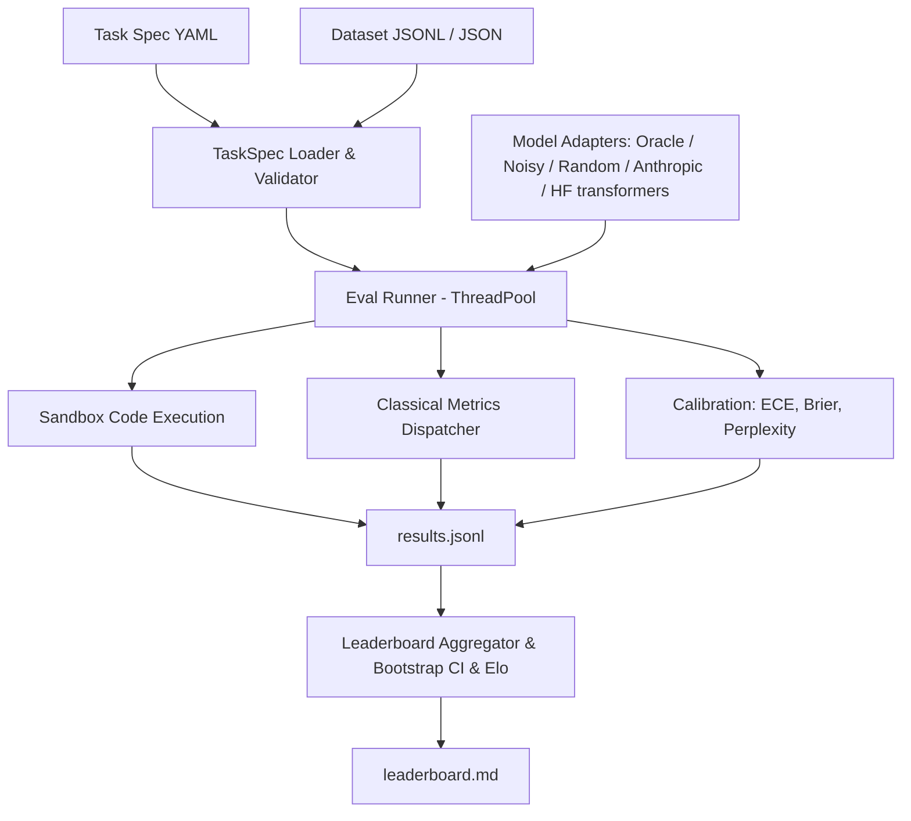

# evalkit

Evaluation runner and benchmark harness built from first principles (lessons 70–75).

## Problem

Evaluating LLMs accurately requires consistent metric definitions, reproducible sandboxed execution, statistical confidence estimation, and standardized task specifications. Without rigorous harnesses, benchmark results diverge across libraries due to hidden tokenization assumptions, uncalibrated confidence scores, and flawed aggregation.

`evalkit` provides an end-to-end evaluation runner with:
1. Pydantic v2 YAML task specifications with variable validation
2. Pure Python implementations of classical metrics (exact match, token F1, BLEU-4, ROUGE-L, chrF, accuracy)
3. Subprocess code execution sandbox with CPU/memory limits and unbiased Codex pass@k
4. Perplexity and Expected Calibration Error (ECE) with reliability diagrams
5. Bootstrap confidence intervals, deterministic Elo ratings (interleaved match order), and a resolvability layer (paired randomisation test, Holm correction, minimum detectable effect, sample size for 80% power, leaderboard tie groups)
6. Resumable multi-threaded evaluation runner with automated markdown leaderboard generation

## Architecture



## Quickstart

```bash
# Run evaluations across bundled tasks
uv run evalkit run --tasks tasks --models oracle,noisy:0.3,random --out runs/demo

# View leaderboard
uv run evalkit leaderboard runs/demo

# Paired comparison of two models on the same examples
uv run evalkit compare runs/demo/results.jsonl --a noisy:0.3 --b random

# All model pairs: randomisation p, Holm correction, minimum detectable effect, n for 80% power
uv run evalkit compare runs/demo/results.jsonl --all-pairs

# Monte Carlo check of the shipped statistics (type-I error, CI coverage, power, Holm FWER)
uv run evalkit stats-check --out runs/stats-check/report.md

# Real local models (needs the [hf] extra: torch + transformers)
uv run --extra hf evalkit run --tasks tasks --models oracle,random,hf:Qwen/Qwen2.5-0.5B-Instruct --workers 1

# Harder task (GSM8K subset, numeric answers); the Qwen runs are in "Harder task" below
uv run evalkit run --tasks tasks_hard --models oracle,random --out runs/gsm8k-mock
uv run --extra hf evalkit run --tasks tasks_hard --models hf:Qwen/Qwen2.5-1.5B-Instruct --workers 1 --hf-batch-size 16
```

## Results

Benchmark results on bundled evaluation tasks (35 arithmetic, 35 trivia MCQ, 10 HumanEval-style, 35 sentiment; 345 example×model pairs):

| Rank | Model | Macro Mean | 95% CI | Win Rate | Elo Rating | ECE (15 bins) | Brier Score | Tie group |
|------|-------|------------|--------|----------|------------|---------------|-------------|-----------|
| 1 | oracle | 1.000 | [1.000, 1.000] | 0.772 | 1145.2 | 0.010 | 0.000 | 1 |
| 2 | noisy:0.3 | 0.714 | [0.614, 0.800] | 0.543 | 1044.5 | 0.098 | 0.210 | 2 |
| 3 | random | 0.179 | [0.129, 0.236] | 0.185 | 810.3 | 0.124 | 0.183 | 3 |

Per-task means:

| Model | arithmetic_qa | code_humaneval | sentiment | trivia_mcq |
|-------|---------------|----------------|-----------|------------|
| oracle | 1.000 | 1.000 | 1.000 | 1.000 |
| noisy:0.3 | 0.714 | 0.800 | 0.657 | 0.686 |
| random | 0.000 | 0.000 | 0.514 | 0.200 |

Random sits at chance on the 2-label sentiment task (0.514) and the 4-option MCQ (0.200). The Tie group column is described under "Resolvability". Rerunning the same command reports `Evaluated: 0, Skipped: 345` (full resume), and a fresh run reproduces `leaderboard.md` byte for byte.

Headline: **oracle macro mean = 1.000 > noisy:0.3 = 0.714 > random = 0.179**.

### Paired comparison

The leaderboard CIs are per model. Whether two models differ is a paired question: both answered the same examples, so `evalkit compare` resamples the per-example differences (10,000 resamples) and adds an exact two-sided sign test on wins/losses (ties dropped).

`evalkit compare runs/demo/results.jsonl --a noisy:0.3 --b random`:

| Task | n | A | B | A - B | 95% CI (paired bootstrap) | W / L / T | sign p |
|---|---|---|---|---|---|---|---|
| arithmetic_qa | 35 | 0.714 | 0.000 | +0.714 | [+0.571, +0.857] | 25 / 0 / 10 | 5.96e-08 |
| code_humaneval | 10 | 0.800 | 0.000 | +0.800 | [+0.500, +1.000] | 8 / 0 / 2 | 0.00781 |
| sentiment | 35 | 0.657 | 0.514 | +0.143 | [-0.086, +0.371] | 12 / 7 / 16 | 0.359 |
| trivia_mcq | 35 | 0.686 | 0.200 | +0.486 | [+0.257, +0.686] | 20 / 3 / 12 | 0.000488 |
| ALL | 115 | 0.696 | 0.217 | +0.478 | [+0.357, +0.591] | 65 / 10 / 40 | 5.15e-11 |

On sentiment the 0.14 gap between noisy:0.3 and random is not distinguishable from zero at n = 35 (CI crosses 0, p = 0.36), although the leaderboard shows 0.657 vs 0.514. p-values are not corrected for the four tasks.

### Resolvability: all pairs, Holm correction, power

Smucker, Allan & Carterette (2007, [CIKM](https://ciir-publications.cs.umass.edu/getpdf.php?id=744)) recommend the randomisation (permutation) test or the bootstrap over the sign test and Wilcoxon test for comparing systems on the same items: the sign test throws away the size of each difference and has poor power. `evalkit compare --all-pairs` therefore uses a paired randomisation test as the p-value that decides, and keeps the sign test only as a reported column. Miller (2024, [arXiv 2411.00640](https://arxiv.org/abs/2411.00640)) recommends paired differences and power analysis; the MDE and sample-size columns use that normal approximation.

Per pair (all examples both models were scored on, pooled over tasks, `A - B`):

- **Randomisation p**: two-sided sign-flip test on the per-example differences. Exact enumeration of all 2^k sign patterns when k (nonzero differences) <= 20; otherwise 10,000 seeded Monte Carlo draws with the (hits + 1) / (draws + 1) estimator, so the smallest value it can report is 1/10001 ≈ 0.0001 (printed `0.0001`, read it as "< 1e-4", not as an exact value).
- **Holm p**: Holm-Bonferroni over every pair printed (3 pairs for the demo, 10 for the five-model run), i.e. family-wise error control without independence assumptions.
- **MDE (80%)**: smallest true mean difference detectable with 80% power at alpha 0.05: `(z_0.975 + z_0.8) * SD(diffs) / sqrt(n)` = `2.8016 * SD / sqrt(n)`.
- **n for 80% power**: `ceil((2.8016 * SD / |effect|)^2)` for the observed |A - B| (or `--effect X`). SD is the sample SD of the per-example differences from this very run, so with few nonzero differences it is itself very noisy; treat n as an order of magnitude.
- **Verdict**: `resolved` if Holm p < 0.05, else `unresolved (needs n≈X)`; if the observed difference is exactly 0 no n makes it resolvable, so the verdict says `unresolved (observed diff = 0)` and `--effect X` gives the n needed to resolve a difference of X.

`uv run evalkit compare runs/demo/results.jsonl --all-pairs` (demo run regenerated with the Quickstart `run` command):

| A vs B | n | A - B | 95% CI (paired bootstrap) | W / L / T | sign p | randomisation p | Holm p | MDE (80%) | n for 80% power | verdict |
|---|---|---|---|---|---|---|---|---|---|---|
| oracle vs noisy:0.3 | 115 | +0.304 | [+0.226, +0.391] | 35 / 0 / 80 | 5.82e-11 | 0.0001 | 0.0003 | 0.121 | 19 | resolved |
| oracle vs random | 115 | +0.783 | [+0.704, +0.852] | 90 / 0 / 25 | 1.62e-27 | 0.0001 | 0.0003 | 0.108 | 3 | resolved |
| noisy:0.3 vs random | 115 | +0.478 | [+0.357, +0.591] | 65 / 10 / 40 | 5.15e-11 | 0.0001 | 0.0003 | 0.171 | 15 | resolved |

All three demo pairs are resolved.

**Tie groups** (leaderboard column): walking down the ranking, a model joins the group of the model ranked directly above it unless the randomisation test between the two is resolved (Holm over the adjacent pairs). Models that share a group are not separated by this data. The relation is not transitive (A ~ B and B ~ C does not imply A ~ C), and the test is on the pooled per-example difference while the ranking is by macro mean, so the two can disagree; the column is a warning against over-reading ranks, not a second ranking.

## Real local models (Hugging Face)

`hf:<model_id>[@<revision>]` loads a transformers causal LM (extra `[hf]`) and runs it through the same runner as the mock models. Everything below was produced by this one command (the three `@` hashes pin the exact weights; `oracle,random` are in the same run as reference):

```bash
uv run --extra hf evalkit run --tasks tasks --workers 1 --out runs/hf-leaderboard --models \
  "oracle,random,hf:Qwen/Qwen2.5-0.5B-Instruct@7ae557604adf67be50417f59c2c2f167def9a775,hf:Qwen/Qwen2.5-1.5B-Instruct@989aa7980e4cf806f80c7fef2b1adb7bc71aa306,hf:Qwen/Qwen2.5-3B-Instruct@aa8e72537993ba99e69dfaafa59ed015b17504d1"
```

Run on 2026-10-16: Apple M4 Pro, 24 GB, macOS 27.0.1, Python 3.12.14, torch 2.14.1 (MPS, bfloat16), transformers 5.20.0. Wall time: **2 min 04 s** for all 575 example×model pairs (115 examples × 5 models), including loading the three models from a warm local cache and running the generated code (`time` of the command above; a repeat took 1 min 57 s). Downloading weights is not included.

| Model | HF revision | Licence |
|---|---|---|
| Qwen/Qwen2.5-0.5B-Instruct | `7ae557604adf67be50417f59c2c2f167def9a775` | Apache-2.0 ([card](https://huggingface.co/Qwen/Qwen2.5-0.5B-Instruct)) |
| Qwen/Qwen2.5-1.5B-Instruct | `989aa7980e4cf806f80c7fef2b1adb7bc71aa306` | Apache-2.0 ([card](https://huggingface.co/Qwen/Qwen2.5-1.5B-Instruct)) |
| Qwen/Qwen2.5-3B-Instruct | `aa8e72537993ba99e69dfaafa59ed015b17504d1` | Qwen Research licence, non-commercial ([card](https://huggingface.co/Qwen/Qwen2.5-3B-Instruct)) |

Weights and generations are not committed (`runs/` is gitignored).

### Leaderboard

| Rank | Model | Macro Mean | 95% CI (stratified bootstrap) | Win Rate | Elo | ECE (15 bins) | Brier | Tie group |
|------|-------|------------|--------|----------|------|------|-------|-----------|
| 1 | oracle | 1.000 | [1.000, 1.000] | 0.628 | 1093.0 | 0.010 | 0.000 | 1 |
| 2 | hf:Qwen2.5-1.5B-Instruct | 0.986 | [0.964, 1.000] | 0.617 | 1091.8 | 0.019 | 0.015 | 1 |
| 3 | hf:Qwen2.5-3B-Instruct | 0.968 | [0.911, 1.000] | 0.617 | 1092.4 | 0.016 | 0.016 | 1 |
| 4 | hf:Qwen2.5-0.5B-Instruct | 0.829 | [0.771, 0.879] | 0.498 | 979.7 | 0.111 | 0.127 | 2 |
| 5 | random | 0.179 | [0.129, 0.236] | 0.139 | 743.1 | 0.124 | 0.183 | 3 |

Oracle, 1.5B and 3B share tie group 1 (`uv run evalkit leaderboard runs/hf-leaderboard --recompute`): the suite does not separate them, while 0.5B and random are each resolved from the model ranked above them.

Per task: score and, for the real models, the Wilson 95% interval of the pass rate (k/n). Sample sizes are 35 / 10 / 35 / 35.

| Model | arithmetic_qa (n=35) | code_humaneval (n=10) | sentiment (n=35) | trivia_mcq (n=35) |
|---|---|---|---|---|
| oracle | 1.000 | 1.000 | 1.000 | 1.000 |
| Qwen2.5-1.5B-Instruct | 0.971 (34/35) [0.855, 0.995] | 1.000 (10/10) [0.722, 1.000] | 1.000 (35/35) [0.901, 1.000] | 0.971 (34/35) [0.855, 0.995] |
| Qwen2.5-3B-Instruct | 0.971 (34/35) [0.855, 0.995] | 0.900 (9/10) [0.596, 0.982] | 1.000 (35/35) [0.901, 1.000] | 1.000 (35/35) [0.901, 1.000] |
| Qwen2.5-0.5B-Instruct | 0.686 (24/35) [0.520, 0.814] | 1.000 (10/10) [0.722, 1.000] | 0.971 (34/35) [0.855, 0.995] | 0.657 (23/35) [0.492, 0.792] |
| random | 0.000 | 0.000 | 0.514 | 0.200 |

(Wilson intervals: standard score-interval formula, z = 1.96, applied to the per-model, per-task `score` sums in `runs/hf-leaderboard/results.jsonl`.)

### Paired comparison of the two closest models

`uv run evalkit compare runs/hf-leaderboard/results.jsonl --a "hf:Qwen/Qwen2.5-1.5B-Instruct@989aa798" --b "hf:Qwen/Qwen2.5-3B-Instruct@aa8e7253"`:

| Task | n | A (1.5B) | B (3B) | A - B | 95% CI (paired bootstrap) | W / L / T | sign p |
|---|---|---|---|---|---|---|---|
| arithmetic_qa | 35 | 0.971 | 0.971 | +0.000 | [+0.000, +0.000] | 0 / 0 / 35 | 1 |
| code_humaneval | 10 | 1.000 | 0.900 | +0.100 | [+0.000, +0.300] | 1 / 0 / 9 | 1 |
| sentiment | 35 | 1.000 | 1.000 | +0.000 | [+0.000, +0.000] | 0 / 0 / 35 | 1 |
| trivia_mcq | 35 | 0.971 | 1.000 | -0.029 | [-0.086, +0.000] | 0 / 1 / 34 | 1 |
| ALL | 115 | 0.983 | 0.983 | +0.000 | [-0.026, +0.026] | 1 / 1 / 113 | 1 |

**Result: 1.5B vs 3B is unresolved.** 113 of 115 examples tie; the 1.5B model wins one (code_008, see below) and loses one (mcq_006), so the pooled difference is exactly 0 (randomisation p = 1, Holm p = 1) and the macro-mean ranking in the leaderboard (0.986 vs 0.968) comes only from the 10-example code task, where one failure moves the task mean by 0.1. Do not read "1.5B beats 3B" out of the leaderboard. Because the observed difference is 0, "n needed" has no value at the observed effect; for a stated effect, `--models <1.5B>,<3B> --effect 0.05` gives **n ≈ 56** and `--effect 0.02` gives **n ≈ 345** examples for 80% power (alpha 0.05), against n = 115 here (MDE at n = 115 is 0.035). Those n use the SD of the differences observed here (2 nonzero of 115), which is itself a rough estimate. Honest reading: the suite is too easy to produce disagreement between the two, so it cannot tell whether a 2-point gap exists.

### All pairs (Holm over 10 comparisons)

`uv run evalkit compare runs/hf-leaderboard/results.jsonl --all-pairs` (model names shortened: `0.5B` = `hf:Qwen/Qwen2.5-0.5B-Instruct@7ae55760`, `1.5B` = `...1.5B-Instruct@989aa798`, `3B` = `...3B-Instruct@aa8e7253`; the real output prints the full names):

| A vs B | n | A - B | 95% CI (paired bootstrap) | W / L / T | sign p | randomisation p | Holm p | MDE (80%) | n for 80% power | verdict |
|---|---|---|---|---|---|---|---|---|---|---|
| oracle vs random | 115 | +0.783 | [+0.704, +0.852] | 90 / 0 / 25 | 1.62e-27 | 0.0001 | 0.001 | 0.108 | 3 | resolved |
| oracle vs 0.5B | 115 | +0.209 | [+0.139, +0.287] | 24 / 0 / 91 | 1.19e-07 | 0.0001 | 0.001 | 0.107 | 31 | resolved |
| oracle vs 1.5B | 115 | +0.017 | [+0.000, +0.043] | 2 / 0 / 113 | 0.5 | 0.5 | 1 | 0.034 | 448 | unresolved (needs n≈448) |
| oracle vs 3B | 115 | +0.017 | [+0.000, +0.043] | 2 / 0 / 113 | 0.5 | 0.5 | 1 | 0.034 | 448 | unresolved (needs n≈448) |
| random vs 0.5B | 115 | -0.574 | [-0.678, -0.470] | 5 / 71 / 39 | 5.25e-16 | 0.0001 | 0.001 | 0.151 | 8 | resolved |
| random vs 1.5B | 115 | -0.765 | [-0.843, -0.687] | 1 / 89 / 25 | 1.47e-25 | 0.0001 | 0.001 | 0.116 | 3 | resolved |
| random vs 3B | 115 | -0.765 | [-0.835, -0.687] | 0 / 88 / 27 | 6.46e-27 | 0.0001 | 0.001 | 0.111 | 3 | resolved |
| 0.5B vs 1.5B | 115 | -0.191 | [-0.261, -0.122] | 0 / 22 / 93 | 4.77e-07 | 0.0001 | 0.001 | 0.103 | 34 | resolved |
| 0.5B vs 3B | 115 | -0.191 | [-0.270, -0.122] | 1 / 23 / 91 | 2.98e-06 | 0.0001 | 0.001 | 0.109 | 38 | resolved |
| 1.5B vs 3B | 115 | +0.000 | [-0.026, +0.026] | 1 / 1 / 113 | 1 | 1 | 1 | 0.035 | n/a | unresolved (observed diff = 0) |

0.5B is resolved from every other model (Holm p < 0.05 in all four of its pairs); 1.5B and 3B are not resolved from each other nor from the oracle: oracle vs either is 2 wins in 115, p = 0.5, and 448 examples would be needed to resolve a 1.7-point gap at the observed SD. The sign test and the randomisation test give the same resolved / unresolved call on every row. Randomisation p of `0.0001` is the Monte Carlo floor (k > 20), not an exact value. Reproduce 1.5B vs 3B with a target effect: `uv run evalkit compare runs/hf-leaderboard/results.jsonl --all-pairs --models "hf:Qwen/Qwen2.5-1.5B-Instruct@989aa798,hf:Qwen/Qwen2.5-3B-Instruct@aa8e7253" --effect 0.05`.

### How the adapter answers (`src/evalkit/hf.py`)

- **Prompting**: the task prompt is sent as one user turn through the model's chat template (Qwen's default system prompt is left as is), with a one-line instruction appended by the adapter: "Reply with only the final answer" (generation), "Complete the function above... single \`\`\`python code block" (code), or "Reply with exactly one of the following options: ..." (classification / MCQ). This instruction is part of what is being measured; a different wording would give different numbers.
- **Decoding**: greedy, no sampling, repetition penalty forced to 1.0 (Qwen's shipped `generation_config` sets 1.05), at most 48 new tokens (generation) or 384 (code).
- **Classification and MCQ** use the label set exactly like the mock models (`choices` of the example, or the dataset's label set): each option is scored as the assistant reply (sum of token log-probs) and the argmax is returned, so output is always on the label set and never needs parsing. MCQ options are the option *texts*; the A/B/C/D letters only appear in the task prompt.
- **Calibration fields come from real log-probs**: `logprobs` are the raw-logit log-probs of the emitted tokens, `token_nll` is their negated sum, `token_count` is the tokenizer's count. `confidence` is (a) for choice tasks, the softmax over the option scores, i.e. probability renormalised over the label set, not over the full vocabulary; (b) for generation/code, the geometric-mean token probability `exp(mean(logprob))`. Both are heuristics, not calibrated probabilities. The ECE column measures how far off they are. `token_nll` for choice tasks is the NLL of the chosen label only. The leaderboard does not report perplexity.
- **Not comparable with oracle/random ECE**: the mock models' confidences are fixed or synthetic constants (e.g. oracle always 0.99), not derived from anything.
- **`--workers 1`**: all workers would share one model instance, and torch/MPS calls on one model from several threads are not safe. The adapter holds a lock around every model call, so higher worker counts are still correct, but they only overlap the code-execution subprocesses and cannot speed up inference. `workers 1` avoids that illusion.

### Caveats

- **Tiny, easy task sets** (35 / 35 / 10 / 35). The 1.5B and 3B models sit near the ceiling, so this suite cannot separate them (see compare table). It is a harness demo, not a model ranking; these are not standard benchmarks and the numbers are not comparable to published scores. Whether the item sets appear in the models' training data has not been checked. The harder GSM8K task below does separate them.
- **Strict exact-match scoring penalises format.** Of the misses: 0.5B answered `96 / 8 = 12` and `256 / 16 = 16` (correct number, wrong format; arith_004, arith_028); 3B answered `14.0` for `196 / 14` (arith_024); 1.5B answered `14.071428571428571` for the same item (a genuine error). These are scored 0 as measured; the metric was not loosened.
- **The one 3B code failure is a real behavioural miss, not an extraction bug**: for code_008 (`count_vowels`) it wrote `vowels = "aeiou"`, which fails the bundled test `count_vowels('AEIOU') == 5`. The docstring ("a, e, i, o, u") is ambiguous about case.
- **Generated code is really executed.** `code_humaneval` runs model output in the subprocess sandbox (`python -I`, temp cwd, 5 s CPU limit). That is not a security boundary: there is no network or filesystem isolation, and the 512 MB address-space limit is skipped on macOS. Only run it on models and tasks you trust.
- **Rank classification is not free generation**: on sentiment and MCQ the model cannot answer off the label set, which makes those tasks easier than a free-text protocol. Win Rate / Elo are relative to this set of five rows, with oracle and random included.
- **Reproducibility**: a repeat of the full command into a fresh directory gave a byte-identical `leaderboard.md` and 0 / 575 differing predictions (max confidence difference 0.0), on the same machine and library versions. bfloat16 on MPS is not guaranteed to match other hardware.

## Harder task: GSM8K subset (`tasks_hard/gsm8k`)

The bundled `tasks/` leave 1.5B vs 3B unresolved (113 of 115 examples tie). `tasks_hard/gsm8k` is a seeded 240-problem subset of the GSM8K test set (grade-school math word problems, Cobbe et al. 2021, [arXiv 2110.14168](https://arxiv.org/abs/2110.14168)) scored by numeric answer. It lives in its own directory so that `--tasks tasks` still reproduces every number above.

**Source and licence.** [openai/grade-school-math](https://github.com/openai/grade-school-math), MIT licence, Copyright (c) 2021 OpenAI (the Hugging Face card for `openai/gsm8k` also says `mit`). MIT permits redistribution with the licence notice, so the 240 rows (71.5 KB) are vendored in `tasks_hard/gsm8k/data.jsonl` with the licence text in `tasks_hard/gsm8k/LICENSE-GSM8K`. The full raw files go to the gitignored `data/raw/`.

```bash
mkdir -p data/raw
B=https://raw.githubusercontent.com/openai/grade-school-math/master/grade_school_math/data
curl -sL $B/test.jsonl -o data/raw/gsm8k_test.jsonl     # 1319 rows, sha256 3730d312f6e3440559ace48831e51066acaca737f6eabec99bccb9e4b3c39d14
curl -sL $B/train.jsonl -o data/raw/gsm8k_train.jsonl   # 7473 rows, used only for the pilot below
uv run python scripts/build_gsm8k_subset.py --split test --n 240 --seed 0 --out tasks_hard/gsm8k/data.jsonl
shasum -a 256 tasks_hard/gsm8k/data.jsonl               # 719e263409cea077d2c52d8ed1648aa8fc64fcc3abb7b1059371c5dbf5c7e04f
```

The subset is the first 240 rows of a seed-0 permutation of the test set; `id` keeps the original row index (`gsm8k_test_1101`). `target` is the number after `####` with thousands commas removed.

**Task definition.** Task type `reasoning` (free generation, greedy, at most 256 new tokens, no adapter instruction appended). The prompt asks for brief step-by-step work ending in `The answer is <number>` (see `spec.yaml`). Metric `numeric_match`: `extract_final_number` takes the first number after the last `The answer is` / `answer:` / `####` / `\boxed{` marker, else the last number in the text; thousands commas are stripped, units and `$` ignored, `18.0` equals `18`, a trailing `.` is punctuation. Not handled: spelled-out numbers, fractions (`1/2` yields 2), scientific notation. `tests/test_evalkit_numeric.py` pins this on a 23-row fixture. Scoring is exact numeric equality (tolerance 1e-6), so `5.10` for a target of `5` is wrong.

### Protocol (committed in `1777f06` before the test set was scored)

1. **Pilot on the train split only**, for sizing and prompt choice. 48 problems (first 48 of the seed-0 train permutation), the three Qwen models, `--hf-batch-size 16`, final prompt. Test problems were not run before the protocol was fixed.
2. **Size by the repo's power calculation.** SD of the paired per-example differences, 1.5B vs 3B, on the pilot: 0.5586. `required_sample_size(0.5586, 0.05)` = **980 examples** for 80% power at effect 0.05 (alpha 0.05, two-sided). The pilot ran 48 examples x 3 models in 117.6 s (2.45 s per example for all three), so 980 examples is about 40 minutes.
3. **Cap at about 10 minutes**, so N = 240 (about 9.8 minutes predicted). The MDE at n = 240 with SD 0.5586 is 0.101, so by construction this run can resolve a gap of about 0.10 but not 0.05 (power at a true 0.05 would be 0.28; at a true 0.10, 0.79).
4. One scored run. Prompt, token budget, batch size and N were not changed after seeing test scores.

Pilot commands (outputs in `runs/`, gitignored):

```bash
mkdir -p data/raw/pilot/gsm8k_train
uv run python scripts/build_gsm8k_subset.py --split train --n 48 --seed 0 --out data/raw/pilot/gsm8k_train/data.jsonl
sed 's/^name: gsm8k/name: gsm8k_pilot_train/' tasks_hard/gsm8k/spec.yaml > data/raw/pilot/gsm8k_train/spec.yaml
uv run --extra hf evalkit run --tasks data/raw/pilot --workers 1 --hf-batch-size 16 --out runs/pilot-train --models "$MODELS"
# sizing: SD of the per-example (1.5B - 3B) score differences in runs/pilot-train/results.jsonl, then
uv run python -c "from evalkit.aggregate import required_sample_size as n; print(n(0.5586, 0.05))"
```

`$MODELS` is the three pinned `hf:` descriptors from the previous section. What the pilot also showed (train split, all measured, none of it scored on test):

| Pilot variant (48 train problems unless noted) | 0.5B | 1.5B | 3B | Decision |
|---|---|---|---|---|
| Direct answer (type `generation`, "reply with only the final answer"), 96 problems | 0.094 | 0.104 | 0.115 | Not used: all three at floor, no separation |
| Step-by-step, verbose prompt, 320-token budget, batch 16 | 0.479 | 0.708 | 0.812 | Replaced: mean 243-269 output tokens, 21-33% hit the cap |
| Step-by-step, brief prompt, 256-token budget, batch 16 (final) | 0.500 | 0.688 | 0.854 | Used. 3B-1.5B gap +0.167 on 48, SD 0.5586 |

A batch size of 32 was also tried on the brief prompt and did not finish within 20 minutes on the shared machine (128 of 144 pairs done when killed), so 16 was used. Timings on this Mac are noisy: other jobs were running (1-minute load average 3.7 to 6.3 when sampled during the pilots, 1.7 right after the scored run).

### Scored run

```bash
MODELS="oracle,random,hf:Qwen/Qwen2.5-0.5B-Instruct@7ae557604adf67be50417f59c2c2f167def9a775,hf:Qwen/Qwen2.5-1.5B-Instruct@989aa7980e4cf806f80c7fef2b1adb7bc71aa306,hf:Qwen/Qwen2.5-3B-Instruct@aa8e72537993ba99e69dfaafa59ed015b17504d1"
time uv run --extra hf evalkit run --tasks tasks_hard --workers 1 --hf-batch-size 16 --out runs/gsm8k --models "$MODELS"
uv run evalkit compare runs/gsm8k/results.jsonl --all-pairs
```

Same machine and versions as the previous section (M4 Pro 24 GB, torch 2.14.1 MPS bfloat16). Wall time **9 min 21 s** for 1200 example x model pairs including model loading from the warm cache. `--workers 1` as before; `--hf-batch-size 16` makes the Qwen models decode 16 problems per call (left-padded), see caveats.

| Rank | Model | Accuracy (k/240) | Wilson 95% | 95% CI (bootstrap) | ECE (15 bins) | Brier | Tie group | Mean output tokens | Hit 256-token cap |
|---|---|---|---|---|---|---|---|---|---|
| 1 | oracle | 1.000 (240) | [0.984, 1.000] | [1.000, 1.000] | 0.010 | 0.000 | 1 | n/a | n/a |
| 2 | Qwen2.5-3B-Instruct | 0.729 (175) | [0.670, 0.781] | [0.675, 0.783] | 0.146 | 0.210 | 2 | 98 | 1 |
| 3 | Qwen2.5-1.5B-Instruct | 0.617 (148) | [0.554, 0.676] | [0.558, 0.675] | 0.235 | 0.277 | 3 | 107 | 6 |
| 4 | Qwen2.5-0.5B-Instruct | 0.375 (90) | [0.316, 0.438] | [0.312, 0.438] | 0.490 | 0.470 | 4 | 223 | 111 |
| 5 | random | 0.000 (0) | [0.000, 0.016] | [0.000, 0.000] | 0.321 | 0.108 | 5 | n/a | n/a |

(Wilson interval: same formula as above, applied to the per-model sums in `runs/gsm8k/results.jsonl`. Tokens and cap hits count `token_count >= 256` for the Qwen rows. Each model sits alone in its tie group: every adjacent pair is resolved.)

`uv run evalkit compare runs/gsm8k/results.jsonl --all-pairs` (Holm over 10 comparisons; `0.5B` = `hf:Qwen/Qwen2.5-0.5B-Instruct@7ae55760`, `1.5B` = `...1.5B-Instruct@989aa798`, `3B` = `...3B-Instruct@aa8e7253`):

| A vs B | n | A - B | 95% CI (paired bootstrap) | W / L / T | sign p | randomisation p | Holm p | MDE (80%) | n for 80% power | verdict |
|---|---|---|---|---|---|---|---|---|---|---|
| random vs oracle | 240 | -1.000 | [-1.000, -1.000] | 0 / 240 / 0 | 1.13e-72 | 0.0001 | 0.001 | 0.000 | 2 | resolved |
| random vs 0.5B | 240 | -0.375 | [-0.438, -0.312] | 0 / 90 / 150 | 1.62e-27 | 0.0001 | 0.001 | 0.088 | 14 | resolved |
| random vs 1.5B | 240 | -0.617 | [-0.679, -0.554] | 0 / 148 / 92 | 5.61e-45 | 0.0001 | 0.001 | 0.088 | 5 | resolved |
| random vs 3B | 240 | -0.729 | [-0.783, -0.671] | 0 / 175 / 65 | 4.18e-53 | 0.0001 | 0.001 | 0.081 | 3 | resolved |
| oracle vs 0.5B | 240 | +0.625 | [+0.562, +0.688] | 150 / 0 / 90 | 1.4e-45 | 0.0001 | 0.001 | 0.088 | 5 | resolved |
| oracle vs 1.5B | 240 | +0.383 | [+0.321, +0.446] | 92 / 0 / 148 | 4.04e-28 | 0.0001 | 0.001 | 0.088 | 13 | resolved |
| oracle vs 3B | 240 | +0.271 | [+0.217, +0.329] | 65 / 0 / 175 | 5.42e-20 | 0.0001 | 0.001 | 0.081 | 22 | resolved |
| 0.5B vs 1.5B | 240 | -0.242 | [-0.317, -0.171] | 18 / 76 / 146 | 1.18e-09 | 0.0001 | 0.001 | 0.105 | 45 | resolved |
| 0.5B vs 3B | 240 | -0.354 | [-0.425, -0.283] | 11 / 96 / 133 | 4.3e-18 | 0.0001 | 0.001 | 0.103 | 21 | resolved |
| 1.5B vs 3B | 240 | -0.113 | [-0.183, -0.042] | 27 / 54 / 159 | 0.0036 | 0.0038 | 0.0038 | 0.103 | 203 | resolved |

**Result: 1.5B vs 3B is now resolved.** The 3B model scores 0.113 higher (paired bootstrap CI [+0.042, +0.183] for 3B - 1.5B), wins 54 problems to the 1.5B's 27 with 159 ties, randomisation p = 0.0038, Holm p = 0.0038. Before and after:

| Pair | Suite | n | A - B (1.5B - 3B) | Randomisation p | Verdict |
|---|---|---|---|---|---|
| 1.5B vs 3B | bundled `tasks/` (4 tasks) | 115 | +0.000 | 1 | unresolved (observed diff = 0) |
| 1.5B vs 3B | `tasks_hard/gsm8k` | 240 | -0.113 | 0.0038 | resolved |

What "resolved" does and does not say here:

- The run was sized for effect 0.05 and could not afford it: `compare --all-pairs --models <1.5B>,<3B> --effect 0.05` on this run gives **n = 1025** for 80% power (observed SD of the differences), against the pilot's 980, and 240 examples. At n = 240 the MDE is 0.103. The observed gap (0.113) is above that, so the test rejects, but a true gap of 0.05 would be detected with only about 28% power and the CI's upper end (3B - 1.5B up to +0.183, lower end +0.042) does not exclude it. Read "3B > 1.5B on this prompt, gap probably between 4 and 18 points", not "gap = 0.113".
- The pilot gap on 48 train problems was 0.167 against 0.113 here; both are noisy.
- Resolution holds for this prompt, token budget and decoding setup only.
- Unlike the bundled suite, the oracle is now separated from both models (oracle vs 3B is 65 / 0 / 175, resolved).

### Caveats (GSM8K)

- **Contamination risk.** GSM8K test has been public since 2021 and is a standard benchmark that Qwen reports on, so these models may have seen it or close variants. The Qwen2.5 technical report ([arXiv 2412.15115](https://arxiv.org/abs/2412.15115)) says training data was filtered against test sets with a 13-token longest-common-subsequence match (also at least 60% of the shorter sequence); that removes near-verbatim copies, not paraphrases or synthetic variants, and I did not test these weights for memorisation. The scores here (0.375 / 0.617 / 0.729) are below the numbers Qwen publishes for the Instruct models (49.6 / 73.2 / 86.7, [Qwen2.5 blog](https://qwenlm.github.io/blog/qwen2.5-llm/); the page does not state the prompt or decoding), which gives no sign of inflation, but a lower score is not evidence of no contamination and the prompts differ. Treat the absolute accuracies as possibly inflated by exposure, and the 1.5B/3B comparison as being about this benchmark, not about reasoning in general.
- **0.5B is partly truncated.** 111 of its 240 answers hit the 256-token cap (and 136 contain no `The answer is` marker, so the last number in the text is scored). Its 0.375 mixes wrong reasoning with budget exhaustion; the 0.5B rows are resolved from every other row regardless. 1.5B hit the cap on 6, 3B on 1.
- **Extraction audit.** Of the 3B model's 65 misses, 7 contain the target number somewhere in the reply; I read all 7 and each is a genuine wrong final answer (for example 5.10 for a target of 5, or an intermediate value reported as the answer). I did not read the 1.5B (13 such) or 0.5B (27) replies.
- **Batching changes numerics.** Batched bf16 generation is not bit-identical to batch size 1, so a greedy continuation can differ between `--hf-batch-size` values. The existing `tasks/` numbers above were produced unbatched and are unchanged. The scored GSM8K run was not repeated.
- **Random is at floor by construction**: it answers a random integer in 0-100 and 162 of the 240 targets lie in that range, so the expected number of hits is 162/101 = 1.6 and 0 observed is unremarkable; oracle returns the target. Neither says anything about GSM8K difficulty.
- **n = 240 of 1319.** Scoring the whole test set would take about 54 minutes (1319 x 2.45 s, extrapolated from the pilot, not run).
- The confidence and ECE columns for the Qwen models come from the geometric-mean token probability of a long reasoning chain, a heuristic, and say little about answer-level calibration.

## Do the statistics hold up? Monte Carlo check (`evalkit stats-check`)

`evalkit stats-check` simulates paired per-example scores with a known true difference and runs the shipped functions in `aggregate.py` on them: `paired_comparison` (percentile bootstrap CI and exact sign test), `randomization_test_p`, `holm_bonferroni` (through `compare_pairs`), `minimum_detectable_effect` and `required_sample_size`. The simulator and the verdict rules live in `src/evalkit/statscheck.py`; numpy only, seeded, no models.

```bash
uv run evalkit stats-check --out runs/stats-check/report.md   # full grid, seed 0
uv run pytest -q tests/test_evalkit_statscheck.py             # unit tests, tiny replication counts
```

### Protocol (committed before any scoring run)

Data generators (`Scenario`): `binary` (0/1 scores; wins and losses with probabilities (1 - t +/- d)/2, ties both-right or both-wrong), `continuous` (A - B ~ N(d/(1 - t), 0.25) on a random subset of 1 - t of the examples, exact ties elsewhere) and `skewed` (same, but A - B = mu + 0.25 (Exp(1) - 1); under H0 the mean is zero but the distribution is asymmetric, which the sign-flip test's exchangeability argument does not cover). `t` is the tie rate P(A = B), `d` the true mean difference.

Grid: n in {20, 50, 115, 240} (115 and 240 are the sizes of the bundled and GSM8K suites), t in {0, 0.5, 0.8}.

1. **H0 (d = 0):** all 36 cells; per replication run the randomisation test (`num_draws` 2000; exact enumeration up to 20 nonzero differences), the exact sign test and `paired_comparison` (2000 resamples). Metrics: rejection rate at alpha 0.05 for the randomisation and sign tests, and coverage of d = 0 by the 95% bootstrap CI. 8000 replications per cell.
2. **H1 at the formula's own sample size:** for each kind and t, take the effect that `minimum_detectable_effect` returns at n (the SD of the differences depends on the effect, so the fixed point is solved in closed form, see `mde_scenario`), then simulate at n* = `required_sample_size(true SD, effect)`. Cells where the fixed point does not exist or exceeds 1 - t are skipped and listed. Nine more cells use fixed effects 0.05 / 0.10 / 0.20 at t = 0.6 with n* from the same function. Metrics: empirical power of the randomisation test against the predicted 0.80, power of the sign test and of "CI excludes 0", and coverage of the true d. 3000 replications per cell. The formula gets the exact true SD, so this tests the formula, not SD estimation.
3. **Holm FWER:** all nulls true; `compare_pairs` over m comparisons, either m independent A/B datasets (m = 3, 5, 10) or k exchangeable models sharing example difficulty with all k(k - 1)/2 pairs (k = 3, 4, 5, so m = 3, 6, 10), binary and continuous scores, n in {50, 115}. FWER = P(any pair resolved, i.e. Holm-adjusted p < 0.05), next to the unadjusted FWER. 3000 replications per cell.
4. **Robustness:** one extra run with 10000 bootstrap resamples (the `compare` default) on n in {20, 50}, t = 0.5 to check that using 2000 in the main grid does not move any verdict.

Decision rule. Every proportion carries a Wilson 99% interval over replications.

| quantity | ok | flagged |
|---|---|---|
| type-I error (randomisation, sign) and Holm FWER, target 0.05 | interval contains 0.05 or lies below it | **anti-conservative** if the interval lies entirely above 0.05 (failure); **conservative** if entirely below 0.04 (valid, wastes power) |
| 95% bootstrap CI coverage, target 0.95 | interval contains 0.95 or lies above it | **undercovers** if entirely below 0.95 (failure); **overcovers** if entirely above 0.96 |
| power of the randomisation test at n*, target 0.80 | interval contains 0.80 or lies above it | **optimistic** if entirely below 0.80 (the formula promises power it does not deliver; failure); **pessimistic** if entirely above 0.85 |

Every flagged cell is reported, not only the failures. The rules, grid and replication counts are not changed after seeing results. A real bug gets a fix and a regression test; a known limitation of an approximation (a normal-approximation power formula, a percentile bootstrap) is reported as a finding and documented, not patched, unless it is a defect in the code rather than in the method.

### Results

Commands (the protocol was committed in `9e6d53f` before either was run; seed 0, 8 worker processes on a 12-core Apple-silicon laptop):

```bash
uv run evalkit stats-check --out runs/stats-check/report.md                       # 103 s wall; full tables
uv run evalkit stats-check --ns 20,50 --ties 0.5 --fwer-ns 50 --fixed-effects "" \
  --resamples 10000 --out runs/stats-check/robustness-10000-resamples.md           # 29 s wall; protocol item 4
```

The compact tables below are generated from `runs/stats-check/report.md`, which has every cell with its interval and verdict (the skewed power cells are in the file only). Flagged cells under the decision rule (every cell is in the report; there are 12 H0 cells and 26 coverage cells (12 H0 + 14 H1), 14 power cells and 12 FWER cells per kind; 3 MDE cells per kind had no attainable effect and were skipped):

| flag | binary | continuous | skewed |
|---|---|---|---|
| type-I anti-conservative (randomisation / sign) | 0 / 0 | 0 / 0 | 9 / 11 |
| type-I conservative (randomisation / sign) | 6 / 6 | 1 / 6 | 1 / 1 |
| CI undercovers (of 26) | 4 | 17 | 24 |
| power optimistic (of 14) | 13 | 2 | 1 |
| power pessimistic (of 14) | 0 | 2 | 10 |
| Holm FWER anti-conservative / conservative (of 12) | 0 / 11 | 0 / 0 | not run |

**Type-I error at alpha 0.05, randomisation / sign test** (8000 replications per cell; 99% interval half-width about 0.006 to 0.008 near 0.05; `c` = conservative, `A` = anti-conservative under the decision rule)

| kind | tie rate | n = 20 | n = 50 | n = 115 | n = 240 |
|---|---|---|---|---|---|
| binary | 0 | 0.044 / 0.044 | 0.031c / 0.031c | 0.039 / 0.039 | 0.045 / 0.046 |
| binary | 0.5 | 0.023c / 0.023c | 0.029c / 0.028c | 0.037 / 0.038 | 0.039 / 0.039 |
| binary | 0.8 | 0.004c / 0.004c | 0.024c / 0.024c | 0.030c / 0.028c | 0.038 / 0.038 |
| continuous | 0 | 0.051 / 0.042 | 0.048 / 0.034c | 0.052 / 0.040 | 0.049 / 0.041 |
| continuous | 0.5 | 0.045 / 0.022c | 0.053 / 0.033c | 0.048 / 0.036 | 0.046 / 0.040 |
| continuous | 0.8 | 0.008c / 0.005c | 0.042 / 0.020c | 0.050 / 0.031c | 0.052 / 0.039 |
| skewed | 0 | 0.079A / 0.196A | 0.065A / 0.406A | 0.056 / 0.789A | 0.052 / 0.984A |
| skewed | 0.5 | 0.089A / 0.067A | 0.079A / 0.199A | 0.062A / 0.475A | 0.056A / 0.808A |
| skewed | 0.8 | 0.015c / 0.009c | 0.088A / 0.075A | 0.080A / 0.186A | 0.064A / 0.402A |

**95% bootstrap CI coverage of the true difference** (H0 cells, 8000 replications; `u` = undercovers under the decision rule)

| kind | tie rate | n = 20 | n = 50 | n = 115 | n = 240 |
|---|---|---|---|---|---|
| binary | 0 | 0.956 | 0.964 | 0.947 | 0.954 |
| binary | 0.5 | 0.952 | 0.954 | 0.953 | 0.956 |
| binary | 0.8 | 0.956 | 0.953 | 0.957 | 0.951 |
| continuous | 0 | 0.924u | 0.943u | 0.944 | 0.949 |
| continuous | 0.5 | 0.910u | 0.932u | 0.943u | 0.949 |
| continuous | 0.8 | 0.932u | 0.918u | 0.938u | 0.940u |
| skewed | 0 | 0.906u | 0.929u | 0.942u | 0.947 |
| skewed | 0.5 | 0.872u | 0.910u | 0.935u | 0.942u |
| skewed | 0.8 | 0.907u | 0.875u | 0.910u | 0.934u |

**Power of the randomisation test at the formula's n\* for 80%** (3000 replications per cell, interval half-width about 0.02; `o` = optimistic: interval entirely below 0.80). "mde" rows: true effect = MDE(n) so n\* is about n; "fixed" rows: effect given, n\* computed. Sign-test power in the last column.

| group | kind | tie rate | true effect | n\* | randomisation power | sign-test power |
|---|---|---|---|---|---|---|
| mde | binary | 0 | 0.531 | 21 | 0.637o | 0.637 |
| mde | binary | 0 | 0.368 | 51 | 0.724o | 0.767 |
| mde | binary | 0 | 0.253 | 116 | 0.752o | 0.726 |
| mde | binary | 0 | 0.178 | 241 | 0.775o | 0.766 |
| mde | binary | 0.5 | 0.375 | 21 | 0.654o | 0.654 |
| mde | binary | 0.5 | 0.260 | 51 | 0.708o | 0.700 |
| mde | binary | 0.5 | 0.179 | 115 | 0.744o | 0.747 |
| mde | binary | 0.5 | 0.126 | 240 | 0.775o | 0.775 |
| mde | binary | 0.8 | 0.165 | 50 | 0.708o | 0.708 |
| mde | binary | 0.8 | 0.113 | 116 | 0.740o | 0.735 |
| mde | binary | 0.8 | 0.080 | 241 | 0.769o | 0.771 |
| mde | continuous | 0 | 0.157 | 21 | 0.776o | 0.494 |
| mde | continuous | 0 | 0.099 | 51 | 0.797 | 0.613 |
| mde | continuous | 0 | 0.065 | 115 | 0.782 | 0.571 |
| mde | continuous | 0 | 0.045 | 241 | 0.801 | 0.559 |
| mde | continuous | 0.5 | 0.142 | 21 | 0.859 | 0.625 |
| mde | continuous | 0.5 | 0.076 | 50 | 0.817 | 0.565 |
| mde | continuous | 0.5 | 0.048 | 116 | 0.815 | 0.572 |
| mde | continuous | 0.5 | 0.033 | 241 | 0.821 | 0.589 |
| mde | continuous | 0.8 | 0.073 | 51 | 0.910 | 0.775 |
| mde | continuous | 0.8 | 0.034 | 116 | 0.866 | 0.625 |
| mde | continuous | 0.8 | 0.022 | 241 | 0.833 | 0.618 |
| fixed | binary | 0.6 | 0.050 | 1248 | 0.790 | 0.793 |
| fixed | binary | 0.6 | 0.100 | 307 | 0.771o | 0.775 |
| fixed | binary | 0.6 | 0.200 | 71 | 0.732o | 0.720 |
| fixed | continuous | 0.6 | 0.050 | 91 | 0.827 | 0.599 |
| fixed | continuous | 0.6 | 0.100 | 32 | 0.873 | 0.623 |
| fixed | continuous | 0.6 | 0.200 | 17 | 0.704o | 0.649 |

**Family-wise error rate, all nulls true** (3000 replications per cell; Holm FWER, with the unadjusted FWER in brackets; none flagged anti-conservative)

| kind | design | m | n = 50 | n = 115 |
|---|---|---|---|---|
| binary | independent | 3 | 0.030 (0.095) | 0.031 (0.111) |
| binary | independent | 5 | 0.027 (0.151) | 0.031 (0.162) |
| binary | independent | 10 | 0.024 (0.261) | 0.030 (0.305) |
| binary | all-pairs | 3 | 0.024 (0.080) | 0.030 (0.094) |
| binary | all-pairs | 6 | 0.022 (0.132) | 0.030 (0.155) |
| binary | all-pairs | 10 | 0.026 (0.203) | 0.025 (0.222) |
| continuous | independent | 3 | 0.047 (0.143) | 0.044 (0.137) |
| continuous | independent | 5 | 0.050 (0.222) | 0.050 (0.223) |
| continuous | independent | 10 | 0.049 (0.403) | 0.046 (0.404) |
| continuous | all-pairs | 3 | 0.039 (0.118) | 0.040 (0.123) |
| continuous | all-pairs | 6 | 0.041 (0.209) | 0.039 (0.206) |
| continuous | all-pairs | 10 | 0.043 (0.295) | 0.041 (0.276) |

### Verdict

No defect in the code was found, so there is no bug fix and no regression test. The shipped functions are correct implementations; what the simulation shows is where the methods behave differently from the nominal numbers they print. Every flagged cell is in the report; the ones that matter:

1. **Randomisation test: valid for symmetric differences, anti-conservative for asymmetric ones.** For binary and symmetric continuous scores the type-I error is 0.042 to 0.053 for continuous scores (except 0.008 at n = 20, t = 0.8, where too few differences are nonzero to ever reject) and 0.004 to 0.045 for binary scores, with no anti-conservative cell. For the skewed generator (mean zero, asymmetric) it is anti-conservative in 9 of 12 cells: 0.056 to 0.089, worst at small n (0.089 at n = 20, t = 0.5), falling to 0.052 to 0.064 at n = 240. The sign-flip reference distribution assumes each difference is symmetric around zero; with asymmetric differences it is only asymptotically right for the mean.
2. **Sign test: valid and conservative for scores it tests correctly, wrong question for the mean.** On binary scores it equals the randomisation test (0.004 to 0.046; every difference is +/-1). On continuous scores it is flagged conservative in 6 cells (0.005 to 0.042) and its power is 0.49 to 0.78 where the randomisation test's is 0.70 to 0.91. On the skewed generator it rejects 0.067 to 0.984 of true nulls in 11 of 12 cells because it tests whether wins and losses are equally likely (the median), not whether the mean is zero. It is a reported column, and the decision uses the randomisation test, so this does not affect the verdicts, but do not read a small sign-test p as evidence about the mean.
3. **Percentile bootstrap CI undercovers on continuous scores at small n.** Coverage of a true difference of 0 is 0.910 to 0.949 for continuous scores (17 of 26 continuous cells flagged undercovering, 9 of the 12 H0 cells; all 12 H0 point estimates are below 0.95), and for the skewed generator 0.872 to 0.947 (24 flagged). It improves with n and does not move when the resamples go from 2000 to 10000 (robustness run), so this is the method, not Monte Carlo noise in the endpoints. On binary scores coverage is 0.947 to 0.964 in all 12 H0 cells; its 4 undercovering cells are H1 cells with large effects at n = 21 to 51 (0.918 to 0.935). The CI is the one reported next to the p-value, so at n <= 50 a continuous-score interval claimed as 95% is about 91 to 94%.
4. **The 80% power formula is optimistic for binary scores.** At the n* the formula returns, the randomisation test reaches only 0.64 to 0.79 power (13 of 14 binary cells flagged; the one unflagged cell, n* = 1248, gives 0.790). The shortfall shrinks with n (0.64 to 0.65 at n* = 21, 0.71 to 0.75 at n* = 50 to 116, 0.77 to 0.78 at n* = 240) and matches the exact test's type-I error being below 0.05 on discrete differences (item 2); I did not separate the two causes further. So `n_needed` and `mde` for binary 0/1 scores, including the n = 1025 quoted in the GSM8K section, are probably lower bounds: more examples than printed are likely needed to hit 80%.
5. **For continuous scores the formula is mostly fine, with small-n misses in both directions.** In 10 of 14 continuous MDE/fixed cells the randomisation power is 0.78 to 0.87, within the rule; flagged optimistic are n* = 21 at t = 0 (0.776) and n* = 17 at effect 0.20 (0.704), both tiny n for a normal approximation, and flagged pessimistic are t = 0.8, n* = 51 (0.910) and t = 0.6, effect 0.10, n* = 32 (0.873), where many exact ties leave a few large differences carrying the sum [INFERENCE, not tested]. For the skewed generator the formula is pessimistic in 10 of 14 cells (0.88 to 0.997). Three of those (t = 0.5 n* = 21, t = 0.8 n* = 51, effect 0.10 at t = 0.6) have a mean nonzero difference of at least 0.25, which makes every nonzero difference positive (a shifted exponential with a hard lower bound at 0), so those flags describe the generator rather than the formula. The rest are plausibly the light left tail [INFERENCE]; either way the SD-only formula cannot see the shape.
6. **Holm controls the family-wise error rate.** No FWER cell is anti-conservative: continuous 0.039 to 0.050 (all 12 inside the rule), binary 0.022 to 0.031 (11 of 12 flagged conservative; they inherit the discrete tests), for m = 3 to 10 independent comparisons and for 3 to 10 pairs among 3 to 5 exchangeable models that share example difficulty. Without correction the same families reject 8% to 40% of the time, so the correction is doing its job.
7. **Conservative binary tests at small n, by design.** With few nonzero differences the exact tests cannot reach 0.05 (for example 0.004 at n = 20, t = 0.8, where fewer than 6 nonzero differences can never reject). Valid, but with little power at small n when most pairs tie.

Robustness check (protocol item 4): going from 2000 to 10000 bootstrap resamples changed no verdict in the 6 shared H0 coverage cells and none of the 12 type-I verdicts. Three of the 12 shared H1 verdicts differ, all at a threshold: coverage binary n* = 51 (0.935 undercovers vs 0.947 ok) and continuous n* = 50 (0.936 vs 0.940), and power continuous n* = 21 (0.859 ok vs 0.867 pessimistic). The two runs also use different random streams and 3000 replications (standard error about 0.004 for coverage), so these move by about the noise; the H1 coverage and power flags near a threshold are the least reliable part of the table.

### Caveats (stats-check)

- The simulated worlds are simple: one tie structure, independent examples, N(0, 0.25) / shifted-exponential differences, binary scores with equal both-right/both-wrong ties. Real eval differences are clustered by topic and have their own SD, which will differ.
- The power cells hand the formula the exact true SD of the differences. In real use `n_needed` takes the SD estimated from the data, which adds error that is not measured here.
- With a 99% interval, about 1% of cells would be flagged by chance even if the method were exact; the flags above are far more numerous and systematic than that and replicate in the second run, but isolated cells at the edge (for example the single 0.936 vs 0.940 coverage cell) should not be over-read.
- The percentile-bootstrap undercoverage and the binary power shortfall are properties of the methods (percentile intervals; a normal-approximation power formula applied to discrete data). Per the protocol they are reported and documented, not patched; a bias-corrected or studentised bootstrap and a simulation-based n for binary scores would be the fixes.
- The Holm check covers all-null families only; it says nothing about power loss from the correction.

## Design Decisions

- **Zero-Dependency Core Metrics**: Metrics are implemented directly with NumPy and standard library to ensure mathematical transparency and prevent external library drift.
- **Subprocess Isolation**: Code execution runs with `python -I` under temporary working directories with POSIX CPU limits (5s) and address space limits (512MB) set by the child process itself before it runs candidate code (not via `preexec_fn`, which is unsafe in the threaded runner).
- **Unbiased pass@k**: Implemented using Chen et al. (2021) unbiased combinatoric formulation to prevent finite-sample estimation bias.
- **Strict Spec Invariants**: Template variables declared in prompt templates are strictly validated against dataset rows upon loading to eliminate runtime format errors.
- **Classification as constrained choice**: the label set is every distinct target in the dataset, and models pick from it the same way they pick MCQ options.
- **Per-prompt RNG in mock models**: each prediction seeds its own `random.Random(f"{seed}:{prompt}")`, so results don't depend on thread scheduling under the 4-worker pool.
- **CI matches the statistic**: the 95% CI is a stratified bootstrap of the macro mean (resample within each task, then average), not a pooled micro mean.
- **Randomisation over sign test for decisions**: the verdict uses a paired randomisation test with Holm correction (Smucker et al. 2007); the sign test stays as a reported column. Power numbers use the normal approximation (Miller 2024); no dependency beyond numpy (the normal quantile comes from `statistics.NormalDist`).
- **Elo over interleaved matches**: games are played in example order. Grouping them by model pair let `noisy` out-rate `oracle` purely because of the order the games were played.
