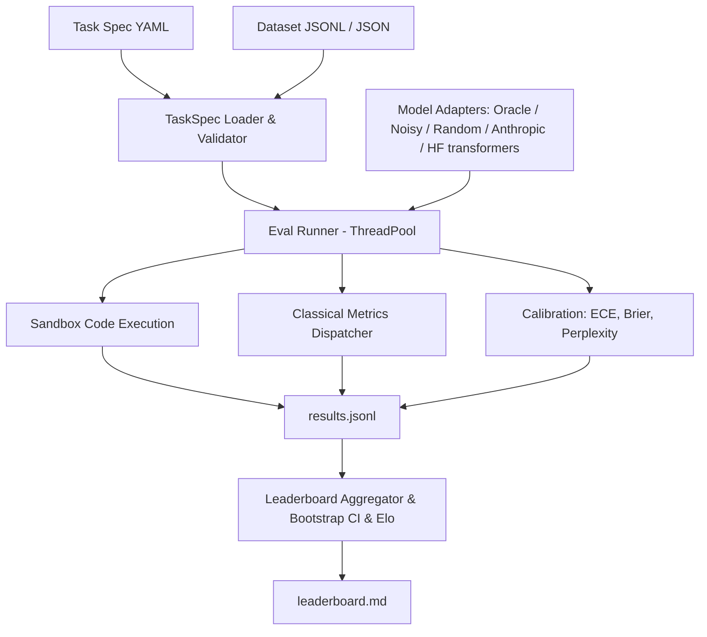

# evalkit

Evaluation runner and benchmark harness built from first principles. It supplies the paired statistics for the ezcross-ems agent evals (#1).

## Problem

Evaluating LLMs accurately requires consistent metric definitions, reproducible sandboxed execution, statistical confidence estimation, and standardized task specifications. Without rigorous harnesses, benchmark results diverge across libraries due to hidden tokenization assumptions, uncalibrated confidence scores, and flawed aggregation.

`evalkit` provides an end-to-end evaluation runner with:
1. Pydantic v2 YAML task specifications with variable validation
2. Pure Python implementations of classical metrics (exact match, token F1, BLEU-4, ROUGE-L, chrF, accuracy)
3. Subprocess code execution sandbox with CPU/memory limits and unbiased Codex pass@k
4. Perplexity and Expected Calibration Error (ECE) with reliability diagrams
5. Bootstrap confidence intervals, deterministic Elo ratings (interleaved match order), and a resolvability layer (paired randomisation test, Holm correction, minimum detectable effect, sample size for 80% power, leaderboard tie groups)
6. Resumable multi-threaded evaluation runner with automated markdown leaderboard generation
7. LLM-as-judge scorer (pointwise rubric and pairwise A/B/tie) with position, reference and length controls, a disk call cache, and agreement validation against MT-Bench human judgments

## Architecture



## Quickstart

```bash
# Run evaluations across bundled tasks
uv run evalkit run --tasks tasks --models oracle,noisy:0.3,random --out runs/demo

# View leaderboard
uv run evalkit leaderboard runs/demo

# Paired comparison of two models on the same examples
uv run evalkit compare runs/demo/results.jsonl --a noisy:0.3 --b random

# All model pairs: randomisation p, Holm correction, minimum detectable effect, n for 80% power
uv run evalkit compare runs/demo/results.jsonl --all-pairs

# Monte Carlo check of the shipped statistics (type-I error, CI coverage, power, Holm FWER)
uv run evalkit stats-check --out runs/stats-check/report.md

# LLM judge over a pairs file (needs the [llm] extra and ANTHROPIC_API_KEY; --cache-only replays a recorded run with no key)
uv run evalkit judge --pairs data/mtbench/test.jsonl --cache data/mtbench/cache-test.jsonl --cache-only --task mt-bench --out runs/judge-mtbench
uv run evalkit compare runs/judge-mtbench/results.jsonl --all-pairs

# Reproduce the HELM Lite comparison (docs/sota-review.md): fetch public per-item results,
# convert to results.jsonl, run the rank-gap study and the metric cross-check (no model is run).
# The fetch pulls ~0.7 GB of raw JSON from a public bucket, keeps ~37 MB (gitignored data/raw/)
uv run python scripts/fetch_helm_lite.py
uv run evalkit import-helm                                    # -> runs/helm-lite/results.jsonl
uv run evalkit helm-study --out docs/results/helm-lite-study.md   # ~5 min
uv run evalkit metric-check --out docs/results/helm-lite-metric-check.md
uv run evalkit compare runs/helm-lite/results.jsonl --all-pairs --models "GPT-4o (2024-05-13),DeepSeek v3,GPT-4 (0613)"
uv run evalkit leaderboard runs/helm-lite --recompute --metric-mode helm --bt   # HELM's ECE binning, Bradley-Terry column
uv run evalkit rank runs/helm-lite/results.jsonl --resamples 200 --out docs/results/helm-lite-bt.md   # Bradley-Terry ratings, bootstrap CIs (cluster-aware)

# Real local models (needs the [hf] extra: torch + transformers)
uv run --extra hf evalkit run --tasks tasks --models oracle,random,hf:Qwen/Qwen2.5-0.5B-Instruct --workers 1

# Harder task (GSM8K subset, numeric answers); the Qwen runs are in "Harder task" below
uv run evalkit run --tasks tasks_hard --models oracle,random --out runs/gsm8k-mock
uv run --extra hf evalkit run --tasks tasks_hard --models hf:Qwen/Qwen2.5-1.5B-Instruct --workers 1 --hf-batch-size 16
```

CI (`.github/workflows/ci.yml`) runs ruff, format check, mypy and pytest on every push to `main` and every pull request. Releases (`release.yml`): bump `version` in `pyproject.toml`, push a tag `v<version>`; the workflow re-runs the tests, checks the tag matches the version, builds the wheel and sdist and attaches them to a GitHub Release. Install from a release without cloning:

```bash
uv tool install https://github.com/d41sys/evalkit/releases/download/v0.1.0/evalkit-0.1.0-py3-none-any.whl
```

## Results

Benchmark results on bundled evaluation tasks (35 arithmetic, 35 trivia MCQ, 10 HumanEval-style, 35 sentiment; 345 example×model pairs):

| Rank | Model | Macro Mean | 95% CI | Win Rate | Elo Rating | ECE (15 bins) | Brier Score | Tie group |
|------|-------|------------|--------|----------|------------|---------------|-------------|-----------|
| 1 | oracle | 1.000 | [1.000, 1.000] | 0.772 | 1145.2 | 0.010 | 0.000 | 1 |
| 2 | noisy:0.3 | 0.714 | [0.614, 0.800] | 0.543 | 1044.5 | 0.098 | 0.210 | 2 |
| 3 | random | 0.179 | [0.129, 0.236] | 0.185 | 810.3 | 0.124 | 0.183 | 3 |

Per-task means:

| Model | arithmetic_qa | code_humaneval | sentiment | trivia_mcq |
|-------|---------------|----------------|-----------|------------|
| oracle | 1.000 | 1.000 | 1.000 | 1.000 |
| noisy:0.3 | 0.714 | 0.800 | 0.657 | 0.686 |
| random | 0.000 | 0.000 | 0.514 | 0.200 |

Random sits at chance on the 2-label sentiment task (0.514) and the 4-option MCQ (0.200). The Tie group column is described under "Resolvability". Rerunning the same command reports `Evaluated: 0, Skipped: 345` (full resume), and a fresh run reproduces `leaderboard.md` byte for byte.

Headline: **oracle macro mean = 1.000 > noisy:0.3 = 0.714 > random = 0.179**.

### Paired comparison

The leaderboard CIs are per model. Whether two models differ is a paired question: both answered the same examples, so `evalkit compare` resamples the per-example differences (10,000 resamples) and adds an exact two-sided sign test on wins/losses (ties dropped). The interval is a bootstrap-t (studentized) interval when n < 400 and at most half the pairs tie, and the percentile interval otherwise (`--ci-method` overrides; `percentile`, `bca` and `studentized` are available). The reasons and the Monte Carlo evidence are in "Do the statistics hold up?" below.

Except for a single task of at most 50 items scored 0/1 (Wilson interval since "Small samples" below), the leaderboard's own "95% CI" column is a percentile bootstrap of the macro mean (`bootstrap_macro_ci`), not the bootstrap-t above. It undercovers when scores are near 0 or 1 and n is small (0.26 coverage at n = 10, accuracy 0.97: the interval is a single point 74% of the time); see "Round 5: coverage of the leaderboard interval" below.

`evalkit compare runs/demo/results.jsonl --a noisy:0.3 --b random`:

| Task | n | A | B | A - B | 95% CI (paired bootstrap or Dirichlet-Jeffreys credible) | W / L / T | sign p |
|---|---|---|---|---|---|---|---|
| arithmetic_qa | 35 | 0.714 | 0.000 | +0.714 | [+0.507, +0.819] | 25 / 0 / 10 | 5.96e-08 |
| code_humaneval | 10 | 0.800 | 0.000 | +0.800 | [+0.333, +0.905] | 8 / 0 / 2 | 0.00781 |
| sentiment | 35 | 0.657 | 0.514 | +0.143 | [-0.100, +0.359] | 12 / 7 / 16 | 0.359 |
| trivia_mcq | 35 | 0.686 | 0.200 | +0.486 | [+0.233, +0.655] | 20 / 3 / 12 | 0.000488 |
| ALL | 115 | 0.696 | 0.217 | +0.478 | [+0.352, +0.591] | 65 / 10 / 40 | 5.15e-11 |

Rows with at most 50 items show the Dirichlet-Jeffreys interval ("Small samples" below); the ALL row (n = 115) keeps the bootstrap. On sentiment the 0.14 gap between noisy:0.3 and random is not distinguishable from zero at n = 35 (CI crosses 0, p = 0.36), although the leaderboard shows 0.657 vs 0.514. p-values are not corrected for the four tasks.

### Resolvability: all pairs, Holm correction, power

Smucker, Allan & Carterette (2007, [CIKM](https://ciir-publications.cs.umass.edu/getpdf.php?id=744)) recommend the randomisation (permutation) test or the bootstrap over the sign test and Wilcoxon test for comparing systems on the same items: the sign test throws away the size of each difference and has poor power. `evalkit compare --all-pairs` therefore uses a paired randomisation test as the p-value that decides, and keeps the sign test only as a reported column. Miller (2024, [arXiv 2411.00640](https://arxiv.org/abs/2411.00640)) recommends paired differences and power analysis; for continuous scores the MDE and sample-size columns use that normal approximation, and for 0/1 scores the exact McNemar power, because `evalkit stats-check` found the normal approximation optimistic there (Round 2 below). The randomisation test assumes each difference is symmetric around 0 under H0; the output lists the pairs where `n < 25 * skewness^2` (Cochran's rule) as a warning that its p-value is approximate.

Per pair (all examples both models were scored on, pooled over tasks, `A - B`):

- **Randomisation p**: two-sided sign-flip test on the per-example differences. Exact enumeration of all 2^k sign patterns when k (nonzero differences) <= 20; otherwise 10,000 seeded Monte Carlo draws with the (hits + 1) / (draws + 1) estimator, so the smallest value it can report is 1/10001 ≈ 0.0001 (printed `0.0001`, read it as "< 1e-4", not as an exact value).
- **Holm p**: Holm-Bonferroni over every pair printed (3 pairs for the demo, 10 for the five-model run), i.e. family-wise error control without independence assumptions.
- **MDE (80%)**: smallest true mean difference detectable with 80% power at alpha 0.05. For 0/1 scores (both models' per-example scores all 0 or 1, as for exact-match tasks) it is solved from the exact conditional McNemar power (`paired_binary_power_exact`; Duffy 1984) at the observed discordant rate psi = (wins + losses) / n; `unattainable` means that even every discordant pair favouring one model would not reach 80% power at this n. Otherwise it is the normal approximation `(z_0.975 + z_0.8) * SD(diffs) / sqrt(n)` = `2.8016 * SD / sqrt(n)`.
- **n for 80% power**: for 0/1 scores the first n whose exact power reaches 80% for the observed |A - B| (or `--effect X`) at the observed discordant rate (psi is raised to |effect| if it is smaller, so with few discordant pairs the number is a lower bound; Connor's 1987 closed form is available as `required_sample_size_binary(..., exact=False)`); otherwise `ceil((2.8016 * SD / |effect|)^2)`. The rate and the SD are estimated from this very run, so with few nonzero differences they are themselves very noisy; treat n as an order of magnitude.
- **Verdict**: `resolved` if Holm p < 0.05, else `unresolved (needs n≈X)`; if the observed difference is exactly 0 no n makes it resolvable, so the verdict says `unresolved (observed diff = 0)` and `--effect X` gives the n needed to resolve a difference of X.

`uv run evalkit compare runs/demo/results.jsonl --all-pairs` (demo run regenerated with the Quickstart `run` command):

| A vs B | n | A - B | 95% CI (paired bootstrap) | W / L / T | sign p | randomisation p | Holm p | MDE (80%) | n for 80% power | verdict |
|---|---|---|---|---|---|---|---|---|---|---|
| oracle vs noisy:0.3 | 115 | +0.304 | [+0.226, +0.391] | 35 / 0 / 80 | 5.82e-11 | 0.0001 | 0.0003 | 0.149 | 25 | resolved |
| oracle vs random | 115 | +0.783 | [+0.702, +0.853] | 90 / 0 / 25 | 1.62e-27 | 0.0001 | 0.0003 | 0.236 | 9 | resolved |
| noisy:0.3 vs random | 115 | +0.478 | [+0.352, +0.591] | 65 / 10 / 40 | 5.15e-11 | 0.0001 | 0.0003 | 0.216 | 23 | resolved |

All three demo pairs are resolved. The MDE and n columns changed from the first version of this table (MDE 0.121 / 0.108 / 0.171, n 19 / 3 / 15) because 0/1 scores now use the exact McNemar power at the observed discordant rate instead of a normal approximation with the SD of the differences (see Round 2 below). For oracle vs random the MDE column now answers "at the observed 90 discordant pairs of 115, how lopsided a win/loss split must the exact sign test see to reject with 80% power", which is 0.236 in mean-difference terms; the old 0.108 was `2.8016 * SD / sqrt(n)` with SD = 0.41. The CI column uses the bootstrap-t interval where at most half the pairs tie (oracle vs random, noisy:0.3 vs random) and the percentile interval otherwise (oracle vs noisy:0.3 ties 80 of 115); the last line of the printed output names the methods used.

**Tie groups** (leaderboard column): walking down the ranking, a model joins the group of the model ranked directly above it unless the randomisation test between the two is resolved (Holm over the adjacent pairs). Models that share a group are not separated by this data. The relation is not transitive (A ~ B and B ~ C does not imply A ~ C), and the test is on the pooled per-example difference while the ranking is by macro mean, so the two can disagree; the column is a warning against over-reading ranks, not a second ranking.

## Real local models (Hugging Face)

`hf:<model_id>[@<revision>]` loads a transformers causal LM (extra `[hf]`) and runs it through the same runner as the mock models. Everything below was produced by this one command (the three `@` hashes pin the exact weights; `oracle,random` are in the same run as reference):

```bash
uv run --extra hf evalkit run --tasks tasks --workers 1 --out runs/hf-leaderboard --models \
  "oracle,random,hf:Qwen/Qwen2.5-0.5B-Instruct@7ae557604adf67be50417f59c2c2f167def9a775,hf:Qwen/Qwen2.5-1.5B-Instruct@989aa7980e4cf806f80c7fef2b1adb7bc71aa306,hf:Qwen/Qwen2.5-3B-Instruct@aa8e72537993ba99e69dfaafa59ed015b17504d1"
```

Run on 2026-10-16: Apple M4 Pro, 24 GB, macOS 27.0.1, Python 3.12.14, torch 2.14.1 (MPS, bfloat16), transformers 5.20.0. Wall time: **2 min 04 s** for all 575 example×model pairs (115 examples × 5 models), including loading the three models from a warm local cache and running the generated code (`time` of the command above; a repeat took 1 min 57 s). Downloading weights is not included.

| Model | HF revision | Licence |
|---|---|---|
| Qwen/Qwen2.5-0.5B-Instruct | `7ae557604adf67be50417f59c2c2f167def9a775` | Apache-2.0 ([card](https://huggingface.co/Qwen/Qwen2.5-0.5B-Instruct)) |
| Qwen/Qwen2.5-1.5B-Instruct | `989aa7980e4cf806f80c7fef2b1adb7bc71aa306` | Apache-2.0 ([card](https://huggingface.co/Qwen/Qwen2.5-1.5B-Instruct)) |
| Qwen/Qwen2.5-3B-Instruct | `aa8e72537993ba99e69dfaafa59ed015b17504d1` | Qwen Research licence, non-commercial ([card](https://huggingface.co/Qwen/Qwen2.5-3B-Instruct)) |

Weights and generations are not committed (`runs/` is gitignored).

### Leaderboard

| Rank | Model | Macro Mean | 95% CI (stratified bootstrap) | Win Rate | Elo | ECE (15 bins) | Brier | Tie group |
|------|-------|------------|--------|----------|------|------|-------|-----------|
| 1 | oracle | 1.000 | [1.000, 1.000] | 0.628 | 1093.0 | 0.010 | 0.000 | 1 |
| 2 | hf:Qwen2.5-1.5B-Instruct | 0.986 | [0.964, 1.000] | 0.617 | 1091.8 | 0.019 | 0.015 | 1 |
| 3 | hf:Qwen2.5-3B-Instruct | 0.968 | [0.911, 1.000] | 0.617 | 1092.4 | 0.016 | 0.016 | 1 |
| 4 | hf:Qwen2.5-0.5B-Instruct | 0.829 | [0.771, 0.879] | 0.498 | 979.7 | 0.111 | 0.127 | 2 |
| 5 | random | 0.179 | [0.129, 0.236] | 0.139 | 743.1 | 0.124 | 0.183 | 3 |

Oracle, 1.5B and 3B share tie group 1 (`uv run evalkit leaderboard runs/hf-leaderboard --recompute`): the suite does not separate them, while 0.5B and random are each resolved from the model ranked above them.

Per task: score and, for the real models, the Wilson 95% interval of the pass rate (k/n). Sample sizes are 35 / 10 / 35 / 35.

| Model | arithmetic_qa (n=35) | code_humaneval (n=10) | sentiment (n=35) | trivia_mcq (n=35) |
|---|---|---|---|---|
| oracle | 1.000 | 1.000 | 1.000 | 1.000 |
| Qwen2.5-1.5B-Instruct | 0.971 (34/35) [0.855, 0.995] | 1.000 (10/10) [0.722, 1.000] | 1.000 (35/35) [0.901, 1.000] | 0.971 (34/35) [0.855, 0.995] |
| Qwen2.5-3B-Instruct | 0.971 (34/35) [0.855, 0.995] | 0.900 (9/10) [0.596, 0.982] | 1.000 (35/35) [0.901, 1.000] | 1.000 (35/35) [0.901, 1.000] |
| Qwen2.5-0.5B-Instruct | 0.686 (24/35) [0.520, 0.814] | 1.000 (10/10) [0.722, 1.000] | 0.971 (34/35) [0.855, 0.995] | 0.657 (23/35) [0.492, 0.792] |
| random | 0.000 | 0.000 | 0.514 | 0.200 |

(Wilson intervals: standard score-interval formula, z = 1.96, applied to the per-model, per-task `score` sums in `runs/hf-leaderboard/results.jsonl`.)

### Paired comparison of the two closest models

`uv run evalkit compare runs/hf-leaderboard/results.jsonl --a "hf:Qwen/Qwen2.5-1.5B-Instruct@989aa798" --b "hf:Qwen/Qwen2.5-3B-Instruct@aa8e7253"`:

| Task | n | A (1.5B) | B (3B) | A - B | 95% CI (paired bootstrap) | W / L / T | sign p |
|---|---|---|---|---|---|---|---|
| arithmetic_qa | 35 | 0.971 | 0.971 | +0.000 | [+0.000, +0.000] | 0 / 0 / 35 | 1 |
| code_humaneval | 10 | 1.000 | 0.900 | +0.100 | [+0.000, +0.300] | 1 / 0 / 9 | 1 |
| sentiment | 35 | 1.000 | 1.000 | +0.000 | [+0.000, +0.000] | 0 / 0 / 35 | 1 |
| trivia_mcq | 35 | 0.971 | 1.000 | -0.029 | [-0.086, +0.000] | 0 / 1 / 34 | 1 |
| ALL | 115 | 0.983 | 0.983 | +0.000 | [-0.026, +0.026] | 1 / 1 / 113 | 1 |

This table predates the small-n defaults: rerun today, the four per-task rows (n <= 50, 0/1 scores) print the Dirichlet-Jeffreys interval instead; the ALL row is unchanged. Not rerun (needs the local Qwen models).

**Result: 1.5B vs 3B is unresolved.** 113 of 115 examples tie; the 1.5B model wins one (code_008, see below) and loses one (mcq_006), so the pooled difference is exactly 0 (randomisation p = 1, Holm p = 1) and the macro-mean ranking in the leaderboard (0.986 vs 0.968) comes only from the 10-example code task, where one failure moves the task mean by 0.1. Do not read "1.5B beats 3B" out of the leaderboard. Because the observed difference is 0, "n needed" has no value at the observed effect; for a stated effect, `--models <1.5B>,<3B> --effect 0.05` gives **n ≈ 157** and `--effect 0.02` gives **n ≈ 394** examples for 80% power (alpha 0.05; the first version of this paragraph said 56 and 345 from a normal approximation with the SD of the differences), against n = 115 here. These come from the exact McNemar power at the observed discordant rate; with 2 discordant pairs of 115 (1.7%) that rate is below both target effects, so it is raised to the effect (every discordant pair favouring one model) and the numbers are lower bounds. The MDE at n = 115 is `unattainable` for the same reason. Honest reading: the suite is too easy to produce disagreement between the two, so it cannot tell whether a 2-point gap exists.

### All pairs (Holm over 10 comparisons)

`uv run evalkit compare runs/hf-leaderboard/results.jsonl --all-pairs` (model names shortened: `0.5B` = `hf:Qwen/Qwen2.5-0.5B-Instruct@7ae55760`, `1.5B` = `...1.5B-Instruct@989aa798`, `3B` = `...3B-Instruct@aa8e7253`; the real output prints the full names):

| A vs B | n | A - B | 95% CI (paired bootstrap) | W / L / T | sign p | randomisation p | Holm p | MDE (80%) | n for 80% power | verdict |
|---|---|---|---|---|---|---|---|---|---|---|
| oracle vs random | 115 | +0.783 | [+0.702, +0.853] | 90 / 0 / 25 | 1.62e-27 | 0.0001 | 0.001 | 0.236 | 9 | resolved |
| oracle vs 0.5B | 115 | +0.209 | [+0.139, +0.287] | 24 / 0 / 91 | 1.19e-07 | 0.0001 | 0.001 | 0.123 | 37 | resolved |
| oracle vs 1.5B | 115 | +0.017 | [+0.000, +0.043] | 2 / 0 / 113 | 0.5 | 0.5 | 1 | unattainable | 454 | unresolved (needs n≈454) |
| oracle vs 3B | 115 | +0.017 | [+0.000, +0.043] | 2 / 0 / 113 | 0.5 | 0.5 | 1 | unattainable | 454 | unresolved (needs n≈454) |
| random vs 0.5B | 115 | -0.574 | [-0.674, -0.461] | 5 / 71 / 39 | 5.25e-16 | 0.0001 | 0.001 | 0.218 | 15 | resolved |
| random vs 1.5B | 115 | -0.765 | [-0.839, -0.675] | 1 / 89 / 25 | 1.47e-25 | 0.0001 | 0.001 | 0.236 | 9 | resolved |
| random vs 3B | 115 | -0.765 | [-0.837, -0.686] | 0 / 88 / 27 | 6.46e-27 | 0.0001 | 0.001 | 0.234 | 9 | resolved |
| 0.5B vs 1.5B | 115 | -0.191 | [-0.261, -0.122] | 0 / 22 / 93 | 4.77e-07 | 0.0001 | 0.001 | 0.117 | 40 | resolved |
| 0.5B vs 3B | 115 | -0.191 | [-0.270, -0.122] | 1 / 23 / 91 | 2.98e-06 | 0.0001 | 0.001 | 0.123 | 44 | resolved |
| 1.5B vs 3B | 115 | +0.000 | [-0.026, +0.026] | 1 / 1 / 113 | 1 | 1 | 1 | unattainable | n/a | unresolved (observed diff = 0) |

0.5B is resolved from every other model (Holm p < 0.05 in all four of its pairs); 1.5B and 3B are not resolved from each other nor from the oracle: oracle vs either is 2 wins in 115, p = 0.5. For those three pairs the MDE is `unattainable`: with only 2 discordant pairs of 115 (1.7%), even if every discordant pair favoured one model the exact test could not reach 80% power at n = 115, and the 454 in the oracle rows is the n for a 1.7-point gap *if the discordant rate stayed at the observed 2 in 115* (a lower bound that rests on 2 observations). The output also prints a skewness warning for the two oracle rows (skewness +7.38, n < 25 * skewness^2): the randomisation test's p = 0.5 is approximate there. The sign test and the randomisation test give the same resolved / unresolved call on every row. Randomisation p of `0.0001` is the Monte Carlo floor (k > 20), not an exact value. Reproduce 1.5B vs 3B with a target effect: `uv run evalkit compare runs/hf-leaderboard/results.jsonl --all-pairs --models "hf:Qwen/Qwen2.5-1.5B-Instruct@989aa798,hf:Qwen/Qwen2.5-3B-Instruct@aa8e7253" --effect 0.05`.

### How the adapter answers (`src/evalkit/hf.py`)

- **Prompting**: the task prompt is sent as one user turn through the model's chat template (Qwen's default system prompt is left as is), with a one-line instruction appended by the adapter: "Reply with only the final answer" (generation), "Complete the function above... single \`\`\`python code block" (code), or "Reply with exactly one of the following options: ..." (classification / MCQ). This instruction is part of what is being measured; a different wording would give different numbers.
- **Decoding**: greedy, no sampling, repetition penalty forced to 1.0 (Qwen's shipped `generation_config` sets 1.05), at most 48 new tokens (generation) or 384 (code).
- **Classification and MCQ** use the label set exactly like the mock models (`choices` of the example, or the dataset's label set): each option is scored as the assistant reply (sum of token log-probs) and the argmax is returned, so output is always on the label set and never needs parsing. MCQ options are the option *texts*; the A/B/C/D letters only appear in the task prompt.
- **Calibration fields come from real log-probs**: `logprobs` are the raw-logit log-probs of the emitted tokens, `token_nll` is their negated sum, `token_count` is the tokenizer's count. `confidence` is (a) for choice tasks, the softmax over the option scores, i.e. probability renormalised over the label set, not over the full vocabulary; (b) for generation/code, the geometric-mean token probability `exp(mean(logprob))`. Both are heuristics, not calibrated probabilities. The ECE column measures how far off they are. `token_nll` for choice tasks is the NLL of the chosen label only. The leaderboard does not report perplexity.
- **Not comparable with oracle/random ECE**: the mock models' confidences are fixed or synthetic constants (e.g. oracle always 0.99), not derived from anything.
- **`--workers 1`**: all workers would share one model instance, and torch/MPS calls on one model from several threads are not safe. The adapter holds a lock around every model call, so higher worker counts are still correct, but they only overlap the code-execution subprocesses and cannot speed up inference. `workers 1` avoids that illusion.

### Caveats

- **Tiny, easy task sets** (35 / 35 / 10 / 35). The 1.5B and 3B models sit near the ceiling, so this suite cannot separate them (see compare table). It is a harness demo, not a model ranking; these are not standard benchmarks and the numbers are not comparable to published scores. Whether the item sets appear in the models' training data has not been checked. The harder GSM8K task below does separate them.
- **Strict exact-match scoring penalises format.** Of the misses: 0.5B answered `96 / 8 = 12` and `256 / 16 = 16` (correct number, wrong format; arith_004, arith_028); 3B answered `14.0` for `196 / 14` (arith_024); 1.5B answered `14.071428571428571` for the same item (a genuine error). These are scored 0 as measured; the metric was not loosened.
- **The one 3B code failure is a real behavioural miss, not an extraction bug**: for code_008 (`count_vowels`) it wrote `vowels = "aeiou"`, which fails the bundled test `count_vowels('AEIOU') == 5`. The docstring ("a, e, i, o, u") is ambiguous about case.
- **Generated code is really executed.** `code_humaneval` runs model output in the subprocess sandbox (`python -I`, temp cwd, 5 s CPU limit). That is not a security boundary: there is no network or filesystem isolation, and the 512 MB address-space limit is skipped on macOS. Only run it on models and tasks you trust.
- **Rank classification is not free generation**: on sentiment and MCQ the model cannot answer off the label set, which makes those tasks easier than a free-text protocol. Win Rate / Elo are relative to this set of five rows, with oracle and random included.
- **Reproducibility**: a repeat of the full command into a fresh directory gave a byte-identical `leaderboard.md` and 0 / 575 differing predictions (max confidence difference 0.0), on the same machine and library versions. bfloat16 on MPS is not guaranteed to match other hardware.

## Harder task: GSM8K subset (`tasks_hard/gsm8k`)

The bundled `tasks/` leave 1.5B vs 3B unresolved (113 of 115 examples tie). `tasks_hard/gsm8k` is a seeded 240-problem subset of the GSM8K test set (grade-school math word problems, Cobbe et al. 2021, [arXiv 2110.14168](https://arxiv.org/abs/2110.14168)) scored by numeric answer. It lives in its own directory so that `--tasks tasks` still reproduces every number above.

**Source and licence.** [openai/grade-school-math](https://github.com/openai/grade-school-math), MIT licence, Copyright (c) 2021 OpenAI (the Hugging Face card for `openai/gsm8k` also says `mit`). MIT permits redistribution with the licence notice, so the 240 rows (71.5 KB) are vendored in `tasks_hard/gsm8k/data.jsonl` with the licence text in `tasks_hard/gsm8k/LICENSE-GSM8K`. The full raw files go to the gitignored `data/raw/`.

```bash
mkdir -p data/raw
B=https://raw.githubusercontent.com/openai/grade-school-math/master/grade_school_math/data
curl -sL $B/test.jsonl -o data/raw/gsm8k_test.jsonl     # 1319 rows, sha256 3730d312f6e3440559ace48831e51066acaca737f6eabec99bccb9e4b3c39d14
curl -sL $B/train.jsonl -o data/raw/gsm8k_train.jsonl   # 7473 rows, used only for the pilot below
uv run python scripts/build_gsm8k_subset.py --split test --n 240 --seed 0 --out tasks_hard/gsm8k/data.jsonl
shasum -a 256 tasks_hard/gsm8k/data.jsonl               # 719e263409cea077d2c52d8ed1648aa8fc64fcc3abb7b1059371c5dbf5c7e04f
```

The subset is the first 240 rows of a seed-0 permutation of the test set; `id` keeps the original row index (`gsm8k_test_1101`). `target` is the number after `####` with thousands commas removed.

**Task definition.** Task type `reasoning` (free generation, greedy, at most 256 new tokens, no adapter instruction appended). The prompt asks for brief step-by-step work ending in `The answer is <number>` (see `spec.yaml`). Metric `numeric_match`: `extract_final_number` takes the first number after the last `The answer is` / `answer:` / `####` / `\boxed{` marker, else the last number in the text; thousands commas are stripped, units and `$` ignored, `18.0` equals `18`, a trailing `.` is punctuation. Not handled: spelled-out numbers, fractions (`1/2` yields 2), scientific notation. `tests/test_evalkit_numeric.py` pins this on a 23-row fixture. Scoring is exact numeric equality (tolerance 1e-6), so `5.10` for a target of `5` is wrong.

### Protocol (committed in `1777f06` before the test set was scored)

1. **Pilot on the train split only**, for sizing and prompt choice. 48 problems (first 48 of the seed-0 train permutation), the three Qwen models, `--hf-batch-size 16`, final prompt. Test problems were not run before the protocol was fixed.
2. **Size by the repo's power calculation.** SD of the paired per-example differences, 1.5B vs 3B, on the pilot: 0.5586. `required_sample_size(0.5586, 0.05)` = **980 examples** for 80% power at effect 0.05 (alpha 0.05, two-sided). The pilot ran 48 examples x 3 models in 117.6 s (2.45 s per example for all three), so 980 examples is about 40 minutes.
3. **Cap at about 10 minutes**, so N = 240 (about 9.8 minutes predicted). The MDE at n = 240 with SD 0.5586 is 0.101, so by construction this run can resolve a gap of about 0.10 but not 0.05 (power at a true 0.05 would be 0.28; at a true 0.10, 0.79).
4. One scored run. Prompt, token budget, batch size and N were not changed after seeing test scores.

Pilot commands (outputs in `runs/`, gitignored):

```bash
mkdir -p data/raw/pilot/gsm8k_train
uv run python scripts/build_gsm8k_subset.py --split train --n 48 --seed 0 --out data/raw/pilot/gsm8k_train/data.jsonl
sed 's/^name: gsm8k/name: gsm8k_pilot_train/' tasks_hard/gsm8k/spec.yaml > data/raw/pilot/gsm8k_train/spec.yaml
uv run --extra hf evalkit run --tasks data/raw/pilot --workers 1 --hf-batch-size 16 --out runs/pilot-train --models "$MODELS"
# sizing: SD of the per-example (1.5B - 3B) score differences in runs/pilot-train/results.jsonl, then
uv run python -c "from evalkit.aggregate import required_sample_size as n; print(n(0.5586, 0.05))"
```

`$MODELS` is the three pinned `hf:` descriptors from the previous section. What the pilot also showed (train split, all measured, none of it scored on test):

| Pilot variant (48 train problems unless noted) | 0.5B | 1.5B | 3B | Decision |
|---|---|---|---|---|
| Direct answer (type `generation`, "reply with only the final answer"), 96 problems | 0.094 | 0.104 | 0.115 | Not used: all three at floor, no separation |
| Step-by-step, verbose prompt, 320-token budget, batch 16 | 0.479 | 0.708 | 0.812 | Replaced: mean 243-269 output tokens, 21-33% hit the cap |
| Step-by-step, brief prompt, 256-token budget, batch 16 (final) | 0.500 | 0.688 | 0.854 | Used. 3B-1.5B gap +0.167 on 48, SD 0.5586 |

A batch size of 32 was also tried on the brief prompt and did not finish within 20 minutes on the shared machine (128 of 144 pairs done when killed), so 16 was used. Timings on this Mac are noisy: other jobs were running (1-minute load average 3.7 to 6.3 when sampled during the pilots, 1.7 right after the scored run).

### Scored run

```bash
MODELS="oracle,random,hf:Qwen/Qwen2.5-0.5B-Instruct@7ae557604adf67be50417f59c2c2f167def9a775,hf:Qwen/Qwen2.5-1.5B-Instruct@989aa7980e4cf806f80c7fef2b1adb7bc71aa306,hf:Qwen/Qwen2.5-3B-Instruct@aa8e72537993ba99e69dfaafa59ed015b17504d1"
time uv run --extra hf evalkit run --tasks tasks_hard --workers 1 --hf-batch-size 16 --out runs/gsm8k --models "$MODELS"
uv run evalkit compare runs/gsm8k/results.jsonl --all-pairs
```

Same machine and versions as the previous section (M4 Pro 24 GB, torch 2.14.1 MPS bfloat16). Wall time **9 min 21 s** for 1200 example x model pairs including model loading from the warm cache. `--workers 1` as before; `--hf-batch-size 16` makes the Qwen models decode 16 problems per call (left-padded), see caveats.

| Rank | Model | Accuracy (k/240) | Wilson 95% | 95% CI (bootstrap) | ECE (15 bins) | Brier | Tie group | Mean output tokens | Hit 256-token cap |
|---|---|---|---|---|---|---|---|---|---|
| 1 | oracle | 1.000 (240) | [0.984, 1.000] | [1.000, 1.000] | 0.010 | 0.000 | 1 | n/a | n/a |
| 2 | Qwen2.5-3B-Instruct | 0.729 (175) | [0.670, 0.781] | [0.675, 0.783] | 0.146 | 0.210 | 2 | 98 | 1 |
| 3 | Qwen2.5-1.5B-Instruct | 0.617 (148) | [0.554, 0.676] | [0.558, 0.675] | 0.235 | 0.277 | 3 | 107 | 6 |
| 4 | Qwen2.5-0.5B-Instruct | 0.375 (90) | [0.316, 0.438] | [0.312, 0.438] | 0.490 | 0.470 | 4 | 223 | 111 |
| 5 | random | 0.000 (0) | [0.000, 0.016] | [0.000, 0.000] | 0.321 | 0.108 | 5 | n/a | n/a |

(Wilson interval: same formula as above, applied to the per-model sums in `runs/gsm8k/results.jsonl`. Tokens and cap hits count `token_count >= 256` for the Qwen rows. Each model sits alone in its tie group: every adjacent pair is resolved.)

`uv run evalkit compare runs/gsm8k/results.jsonl --all-pairs` (Holm over 10 comparisons; `0.5B` = `hf:Qwen/Qwen2.5-0.5B-Instruct@7ae55760`, `1.5B` = `...1.5B-Instruct@989aa798`, `3B` = `...3B-Instruct@aa8e7253`):

| A vs B | n | A - B | 95% CI (paired bootstrap) | W / L / T | sign p | randomisation p | Holm p | MDE (80%) | n for 80% power | verdict |
|---|---|---|---|---|---|---|---|---|---|---|
| random vs oracle | 240 | -1.000 | [-1.000, -1.000] | 0 / 240 / 0 | 1.13e-72 | 0.0001 | 0.001 | 0.183 | 6 | resolved |
| random vs 0.5B | 240 | -0.375 | [-0.438, -0.312] | 0 / 90 / 150 | 1.62e-27 | 0.0001 | 0.001 | 0.114 | 20 | resolved |
| random vs 1.5B | 240 | -0.617 | [-0.678, -0.552] | 0 / 148 / 92 | 5.61e-45 | 0.0001 | 0.001 | 0.145 | 12 | resolved |
| random vs 3B | 240 | -0.729 | [-0.784, -0.671] | 0 / 175 / 65 | 4.18e-53 | 0.0001 | 0.001 | 0.158 | 10 | resolved |
| oracle vs 0.5B | 240 | +0.625 | [+0.560, +0.686] | 150 / 0 / 90 | 1.4e-45 | 0.0001 | 0.001 | 0.146 | 11 | resolved |
| oracle vs 1.5B | 240 | +0.383 | [+0.321, +0.446] | 92 / 0 / 148 | 4.04e-28 | 0.0001 | 0.001 | 0.115 | 20 | resolved |
| oracle vs 3B | 240 | +0.271 | [+0.217, +0.329] | 65 / 0 / 175 | 5.42e-20 | 0.0001 | 0.001 | 0.096 | 28 | resolved |
| 0.5B vs 1.5B | 240 | -0.242 | [-0.317, -0.171] | 18 / 76 / 146 | 1.18e-09 | 0.0001 | 0.001 | 0.116 | 55 | resolved |
| 0.5B vs 3B | 240 | -0.354 | [-0.425, -0.283] | 11 / 96 / 133 | 4.3e-18 | 0.0001 | 0.001 | 0.124 | 28 | resolved |
| 1.5B vs 3B | 240 | -0.113 | [-0.183, -0.042] | 27 / 54 / 159 | 0.0036 | 0.0038 | 0.0038 | 0.108 | 221 | resolved |

**Result: 1.5B vs 3B is now resolved.** The 3B model scores 0.113 higher (paired bootstrap CI [+0.042, +0.183] for 3B - 1.5B), wins 54 problems to the 1.5B's 27 with 159 ties, randomisation p = 0.0038, Holm p = 0.0038. Before and after:

| Pair | Suite | n | A - B (1.5B - 3B) | Randomisation p | Verdict |
|---|---|---|---|---|---|
| 1.5B vs 3B | bundled `tasks/` (4 tasks) | 115 | +0.000 | 1 | unresolved (observed diff = 0) |
| 1.5B vs 3B | `tasks_hard/gsm8k` | 240 | -0.113 | 0.0038 | resolved |

What "resolved" does and does not say here:

- The run was sized for effect 0.05 and could not afford it: `compare --all-pairs --models <1.5B>,<3B> --effect 0.05` on this run gives **n = 1093** for 80% power (exact McNemar power at the observed discordant rate 81 / 240; the first version of this sentence said 1025 from a normal approximation with the SD of the differences, and Connor's closed form, `required_sample_size_binary(81/240, 0.05, exact=False)`, gives 1058), against the pilot's 980 (the pre-registered sizing below used the SD-based formula) and 240 examples. At n = 240 the MDE is 0.108 (was 0.103). The observed gap (0.113) is above that, so the test rejects, but a true gap of 0.05 would be detected with only about 23% power (`uv run python -c "from evalkit.aggregate import paired_binary_power_exact as p; print(p(240, 0.05, 81/240))"` = 0.229; the normal approximation gave 28%) and the CI's upper end (3B - 1.5B up to +0.183, lower end +0.042) does not exclude it. Read "3B > 1.5B on this prompt, gap probably between 4 and 18 points", not "gap = 0.113".
- The pilot gap on 48 train problems was 0.167 against 0.113 here; both are noisy.
- Resolution holds for this prompt, token budget and decoding setup only.
- Unlike the bundled suite, the oracle is now separated from both models (oracle vs 3B is 65 / 0 / 175, resolved).

### Caveats (GSM8K)

- **Contamination risk.** GSM8K test has been public since 2021 and is a standard benchmark that Qwen reports on, so these models may have seen it or close variants. The Qwen2.5 technical report ([arXiv 2412.15115](https://arxiv.org/abs/2412.15115)) says training data was filtered against test sets with a 13-token longest-common-subsequence match (also at least 60% of the shorter sequence); that removes near-verbatim copies, not paraphrases or synthetic variants, and I did not test these weights for memorisation. The scores here (0.375 / 0.617 / 0.729) are below the numbers Qwen publishes for the Instruct models (49.6 / 73.2 / 86.7, [Qwen2.5 blog](https://qwenlm.github.io/blog/qwen2.5-llm/); the page does not state the prompt or decoding), which gives no sign of inflation, but a lower score is not evidence of no contamination and the prompts differ. Treat the absolute accuracies as possibly inflated by exposure, and the 1.5B/3B comparison as being about this benchmark, not about reasoning in general.
- **0.5B is partly truncated.** 111 of its 240 answers hit the 256-token cap (and 136 contain no `The answer is` marker, so the last number in the text is scored). Its 0.375 mixes wrong reasoning with budget exhaustion; the 0.5B rows are resolved from every other row regardless. 1.5B hit the cap on 6, 3B on 1.
- **Extraction audit.** Of the 3B model's 65 misses, 7 contain the target number somewhere in the reply; I read all 7 and each is a genuine wrong final answer (for example 5.10 for a target of 5, or an intermediate value reported as the answer). I did not read the 1.5B (13 such) or 0.5B (27) replies.
- **Batching changes numerics.** Batched bf16 generation is not bit-identical to batch size 1, so a greedy continuation can differ between `--hf-batch-size` values. The existing `tasks/` numbers above were produced unbatched and are unchanged. The scored GSM8K run was not repeated.
- **Random is at floor by construction**: it answers a random integer in 0-100 and 162 of the 240 targets lie in that range, so the expected number of hits is 162/101 = 1.6 and 0 observed is unremarkable; oracle returns the target. Neither says anything about GSM8K difficulty.
- **n = 240 of 1319.** Scoring the whole test set would take about 54 minutes (1319 x 2.45 s, extrapolated from the pilot, not run).
- The confidence and ECE columns for the Qwen models come from the geometric-mean token probability of a long reasoning chain, a heuristic, and say little about answer-level calibration.

## Do the statistics hold up? Monte Carlo check (`evalkit stats-check`)

`evalkit stats-check` simulates paired per-example scores with a known true difference and runs the shipped functions in `aggregate.py` on them: `paired_comparison` (percentile bootstrap CI and exact sign test), `randomization_test_p`, `holm_bonferroni` (through `compare_pairs`), `minimum_detectable_effect` and `required_sample_size`. The simulator and the verdict rules live in `src/evalkit/statscheck.py`; numpy only, seeded, no models.

```bash
uv run evalkit stats-check --out runs/stats-check/report.md   # full grid, seed 0
uv run pytest -q tests/test_evalkit_statscheck.py             # unit tests, tiny replication counts
```

### Protocol (committed before any scoring run)

Data generators (`Scenario`): `binary` (0/1 scores; wins and losses with probabilities (1 - t +/- d)/2, ties both-right or both-wrong), `continuous` (A - B ~ N(d/(1 - t), 0.25) on a random subset of 1 - t of the examples, exact ties elsewhere) and `skewed` (same, but A - B = mu + 0.25 (Exp(1) - 1); under H0 the mean is zero but the distribution is asymmetric, which the sign-flip test's exchangeability argument does not cover). `t` is the tie rate P(A = B), `d` the true mean difference.

Grid: n in {20, 50, 115, 240} (115 and 240 are the sizes of the bundled and GSM8K suites), t in {0, 0.5, 0.8}.

1. **H0 (d = 0):** all 36 cells; per replication run the randomisation test (`num_draws` 2000; exact enumeration up to 20 nonzero differences), the exact sign test and `paired_comparison` (2000 resamples). Metrics: rejection rate at alpha 0.05 for the randomisation and sign tests, and coverage of d = 0 by the 95% bootstrap CI. 8000 replications per cell.
2. **H1 at the formula's own sample size:** for each kind and t, take the effect that `minimum_detectable_effect` returns at n (the SD of the differences depends on the effect, so the fixed point is solved in closed form, see `mde_scenario`), then simulate at n* = `required_sample_size(true SD, effect)`. Cells where the fixed point does not exist or exceeds 1 - t are skipped and listed. Nine more cells use fixed effects 0.05 / 0.10 / 0.20 at t = 0.6 with n* from the same function. Metrics: empirical power of the randomisation test against the predicted 0.80, power of the sign test and of "CI excludes 0", and coverage of the true d. 3000 replications per cell. The formula gets the exact true SD, so this tests the formula, not SD estimation.
3. **Holm FWER:** all nulls true; `compare_pairs` over m comparisons, either m independent A/B datasets (m = 3, 5, 10) or k exchangeable models sharing example difficulty with all k(k - 1)/2 pairs (k = 3, 4, 5, so m = 3, 6, 10), binary and continuous scores, n in {50, 115}. FWER = P(any pair resolved, i.e. Holm-adjusted p < 0.05), next to the unadjusted FWER. 3000 replications per cell.
4. **Robustness:** one extra run with 10000 bootstrap resamples (the `compare` default) on n in {20, 50}, t = 0.5 to check that using 2000 in the main grid does not move any verdict.

Decision rule. Every proportion carries a Wilson 99% interval over replications.

| quantity | ok | flagged |
|---|---|---|
| type-I error (randomisation, sign) and Holm FWER, target 0.05 | interval contains 0.05 or lies below it | **anti-conservative** if the interval lies entirely above 0.05 (failure); **conservative** if entirely below 0.04 (valid, wastes power) |
| 95% bootstrap CI coverage, target 0.95 | interval contains 0.95 or lies above it | **undercovers** if entirely below 0.95 (failure); **overcovers** if entirely above 0.96 |
| power of the randomisation test at n*, target 0.80 | interval contains 0.80 or lies above it | **optimistic** if entirely below 0.80 (the formula promises power it does not deliver; failure); **pessimistic** if entirely above 0.85 |

Every flagged cell is reported, not only the failures. The rules, grid and replication counts are not changed after seeing results. A real bug gets a fix and a regression test; a known limitation of an approximation (a normal-approximation power formula, a percentile bootstrap) is reported as a finding and documented, not patched, unless it is a defect in the code rather than in the method.

### Results (round 1)

*Round 1: the shipped functions as of `4ef9c97`. Round 2 re-ran the same grid after the changes described below; `runs/stats-check/report-round1.md` is this section's source.* Commands (the protocol was committed in `9e6d53f` before either was run; seed 0, 8 worker processes on a 12-core Apple-silicon laptop):

```bash
uv run evalkit stats-check --out runs/stats-check/report.md                       # 103 s wall; full tables
uv run evalkit stats-check --ns 20,50 --ties 0.5 --fwer-ns 50 --fixed-effects "" \
  --resamples 10000 --out runs/stats-check/robustness-10000-resamples.md           # 29 s wall; protocol item 4
```

The compact tables below are generated from `runs/stats-check/report.md`, which has every cell with its interval and verdict (the skewed power cells are in the file only). Flagged cells under the decision rule (every cell is in the report; there are 12 H0 cells and 26 coverage cells (12 H0 + 14 H1), 14 power cells and 12 FWER cells per kind; 3 MDE cells per kind had no attainable effect and were skipped):

| flag | binary | continuous | skewed |
|---|---|---|---|
| type-I anti-conservative (randomisation / sign) | 0 / 0 | 0 / 0 | 9 / 11 |
| type-I conservative (randomisation / sign) | 6 / 6 | 1 / 6 | 1 / 1 |
| CI undercovers (of 26) | 4 | 17 | 24 |
| power optimistic (of 14) | 13 | 2 | 1 |
| power pessimistic (of 14) | 0 | 2 | 10 |
| Holm FWER anti-conservative / conservative (of 12) | 0 / 11 | 0 / 0 | not run |

**Type-I error at alpha 0.05, randomisation / sign test** (8000 replications per cell; 99% interval half-width about 0.006 to 0.008 near 0.05; `c` = conservative, `A` = anti-conservative under the decision rule)

| kind | tie rate | n = 20 | n = 50 | n = 115 | n = 240 |
|---|---|---|---|---|---|
| binary | 0 | 0.044 / 0.044 | 0.031c / 0.031c | 0.039 / 0.039 | 0.045 / 0.046 |
| binary | 0.5 | 0.023c / 0.023c | 0.029c / 0.028c | 0.037 / 0.038 | 0.039 / 0.039 |
| binary | 0.8 | 0.004c / 0.004c | 0.024c / 0.024c | 0.030c / 0.028c | 0.038 / 0.038 |
| continuous | 0 | 0.051 / 0.042 | 0.048 / 0.034c | 0.052 / 0.040 | 0.049 / 0.041 |
| continuous | 0.5 | 0.045 / 0.022c | 0.053 / 0.033c | 0.048 / 0.036 | 0.046 / 0.040 |
| continuous | 0.8 | 0.008c / 0.005c | 0.042 / 0.020c | 0.050 / 0.031c | 0.052 / 0.039 |
| skewed | 0 | 0.079A / 0.196A | 0.065A / 0.406A | 0.056 / 0.789A | 0.052 / 0.984A |
| skewed | 0.5 | 0.089A / 0.067A | 0.079A / 0.199A | 0.062A / 0.475A | 0.056A / 0.808A |
| skewed | 0.8 | 0.015c / 0.009c | 0.088A / 0.075A | 0.080A / 0.186A | 0.064A / 0.402A |

**95% bootstrap CI coverage of the true difference** (H0 cells, 8000 replications; `u` = undercovers under the decision rule)

| kind | tie rate | n = 20 | n = 50 | n = 115 | n = 240 |
|---|---|---|---|---|---|
| binary | 0 | 0.956 | 0.964 | 0.947 | 0.954 |
| binary | 0.5 | 0.952 | 0.954 | 0.953 | 0.956 |
| binary | 0.8 | 0.956 | 0.953 | 0.957 | 0.951 |
| continuous | 0 | 0.924u | 0.943u | 0.944 | 0.949 |
| continuous | 0.5 | 0.910u | 0.932u | 0.943u | 0.949 |
| continuous | 0.8 | 0.932u | 0.918u | 0.938u | 0.940u |
| skewed | 0 | 0.906u | 0.929u | 0.942u | 0.947 |
| skewed | 0.5 | 0.872u | 0.910u | 0.935u | 0.942u |
| skewed | 0.8 | 0.907u | 0.875u | 0.910u | 0.934u |

**Power of the randomisation test at the formula's n\* for 80%** (3000 replications per cell, interval half-width about 0.02; `o` = optimistic: interval entirely below 0.80). "mde" rows: true effect = MDE(n) so n\* is about n; "fixed" rows: effect given, n\* computed. Sign-test power in the last column.

| group | kind | tie rate | true effect | n\* | randomisation power | sign-test power |
|---|---|---|---|---|---|---|
| mde | binary | 0 | 0.531 | 21 | 0.637o | 0.637 |
| mde | binary | 0 | 0.368 | 51 | 0.724o | 0.767 |
| mde | binary | 0 | 0.253 | 116 | 0.752o | 0.726 |
| mde | binary | 0 | 0.178 | 241 | 0.775o | 0.766 |
| mde | binary | 0.5 | 0.375 | 21 | 0.654o | 0.654 |
| mde | binary | 0.5 | 0.260 | 51 | 0.708o | 0.700 |
| mde | binary | 0.5 | 0.179 | 115 | 0.744o | 0.747 |
| mde | binary | 0.5 | 0.126 | 240 | 0.775o | 0.775 |
| mde | binary | 0.8 | 0.165 | 50 | 0.708o | 0.708 |
| mde | binary | 0.8 | 0.113 | 116 | 0.740o | 0.735 |
| mde | binary | 0.8 | 0.080 | 241 | 0.769o | 0.771 |
| mde | continuous | 0 | 0.157 | 21 | 0.776o | 0.494 |
| mde | continuous | 0 | 0.099 | 51 | 0.797 | 0.613 |
| mde | continuous | 0 | 0.065 | 115 | 0.782 | 0.571 |
| mde | continuous | 0 | 0.045 | 241 | 0.801 | 0.559 |
| mde | continuous | 0.5 | 0.142 | 21 | 0.859 | 0.625 |
| mde | continuous | 0.5 | 0.076 | 50 | 0.817 | 0.565 |
| mde | continuous | 0.5 | 0.048 | 116 | 0.815 | 0.572 |
| mde | continuous | 0.5 | 0.033 | 241 | 0.821 | 0.589 |
| mde | continuous | 0.8 | 0.073 | 51 | 0.910 | 0.775 |
| mde | continuous | 0.8 | 0.034 | 116 | 0.866 | 0.625 |
| mde | continuous | 0.8 | 0.022 | 241 | 0.833 | 0.618 |
| fixed | binary | 0.6 | 0.050 | 1248 | 0.790 | 0.793 |
| fixed | binary | 0.6 | 0.100 | 307 | 0.771o | 0.775 |
| fixed | binary | 0.6 | 0.200 | 71 | 0.732o | 0.720 |
| fixed | continuous | 0.6 | 0.050 | 91 | 0.827 | 0.599 |
| fixed | continuous | 0.6 | 0.100 | 32 | 0.873 | 0.623 |
| fixed | continuous | 0.6 | 0.200 | 17 | 0.704o | 0.649 |

**Family-wise error rate, all nulls true** (3000 replications per cell; Holm FWER, with the unadjusted FWER in brackets; none flagged anti-conservative)

| kind | design | m | n = 50 | n = 115 |
|---|---|---|---|---|
| binary | independent | 3 | 0.030 (0.095) | 0.031 (0.111) |
| binary | independent | 5 | 0.027 (0.151) | 0.031 (0.162) |
| binary | independent | 10 | 0.024 (0.261) | 0.030 (0.305) |
| binary | all-pairs | 3 | 0.024 (0.080) | 0.030 (0.094) |
| binary | all-pairs | 6 | 0.022 (0.132) | 0.030 (0.155) |
| binary | all-pairs | 10 | 0.026 (0.203) | 0.025 (0.222) |
| continuous | independent | 3 | 0.047 (0.143) | 0.044 (0.137) |
| continuous | independent | 5 | 0.050 (0.222) | 0.050 (0.223) |
| continuous | independent | 10 | 0.049 (0.403) | 0.046 (0.404) |
| continuous | all-pairs | 3 | 0.039 (0.118) | 0.040 (0.123) |
| continuous | all-pairs | 6 | 0.041 (0.209) | 0.039 (0.206) |
| continuous | all-pairs | 10 | 0.043 (0.295) | 0.041 (0.276) |

### Verdict (round 1)

*Round-1 verdict, written against the shipped functions at commit `4ef9c97`; items 3 and 4 and the skewed part of item 1 are what Round 2 revisits, with the numbers in "Round 2 results".* No defect in the code was found, so there is no bug fix and no regression test. The shipped functions are correct implementations; what the simulation shows is where the methods behave differently from the nominal numbers they print. Every flagged cell is in the report; the ones that matter:

1. **Randomisation test: valid for symmetric differences, anti-conservative for asymmetric ones.** For binary and symmetric continuous scores the type-I error is 0.042 to 0.053 for continuous scores (except 0.008 at n = 20, t = 0.8, where too few differences are nonzero to ever reject) and 0.004 to 0.045 for binary scores, with no anti-conservative cell. For the skewed generator (mean zero, asymmetric) it is anti-conservative in 9 of 12 cells: 0.056 to 0.089, worst at small n (0.089 at n = 20, t = 0.5), falling to 0.052 to 0.064 at n = 240. The sign-flip reference distribution assumes each difference is symmetric around zero; with asymmetric differences it is only asymptotically right for the mean.
2. **Sign test: valid and conservative for scores it tests correctly, wrong question for the mean.** On binary scores it equals the randomisation test (0.004 to 0.046; every difference is +/-1). On continuous scores it is flagged conservative in 6 cells (0.005 to 0.042) and its power is 0.49 to 0.78 where the randomisation test's is 0.70 to 0.91. On the skewed generator it rejects 0.067 to 0.984 of true nulls in 11 of 12 cells because it tests whether wins and losses are equally likely (the median), not whether the mean is zero. It is a reported column, and the decision uses the randomisation test, so this does not affect the verdicts, but do not read a small sign-test p as evidence about the mean.
3. **Percentile bootstrap CI undercovers on continuous scores at small n.** Coverage of a true difference of 0 is 0.910 to 0.949 for continuous scores (17 of 26 continuous cells flagged undercovering, 9 of the 12 H0 cells; all 12 H0 point estimates are below 0.95), and for the skewed generator 0.872 to 0.947 (24 flagged). It improves with n and does not move when the resamples go from 2000 to 10000 (robustness run), so this is the method, not Monte Carlo noise in the endpoints. On binary scores coverage is 0.947 to 0.964 in all 12 H0 cells; its 4 undercovering cells are H1 cells with large effects at n = 21 to 51 (0.918 to 0.935). The CI is the one reported next to the p-value, so at n <= 50 a continuous-score interval claimed as 95% is about 91 to 94%.
4. **The 80% power formula is optimistic for binary scores.** At the n* the formula returns, the randomisation test reaches only 0.64 to 0.79 power (13 of 14 binary cells flagged; the one unflagged cell, n* = 1248, gives 0.790). The shortfall shrinks with n (0.64 to 0.65 at n* = 21, 0.71 to 0.75 at n* = 50 to 116, 0.77 to 0.78 at n* = 240) and matches the exact test's type-I error being below 0.05 on discrete differences (item 2); I did not separate the two causes further. So `n_needed` and `mde` for binary 0/1 scores, including the n = 1025 quoted in the GSM8K section, are probably lower bounds: more examples than printed are likely needed to hit 80%.
5. **For continuous scores the formula is mostly fine, with small-n misses in both directions.** In 10 of 14 continuous MDE/fixed cells the randomisation power is 0.78 to 0.87, within the rule; flagged optimistic are n* = 21 at t = 0 (0.776) and n* = 17 at effect 0.20 (0.704), both tiny n for a normal approximation, and flagged pessimistic are t = 0.8, n* = 51 (0.910) and t = 0.6, effect 0.10, n* = 32 (0.873), where many exact ties leave a few large differences carrying the sum [INFERENCE, not tested]. For the skewed generator the formula is pessimistic in 10 of 14 cells (0.88 to 0.997). Three of those (t = 0.5 n* = 21, t = 0.8 n* = 51, effect 0.10 at t = 0.6) have a mean nonzero difference of at least 0.25, which makes every nonzero difference positive (a shifted exponential with a hard lower bound at 0), so those flags describe the generator rather than the formula. The rest are plausibly the light left tail [INFERENCE]; either way the SD-only formula cannot see the shape.
6. **Holm controls the family-wise error rate.** No FWER cell is anti-conservative: continuous 0.039 to 0.050 (all 12 inside the rule), binary 0.022 to 0.031 (11 of 12 flagged conservative; they inherit the discrete tests), for m = 3 to 10 independent comparisons and for 3 to 10 pairs among 3 to 5 exchangeable models that share example difficulty. Without correction the same families reject 8% to 40% of the time, so the correction is doing its job.
7. **Conservative binary tests at small n, by design.** With few nonzero differences the exact tests cannot reach 0.05 (for example 0.004 at n = 20, t = 0.8, where fewer than 6 nonzero differences can never reject). Valid, but with little power at small n when most pairs tie.

Robustness check (protocol item 4): going from 2000 to 10000 bootstrap resamples changed no verdict in the 6 shared H0 coverage cells and none of the 12 type-I verdicts. Three of the 12 shared H1 verdicts differ, all at a threshold: coverage binary n* = 51 (0.935 undercovers vs 0.947 ok) and continuous n* = 50 (0.936 vs 0.940), and power continuous n* = 21 (0.859 ok vs 0.867 pessimistic). The two runs also use different random streams and 3000 replications (standard error about 0.004 for coverage), so these move by about the noise; the H1 coverage and power flags near a threshold are the least reliable part of the table.

### Caveats (stats-check)

- The simulated worlds are simple: one tie structure, independent examples, N(0, 0.25) / shifted-exponential differences, binary scores with equal both-right/both-wrong ties. Real eval differences are clustered by topic and have their own SD, which will differ.
- The power cells hand the formula the exact true SD of the differences. In real use `n_needed` takes the SD estimated from the data, which adds error that is not measured here.
- With a 99% interval, about 1% of cells would be flagged by chance even if the method were exact; the flags above are far more numerous and systematic than that and replicate in the second run, but isolated cells at the edge (for example the single 0.936 vs 0.940 coverage cell) should not be over-read.
- The three miscalibrations were first reported, not patched (a known limitation of an approximation is a finding under the protocol). Round 2 then changed the code for them; see "Round 2" above for what moved and what did not (binary power fixed; coverage fixed only when few pairs tie; skewed type-I error not fixed, a warning added).
- The Holm check covers all-null families only; it says nothing about power loss from the correction.

## Round 2: fixing the three findings (protocol committed before any re-scoring)

Round 1 (above) found three miscalibrations that were not code bugs but method limits: the 80% power formula is optimistic for binary 0/1 scores, the percentile bootstrap CI undercovers at small n, and the sign-flip randomisation test is anti-conservative on skewed differences. Round 2 changes the code for each, then re-runs the same grid with the same seed and the same decision rules. Round-1 outputs are kept as `runs/stats-check/report-round1.md` and `runs/stats-check/robustness-10000-resamples-round1.md`.

**Changes (all in `src/evalkit/aggregate.py`):**

1. **Binary power / sample size / MDE.** When both score vectors are 0/1, `compare_pairs` uses the McNemar design formula of Connor (1987, [Biometrics 43:207-211](https://doi.org/10.2307/2531961)), which is stated in the discordant-pair rate psi = P(A != B) and the difference delta = P(A=1, B=0) - P(A=0, B=1): `n = (z_{1-alpha/2} sqrt(psi) + z_{power} sqrt(psi - delta^2))^2 / delta^2`. The variance under H0 is psi, under H1 psi - delta^2; the old continuous formula used the H1 SD on both sides. MDE solves the same equation for delta at fixed psi and n. psi is the observed discordant rate. Continuous scores keep the normal approximation. Worked examples used as unit tests: Machin et al. (2009) via the [MedCalc manual](https://www.medcalc.org/en/manual/sample-size-mcnemar-test.php) (shift 20% / 10%, alpha 0.05, power 0.8: n = 234) and the [Stata `power pairedproportions` manual](https://www.stata.com/manuals/pss-2powerpairedproportions.pdf) (p12 = 0.105, p21 = 0.004: n = 82, power 0.8759 at n = 100).
2. **Bootstrap CI.** `bootstrap_mean_ci(..., method=)` accepts `percentile`, `bca` (Efron 1987: bias-correction z0 and jackknife acceleration) and `studentized` (bootstrap-t); `auto` (the default) uses the method chosen below for n < 400 and the percentile interval otherwise. **Threshold 400:** Hesterberg (2015, [Am. Statistician 69:371](https://www.amstat.org/docs/default-source/amstat-documents/edu-resamplingundergradcurriculum.pdf)) shows the percentile interval behaves like `xbar +/- z * s * sqrt((n-1)/n) / sqrt(n)`, i.e. too narrow by the narrowness factor and by using z instead of t. For symmetric data its coverage is then `P(|T_{n-1}| < 1.96 sqrt((n-1)/n))` = 0.904 / 0.929 / 0.942 / 0.947 / 0.948 / 0.949 at n = 10 / 20 / 50 / 115 / 240 / 400 (numerical integration of the t density, scratch script, not in the repo), so n = 400 is where the symmetric-data shortfall drops below 0.1 point. Skewed data need more (Hesterberg: percentile needs n of about 2400 on an exponential population), which is why the cut-off is a floor, not a guarantee.
3. **Skewed differences.** Swapping the model labels inside each example is the same as flipping the sign of that example's difference, so the "paired permutation of model labels" is exactly the sign-flip test already shipped; it does not remove the problem. The null that justifies the permutation is "(A_i, B_i) is exchangeable", i.e. each difference is symmetric around 0, which is stronger than "mean difference = 0"; with an asymmetric difference distribution the test is exact only under that stronger null and asymptotically valid for the mean otherwise (Romano 1990, JASA 85:686-692, shows when randomisation tests without a group invariance fail for means; Lehmann & Romano, *Testing Statistical Hypotheses*, ch. 15). The fix the literature offers is a studentised statistic, which I do not ship. **Decision: keep the test, add a warning.** `PairResolution.skew_warning` is set, and `compare --all-pairs` prints a note, when `n < 25 * g^2` where `g` is the sample skewness of the differences: Cochran's (1977, *Sampling Techniques*, 3rd ed., p. 42; Sugden, Smith & Jones 2000, JRSS-B 62:787-793) sample-size rule for when a normal-theory interval for a mean is adequate under skew. It is a heuristic borrowed from the t-test, and the stats-check below measures how well it flags the data where the test misbehaves.

**Selecting the small-n CI method (development seed, before the final run).** Candidates `bca` and `studentized`, run with the same grid, replications and decision rules as round 1 but **seed 1**, never seed 0 (the final run):

```bash
uv run evalkit stats-check --seed 1 --ci-method bca --out runs/stats-check/dev-seed1-bca.md
uv run evalkit stats-check --seed 1 --ci-method studentized --out runs/stats-check/dev-seed1-studentized.md
```

Selection rule: the method with fewer `undercovers` verdicts over all coverage cells (H0, MDE and fixed groups, all three kinds) becomes the `auto` default for n < 400; on a tie, fewer `overcovers` verdicts; on a further tie, `bca`. Both dev reports are committed whichever wins.

**Final run (seed 0, identical grid, replications and decision rules to round 1):**

```bash
uv run evalkit stats-check --out runs/stats-check/report.md
uv run evalkit stats-check --ns 20,50 --ties 0.5 --fwer-ns 50 --fixed-effects "" \
  --resamples 10000 --out runs/stats-check/robustness-10000-resamples.md
```

Round-2 pass criteria, fixed now:

| target | pass if | note |
|---|---|---|
| binary power at n\* | no binary power cell flagged `optimistic` | the formula is judged at the n it returns, as in round 1 |
| bootstrap coverage at small n | the number of `undercovers` coverage cells (of 26 per kind) falls for continuous and for skewed, and does not rise for binary | per-cell flags are reported, not only counts |
| skewed type-I error | **no change expected**: the test is unchanged. The warning passes if it fires in at least 50% of replications in every skewed H0 cell flagged `anti-conservative` in round 1, and in at most 10% of replications in every binary and continuous H0 cell | new column `warn rate` in the H0 table |

Contingency, fixed now: if binary power is still flagged `optimistic` after Connor's closed form, the next step is exact conditional power of the shipped exact test (Duffy 1984, Biometrics 40:1005-1015; the exact test conditions on the number of discordant pairs, so power is a binomial mixture), committed with its reason and the report re-run; both outcomes would then be reported. The decision rules, grid, replication counts and seed are not changed.

### Round 2a outcome and round 2b amendments (committed before the round-2b scoring run)

The dev selection chose `studentized` (20 vs 43 `undercovers` coverage cells on seed 1; `runs/stats-check/dev-seed1-*.md`). Round 2a is the seed-0 final run with Connor's formula and `auto` = bootstrap-t below n = 400 (`runs/stats-check/report-connor.md`, `uv run evalkit stats-check --out runs/stats-check/report-connor.md`):

- **Binary power: contingency triggered.** 11 of 14 binary power cells are still flagged `optimistic` (empirical power 0.74 to 0.79 at Connor's n for 0.80). Connor's formula is a normal approximation to a discrete, conservative test.
- **Bootstrap coverage:** `undercovers` cells fall from 17 to 7 (continuous) and from 24 to 7 (skewed) but the second-order intervals are worse than the percentile interval when most pairs tie. At tie rate 0.8 coverage drops from 0.956 / 0.953 to 0.904 / 0.925 (binary, n = 20 / 50), from 0.932 / 0.918 to 0.880 / 0.889 (continuous) and from 0.907 / 0.875 to 0.838 / 0.849 (skewed). Development seed 1 shows the same regression for both `bca` and `studentized` at tie rate 0.8 and no gain at 0.5 (n = 20 / 50: bootstrap-t 0.906 / 0.929 continuous, percentile round 1 on seed 0 0.910 / 0.932). Real eval pairs often tie heavily (113 of 115 for 1.5B vs 3B), so this is the regime that matters most.

Round-2b amendments, made after seeing round 2a (the second is **not** pre-registered; it is a response to the 2a result, based on the dev-seed evidence above, and is reported as such):

1. **Exact conditional power for binary scores** (the pre-registered contingency, Duffy 1984). `paired_binary_power_exact` is the binomial mixture over the number of discordant pairs m ~ Bin(n, psi), with the rejection region of the exact two-sided sign test given m. It is verified against full trinomial enumeration in the tests. `required_sample_size_binary` and `minimum_detectable_effect_binary` use it by default (Connor's closed form stays available as `exact=False`). Exact power is not monotone in n, so n\* is found by bisection from 80% of Connor's n and then the earliest n that reaches 80% within the 60 pairs below the crossing; above 5000 pairs the closed form is returned (exact power there is within 1 percentage point of it, by the same calculation). `compare_pairs(with_power=False)` skips these columns for callers that only need p-values (the FWER cells and the tie-group ranking).
2. **Tie guard for `auto`.** `auto` uses bootstrap-t only when n < 400 **and** at most 50% of the paired differences are exactly zero; otherwise percentile. The cut at 0.5 is the midpoint between the tie rates (0.5, 0.8) of the grid, read off dev seed 1; no other value was tried.
3. **Range clip for `bca` / `studentized`.** After the first 2b scoring run (kept as `runs/stats-check/report-2b-unclipped.md`, `robustness-10000-resamples-2b-unclipped.md`), `evalkit compare` on the demo run printed a paired CI of `[+0.667, +1.040]` for 8 wins and 2 ties out of 10: a bootstrap-t endpoint can leave the range of the data, which no resampled mean can. The endpoints of the two second-order methods are now clipped to `[min, max]` of the scores (percentile is unchanged), and the 2b scoring run was repeated. This is a defect fix found on real output, not a tuning step; it is disclosed because the scoring run was done twice.

The 2b final run overwrites `report.md` and `robustness-10000-resamples.md` with the same commands, grid, seed and decision rules as above. Pass criteria are unchanged. Binary power is evaluated at the new n\*. The H0 data are identical to round 1 and 2a (the cell ids did not change), so any coverage change is the interval method.

### Round 2 results (final run: seed 0, same grid, replications and decision rules as round 1)

```bash
uv run evalkit stats-check --out runs/stats-check/report.md                       # 204 s wall; full tables
uv run evalkit stats-check --ns 20,50 --ties 0.5 --fwer-ns 50 --fixed-effects "" \
  --resamples 10000 --out runs/stats-check/robustness-10000-resamples.md           # 48 s wall; protocol item 4
uv run python scripts/stats_check_compare.py runs/stats-check/report-round1.md runs/stats-check/report.md
```

The last command prints the before/after tables below (it parses the two markdown reports). Reports kept in `runs/stats-check/`: `report-round1.md` (before), `report-connor.md` (round 2a: Connor + unguarded bootstrap-t), `report-2b-unclipped.md` (first 2b run), `report.md` (final), the dev-seed reports, and the matching `robustness-*` files. Wall times are 8 workers; the exact-power search is cheap (`mde_scenario` and `n_star` for the whole grid take under a second).

| target | metric | round 1 | round 2a (Connor, bootstrap-t) | **round 2 final** |
|---|---|---|---|---|
| binary power at n\* | binary power cells flagged `optimistic` (of 14) | 13 | 11 | **0** |
| | empirical power of the randomisation test at n\*, range over the 14 cells (target 0.80) | 0.637 to 0.790 | 0.748 to 0.794 | **0.790 to 0.813** |
| bootstrap coverage | `undercovers` cells (of 26), binary / continuous / skewed | 4 / 17 / 24 | 3 / 7 / 7 | **1 / 13 / 18** |
| | `overcovers` cells (of 26), binary / continuous / skewed | 0 / 0 / 0 | 2 / 2 / 0 | **1 / 0 / 0** |
| | H0 coverage at tie rate 0, n = 20 / 50, continuous | 0.924 / 0.943 | 0.947 / 0.952 | **0.947 / 0.952** |
| | H0 coverage at tie rate 0, n = 20 / 50, skewed | 0.906 / 0.929 | 0.947 / 0.948 | **0.947 / 0.948** |
| | H0 coverage at tie rate 0.8, n = 20 / 50, continuous | 0.932 / 0.918 | 0.880 / 0.889 | **0.932 / 0.918** (percentile again) |
| skewed type-I | randomisation type-I error in the 9 cells flagged `anti-conservative` | 0.056 to 0.089 | 0.056 to 0.089 | **0.056 to 0.089 (unchanged: same test, same data)** |
| | warning fire rate in those 9 cells | n/a | 0.198 to 0.726 | **0.198 to 0.726** |

The script's output has every before/after cell for H0 coverage and type-I error, and the final report has every cell with its interval. Binary power at n\* (first n with exact power 0.80; the "before" columns are the round-1 formula's n\*):

| tie rate | n (mde) / effect (fixed) | n\* before | power before | n\* after | power after |
|---|---|---|---|---|---|
| 0 | 20 | 21 | 0.637o | 20 | 0.801 |
| 0 | 50 | 51 | 0.724o | 49 | 0.813 |
| 0 | 115 | 116 | 0.752o | 112 | 0.790 |
| 0 | 240 | 241 | 0.775o | 240 | 0.795 |
| 0.5 | 20 | 21 | 0.654o | 20 | 0.804 |
| 0.5 | 50 | 51 | 0.708o | 50 | 0.800 |
| 0.5 | 115 | 115 | 0.744o | 115 | 0.796 |
| 0.5 | 240 | 240 | 0.775o | 240 | 0.805 |
| 0.8 | 50 | 50 | 0.708o | 50 | 0.800 |
| 0.8 | 115 | 116 | 0.740o | 115 | 0.799 |
| 0.8 | 240 | 241 | 0.769o | 240 | 0.808 |
| 0.6 (fixed) | 0.05 | 1248 | 0.790 | 1291 | 0.806 |
| 0.6 (fixed) | 0.10 | 307 | 0.771o | 329 | 0.793 |
| 0.6 (fixed) | 0.20 | 71 | 0.732o | 84 | 0.802 |

(`o` = flagged optimistic. The two columns test the formula at the same nominal n but at different true effects, because the MDE moved with the formula; they are not the same data. The same 11 binary MDE cells ran as in round 1: binary n = 20, t = 0.8 is still unattainable.)

**Pass criteria (fixed before scoring, evaluated on the final run):**

| criterion | result |
|---|---|
| no binary power cell flagged `optimistic` | **pass**: 0 of 14 (round 1: 13) |
| `undercovers` cells fall for continuous and for skewed, do not rise for binary | **pass on the counts**: 17 to 13, 24 to 18, 4 to 1. Not a clean win: see below |
| warning fires in at least 50% of replications in every round-1 anti-conservative skewed H0 cell | **fail**: 8 of 9 cells (0.516 to 0.726); the ninth, tie rate 0.5, n = 240, fires in 19.8% |
| warning fires in at most 10% of replications in every binary and continuous H0 cell | **fail**: 5 of 24 cells exceed it (continuous t = 0.5 n = 20: 0.388; t = 0.8 n = 20 / 50 / 115: 0.780 / 0.517 / 0.153; binary t = 0.8 n = 20: 0.214) |

**What the fixes did and did not do**

1. **Binary power is fixed at the n\* the function returns.** Connor's closed form (round 2a) moved empirical power from 0.64 to 0.79 up to 0.75 to 0.79 but left 11 of 14 cells flagged, because it is a normal approximation to a discrete test whose type-I error is below 0.05. Exact conditional power gives 0.790 to 0.813 in all 14 cells, with no `optimistic` and no `pessimistic` flag. The price is a larger n (1291 vs 1248 for effect 0.05 at tie rate 0.6; 84 vs 71 for effect 0.20). Connor's formula and the published examples (n = 234, n = 82) stay in the unit tests as `exact=False`. The exact search is capped at n = 5000 (closed form above; within 1 percentage point of exact power there).
2. **Bootstrap coverage is fixed where few pairs tie, not elsewhere.** With no tied pairs (tie rate 0) every continuous and skewed H0 cell now covers at 0.947 to 0.952 (round 1: 0.906 to 0.949), and all 10 continuous and skewed coverage cells (5 H0, 5 MDE) that were flagged at tie rate 0 are gone. At tie rates 0.5 and 0.8 `auto` mostly uses the percentile interval (bootstrap-t only for replications whose observed tie share is at most 50%), so those H0 cells stay close to round 1 (continuous tie rate 0.5, n = 20 / 50: 0.910 / 0.932 before, 0.911 / 0.930 after) and 13 continuous and 18 skewed coverage cells still `undercovers`, all at tie rates 0.5 to 0.8 (continuous H0 0.911 to 0.943 and skewed 0.875 to 0.944 among the flagged ones). The guard exists because bootstrap-t and BCa were worse than percentile at tie rate 0.8 (round 2a, n = 20 / 50: continuous 0.880 / 0.889 against 0.932 / 0.918; skewed 0.838 / 0.849 against 0.907 / 0.875). Neither second-order method fixed the high-tie regime and I did not find one that does; it is the regime that matters most for model comparisons on easy suites (113 of 115 pairs tie for 1.5B vs 3B). BCa on its own did little: 43 undercovering cells on the dev seed against 20 for bootstrap-t, consistent with its acceleration being skewness / (6 sqrt(n)) (zero for symmetric data; the unit tests show BCa is close to percentile there) and with the shortfall at small n being mostly the narrowness and z-for-t effect of Hesterberg (2015), which bootstrap-t corrects.
3. **One binary coverage cell got worse and one now overcovers.** Binary H1 at tie rate 0, n\* = 20, true effect 0.597: coverage 0.782 (round 1 at n\* = 21, effect 0.531: 0.929). Binary n\* = 49 covers at 0.971 (`overcovers`). With a large true effect and 20 pairs the differences are about 80% wins, and the resampled standard error is small and unstable, which is the likely reason bootstrap-t is erratic there [INFERENCE, not tested]. For large effects at n of about 20, the percentile interval is the better choice (`--ci-method percentile`). The H0 binary cells are fine (0.952 to 0.962 at tie rate 0; 0.951 to 0.957 elsewhere).
4. **Skewed type-I error is not fixed and no test was changed.** The randomisation test is anti-conservative in the same 9 of 12 skewed cells, at the same values (0.056 to 0.089), because the data and the test are identical; this follows from the symmetry assumption documented in `randomization_test_p` and Round 2 item 3. What shipped is a warning (`n < 25 * skewness^2`, Cochran 1977), printed by `compare --all-pairs` for the pairs it fires on. It catches 8 of the 9 failing cells in at least half the replications but it also fires on well-behaved data: continuous and binary cells with many ties, where the test is conservative or valid (probably because a zero-inflated difference has a large sample skewness [INFERENCE, not tested]). It is a screen to read, not a validity test. A studentized sign-flip statistic (Romano 1990; Chung and Romano 2013) is the literature's repair and is not implemented.
5. **Robustness run (10,000 resamples, n = 20 / 50, tie rate 0.5):** coverage flags 1 to 0 (binary), 3 to 3 (continuous), 4 to 4 (skewed); binary power `optimistic` 2 to 0; type-I verdicts unchanged.

Caveats for round 2: the tie-guard cut (0.5) and the range clip were decided after seeing round 2a (disclosed above), and the final run is the second 2b scoring run (the clip changed one reported number, a mean CI width, and no verdict); the grid has only tie rates 0, 0.5 and 0.8, so the 0.5 threshold is a midpoint, not an estimate. The 8000- and 3000-replication intervals are the same as in round 1.

## Round 3: fixing the skewed-data type-I inflation (protocol committed in `be3a82a`)

Round 1 and Round 2 left the randomisation test anti-conservative in 9 of 12 skewed cells (type-I error 0.056 to 0.089 at nominal 0.05), accompanied by a diagnostic warning. Round 3 diagnoses and fixes the underlying test, pre-registered in `docs/protocol-skew-fix.md`.

### Diagnosis

1. **What inflated:** `rand_p` (the paired sign-flip randomisation test), which decides pair resolvability in `compare --all-pairs`. `--ci-method` (`percentile`, `bca`, `studentized`) changes only the CI column, not the p-value.
2. **Studentising the sign-flip statistic cannot fix asymmetry:** Under sign flips `s_i d_i`, `sum (s_i d_i)^2 = sum d_i^2` is invariant, so the one-sample t-statistic is a strictly monotone function of `|sum s_i d_i|`. The studentised sign-flip test and the plain sign-flip test produce identical p-values (Fisher's classical equivalence; pinned in unit tests). The reference distribution must be replaced, not the statistic.
3. **The fix:** Replace the sign-flip reference distribution on asymmetric differences with the **bootstrap-t test of the mean** (`boott`, Efron & Tibshirani 1993, ch. 16: resamples from mean-centred differences, studentised t-statistic; second-order accurate). To preserve exactness for binary data (where sign-flip is the exact conditional McNemar test) and for symmetric differences, `mean_test_p` uses an **asymmetry gate** (`k < 25 g_nz^2` on the `k` nonzero differences, with sample skewness `g_nz`). Binary differences (equal absolute values) never fire the gate.

### Candidate selection (development seed 1)

Evaluated on seed 1 against the pre-registered decision rule (`docs/protocol-skew-fix.md`): `auto-boott` (7/12 skewed in [0.035, 0.065], 0 continuous anti-conservative, binary identical) won over `auto-johnson` (5/12 in-band, 3 continuous anti-conservative) and became the default fallback for `auto`.

### Scored run (seed 0, identical grid and data to round 2)

```bash
uv run evalkit stats-check --out runs/stats-check/report.md
uv run python scripts/stats_check_compare.py runs/stats-check/report-round2.md runs/stats-check/report.md
```

| tie rate | n | round 2 before | **round 3 after** | 99% Wilson interval | verdict |
|---|---|---|---|---|---|
| 0 | 20 | 0.079A | **0.062** | [0.055, 0.069] | anti-conservative (point in-band) |
| 0 | 50 | 0.065A | **0.056** | [0.050, 0.063] | ok |
| 0 | 115 | 0.056 | **0.054** | [0.048, 0.061] | ok |
| 0 | 240 | 0.052 | **0.052** | [0.046, 0.059] | ok |
| 0.5 | 20 | 0.089A | **0.084** | [0.076, 0.092] | anti-conservative |
| 0.5 | 50 | 0.079A | **0.074** | [0.067, 0.082] | anti-conservative |
| 0.5 | 115 | 0.062A | **0.056** | [0.050, 0.063] | ok |
| 0.5 | 240 | 0.056A | **0.055** | [0.049, 0.062] | ok |
| 0.8 | 20 | 0.015c | **0.015** | [0.012, 0.019] | conservative (discrete floor, ~4 nonzero diffs) |
| 0.8 | 50 | 0.088A | **0.074** | [0.067, 0.082] | anti-conservative |
| 0.8 | 115 | 0.080A | **0.075** | [0.067, 0.083] | anti-conservative |
| 0.8 | 240 | 0.064A | **0.058** | [0.051, 0.065] | anti-conservative (point in-band) |

*Summary:* Point estimates in [0.035, 0.065] rose from 4 to **7 of 12**; flagged anti-conservative cells dropped from 9 to **6**. At tie rate 0, all 4 cells are in-band (0.052 to 0.062). At small n with heavy ties (t=0.8, n=20), the discrete floor limits power (min achievable p > 0.05). Binary cells are 100% identical to baseline.


## Round 4: the high-tie cell (Phase N; protocol `docs/protocol-ties.md`, committed in `664c0e6` before any scoring)

After Round 3 the skewed cell with 80% ties and n = 115 still rejected a true null 7.5% of the time at nominal 5%. **Diagnosis** (development seeds 1 and 2, `runs/stats-check/ties-dev.md`): H0 "mean of all differences is 0" is the same as "mean of the non-tied differences is 0", so the zeros carry no information about it. Resampling them costs bootstrap-t about 0.01 to 0.016 of type-I error at 20 to 49 nonzero differences and n = 115 (0.068 to 0.072 against 0.055 to 0.056 for a tie-free sample of the same size); a bootstrap-t on the non-tied differences only recovers it (0.056 to 0.060). What no tie rule removes is the small-sample skewness error of bootstrap-t itself: about 0.07 at roughly 10 nonzero differences, tie-free too. The exact sign-flip test on the non-tied pairs is the shipped test (zeros never changed it), and the exact conditional sign test on them tests the median, so both fail on mean-zero skewed data (development seeds: sign-flip 0.065 to 0.096, sign test 0.083 to 0.445 at 10 or more nonzero differences). Candidates: `signflip`, `signtest`, `boott_nz`, `johnson_nz`, and `boott_nz_cal` (calibrated double bootstrap-t on the non-tied differences, Beran 1987), each used by `auto` when the asymmetry gate fires and more than a share `tau` (0.5 or 0.7) of the differences are exactly zero. Development selection picked `boott_nz_cal`, tau = 0.5.

**Final run** (fresh seed 101, 10,000 replications per H0 and power cell, Monte Carlo SE 0.0022 at 0.05 and at most 0.005 for power; binary cells identical to the digit):

```bash
uv run evalkit stats-check --seed 101 --reps-h0 10000 --reps-power 10000 --rand-tie-fallback none --out runs/stats-check/ties-before-seed101.md
uv run evalkit stats-check --seed 101 --reps-h0 10000 --reps-power 10000 --rand-tie-fallback boott_nz_cal --out runs/stats-check/ties-after-seed101.md
uv run python scripts/ties_rule.py runs/stats-check/ties-before-seed101.md runs/stats-check/ties-after-seed101.md
```

Randomisation Type-I error, skewed cells, before to after (all 36 H0 cells, the 42 power cells and the rule are in `runs/stats-check/ties-rule-seed101.md` and `docs/protocol-ties.md`):

| tie rate | n | before (Phase M) | after (`boott_nz_cal`) |
|---|---|---|---|
| 0 | 20 | 0.058 [0.052, 0.065] | 0.058 [0.052, 0.065] |
| 0 | 50 | 0.058 [0.052, 0.064] | 0.058 [0.052, 0.064] |
| 0 | 115 | 0.056 [0.051, 0.062] | 0.056 [0.051, 0.062] |
| 0 | 240 | 0.053 [0.047, 0.059] | 0.053 [0.047, 0.059] |
| 0.5 | 20 | 0.088 [0.081, 0.096] | 0.083 [0.076, 0.090] |
| 0.5 | 50 | 0.067 [0.061, 0.073] | 0.059 [0.054, 0.066] |
| 0.5 | 115 | 0.059 [0.053, 0.065] | 0.055 [0.049, 0.061] |
| 0.5 | 240 | 0.056 [0.051, 0.062] | 0.056 [0.050, 0.062] |
| 0.8 | 20 | 0.017 [0.014, 0.021] | 0.015 [0.013, 0.019] |
| 0.8 | 50 | 0.069 [0.062, 0.075] | 0.057 [0.051, 0.063] |
| 0.8 | 115 | 0.071 [0.065, 0.078] | 0.055 [0.050, 0.061] |
| 0.8 | 240 | 0.064 [0.058, 0.070] | 0.056 [0.050, 0.062] |

**Pre-registered rule:** adopt as the default if all 36 H0 cells have point estimate <= 0.06 and the mean power loss over the 42 power cells is <= 0.03. **Result:** H0 cells above 0.06 fall from 5 to 1 (the target cell, tie rate 0.8 and n = 115, goes from 0.071 to 0.055 [0.050, 0.061]); mean power loss is +0.0009 (approximate 99% interval -0.0013 to +0.0032: no detectable mean effect), single cells move from a gain of 0.047 to a loss of 0.107. The one cell still above 0.06 is skewed, tie rate 0.5, n = 20 (0.083 [0.076, 0.090]), with about 10 nonzero differences, where bootstrap-t is anti-conservative with or without ties. **Decision: not adopted as the default (condition 1 fails); the path is opt-in** via `evalkit compare --all-pairs --tie-fallback boott_nz_cal` and `evalkit stats-check --rand-tie-fallback boott_nz_cal` (default `none`, which is Round 3 behaviour; the gate is `--rand-tie-gate`, default 0.5). The calibrated bootstrap is about 24 ms per call, which made the stats-check run 842 s against 231 s.

## Round 5: coverage of the leaderboard interval (`docs/protocol-leaderboard-ci.md`, committed in `b9fa373` before the harness existed)

`stats-check` covers paired intervals only. The per-model "95% CI" in the leaderboard is `bootstrap_macro_ci`, a percentile bootstrap; for a model run on one task it is that task's percentile bootstrap. `scripts/leaderboard_ci_check.py` simulates Bernoulli(p) task scores for n in {10, 35, 240} and the macro mean of tasks sized (35, 35, 10, 35), p in {0.5, 0.7, 0.9, 0.97}, and scores the shipped percentile interval, the shipped bootstrap-t (`bootstrap_mean_ci`, studentized), the Wilson interval and, for the macro mean, three alternatives (Newcombe square-and-add of per-task Wilson intervals, Wilson on an effective sample size, stratified bootstrap-t); development seeds 1 and 2 chose the stratified bootstrap-t. Final scoring: fresh seeds 4001 to 4003, 6000 replications per cell, flagged = Wilson 99% interval of coverage entirely below 0.95.

```bash
uv run --offline python scripts/leaderboard_ci_check.py --seeds 4001,4002,4003 --winner strat-bootstrap-t --out runs/stats-check/leaderboard-ci.md
```

| n | p | percentile (shipped) | bootstrap-t | Wilson |
|---|---|---|---|---|
| 10 | 0.9 | 0.650 **U** | 0.650 **U** | 0.931 **U** |
| 10 | 0.97 | 0.262 **U** | 0.262 **U** | 0.963 |
| 35 | 0.9 | 0.864 **U** | 0.670 **U** | 0.917 **U** |
| 35 | 0.97 | 0.654 **U** | 0.278 **U** | 0.980 |
| 240 | 0.97 | 0.922 **U** | 0.903 **U** | 0.945 |

(The five worst percentile cells; all 12 per-task and 4 macro cells are in `docs/results/leaderboard-ci.md`.) **Pre-registered rule:** switch the single-task interval to Wilson if the percentile interval is flagged in >= 3 of the 12 per-task cells and Wilson in <= 1; switch the macro interval to the development winner if the percentile interval is flagged in >= 2 of 4 macro cells and the winner in <= 1. **Result:** per-task flagged cells: percentile 7, bootstrap-t 7, Wilson 4; macro flagged cells: percentile 2, stratified bootstrap-t 2. **Decision: unchanged.** Wilson fails the "<= 1 flagged" condition because its coverage oscillates (0.917 to 0.939 in four cells), and the macro winner is flagged as often as the percentile interval. Post-hoc (not part of the rule): Wilson's lowest coverage is 0.917 against 0.262 for the percentile interval, at a mean width of 0.246 against 0.222, so the rule's verdict and the size of the failure point in different directions; whether to print Wilson for 0/1 tasks is left to the maintainer.

## Clustered standard errors, multi-sample runs, pass^k

Eval items often share a source (questions about one passage, items from one document), so their scores are correlated and `s / sqrt(n)` is too small. Miller (2024, "Adding Error Bars to Evals", [arXiv 2411.00640](https://arxiv.org/abs/2411.00640), sec. 3.2) gives the clustered standard error of a mean:

```
SE_clustered = sqrt( SE_CLT^2 + (1/n^2) * sum_c sum_i sum_{j != i} (s_ic - s_bar)(s_jc - s_bar) )     SE_CLT^2 = Var(s) / n
```

(`s_ic` is the score of item `i` in cluster `c`, `s_bar` the grand mean; the double sum runs over ordered pairs of distinct items in the same cluster; `evalkit.clustered.clustered_se`). With every item its own cluster it equals the naive SE. Applied to the per-item differences it is the SE of a paired difference.

What is in the box (numpy only, `src/evalkit/clustered.py`, `results.py`, `samples.py`):

- **`cluster_id` per item.** A dataset row may carry `cluster_id`, or the task spec names another field with `cluster_field: passage`; `run` writes it into `results.jsonl`. An item without one is its own cluster; one `cluster_id` is scoped to its task.
- **Cluster bootstrap** (`cluster_bootstrap_ci`): resample whole clusters with replacement, mean = total score over total items, percentile interval.
- **`compare` and `compare --all-pairs` switch to the clustered versions when the results file has cluster ids**: the CI is the cluster bootstrap, the randomisation p is a **cluster sign-flip test** (all differences in a cluster change sign together, i.e. `randomization_test_p` on cluster sums), and the table shows naive SE, clustered SE (with the CR1 small-cluster correction, see below) and their ratio (all-pairs also the ICC and DEFF). Files without cluster ids print the tables above, unchanged. The item-level sign test stays as a reference column.
- **Design effect in power**: `DEFF = 1 + (m - 1) * ICC` (Kish 1965; `m` = sum of squared cluster sizes / n, which is the cluster size for equal clusters and covers unequal ones, Eldridge, Ashby & Kerry 2006). The ICC is the one-way ANOVA estimate on the paired differences, clipped at 0. `minimum_detectable_effect`, `required_sample_size` and the binary versions take `deff=`; `compare` passes the estimated one, so the `MDE` and `n for 80% power` columns are in items and are inflated by it. The binary versions evaluate McNemar power at `n / DEFF`, an approximation.
- **Several samples per item.** `run --samples k` queries each item `k` times (rows get a `sample` index; the mock `noisy` and `random` models draw independently per sample, a greedy model such as the `hf:` ones repeats itself). The item is the unit of analysis: samples are averaged per item before any statistic, in `compare` and in the leaderboard. **pass^k** (tau-bench, Yao et al. 2024, [arXiv 2406.12045](https://arxiv.org/abs/2406.12045)) is the probability that all `k` samples of an item are correct, estimated unbiasedly per item as `C(c, k) / C(n, k)` for `c` correct of `n` samples (0/1 scores only); `compare` prints it, with a cluster-aware bootstrap CI, whenever an item has several samples (`--pass-k` picks `k`, default the fewest samples per item).

```bash
uv run evalkit run --tasks tasks --models noisy:0.3,random --samples 5
uv run evalkit compare runs/<run>/results.jsonl --all-pairs
uv run evalkit stats-check --only-clustered --out docs/results/clustered-se-stats-check.md
```

### Real-data demo: none available, so the demo is simulated

No local results have natural clusters. The bundled tasks, the GSM8K runs and the pilot runs have no cluster field (the trivia MCQ rows are `id, question, choices, choices_text, target, targets`: no category), and I did not invent one. The HELM Lite per-item data is not cached (`data/` is empty, and a search of the disk for `core_scenarios.json` found nothing); it was not re-downloaded. So the demo below is a simulation (`scripts/make_clustered_demo.py`: 40 passages x 5 questions, 3 models, 3 samples each, a shared passage difficulty plus a model x passage interaction; seed 0). Nothing in it is a measurement of a real model. Full output: [docs/results/clustered-demo.md](docs/results/clustered-demo.md).

`evalkit compare runs/clustered-demo/results.jsonl --all-pairs` (columns for the first two pairs; verdicts from the cluster sign-flip test with Holm over 3 pairs):

| A vs B | n | clusters | naive SE | clustered SE (ratio) | ICC | DEFF | A - B | 95% CI (cluster bootstrap) | sign p (item level) | cluster randomisation p | Holm p | n for 80% power | verdict |
|---|---|---|---|---|---|---|---|---|---|---|---|---|---|
| model_a vs model_b | 200 | 40 | 0.0282 | 0.0439 (1.56x) | 0.35 | 2.40 | +0.093 | [+0.008, +0.178] | 0.00328 | 0.0478 | 0.054 | 344 | unresolved |
| model_a vs model_c | 200 | 40 | 0.0307 | 0.0477 (1.56x) | 0.35 | 2.40 | +0.192 | [+0.098, +0.282] | 1.41e-08 | 0.0005 | 0.0015 | 97 | resolved |

The item-level sign test calls model_a vs model_b significant at p = 0.003; with passages as the unit the cluster sign-flip p is 0.048, the Holm-adjusted p 0.054 and the `n for 80% power` column says 344 items (inflated by DEFF 2.40, at the observed difference). Per-model pass^3 in the same output: 0.345 / 0.210 / 0.115 against pass^1 of 0.628 / 0.535 / 0.437.

### Does the clustered statistic hold up? (`evalkit stats-check --clustered`)

Protocol, grid and decision rules were committed before the scoring run: [docs/protocol-clustered-se.md](docs/protocol-clustered-se.md) (`987f0d6`). The estimators were implemented in `2aab09f` and `4b69299` and not changed after the run. Full report (72 coverage cells, 6 power cells): [docs/results/clustered-se-stats-check.md](docs/results/clustered-se-stats-check.md), seed 0, 2000 replications per cell, 88 s on 8 workers.

Data generators (`src/evalkit/statscheck_cluster.py`): design `mean` (one model's scores: beta-binomial binary, Gaussian random-effect continuous) and design `paired` (the analysed score is `A - B`; true difference 0; binary scores from cluster-level probabilities `0.5 +/- s_c`, so A and B are exchangeable); ICC 0, 0.1, 0.3; 20, 50, 100 clusters; clusters of 5 or `1 + Poisson(4)`. Four 95% intervals per replication: naive normal (`mean +/- 1.96 s / sqrt(n)`), the item bootstrap `compare` printed before this change, clustered-SE normal, cluster bootstrap. Verdicts use the existing Wilson-99% rules.

| Pre-registered claim | Rule (fixed beforehand) | Outcome |
|---|---|---|
| 1. The naive SE and the item bootstrap undercover when ICC > 0 | each flagged `undercovers` in at least 90% of the 48 cells with ICC > 0 | **supported**, 48 of 48 for both. Point coverage at 50 or more clusters: 0.88 to 0.91 at ICC 0.1, 0.78 to 0.82 at ICC 0.3 (nominal 0.95) |
| 2. The clustered SE (normal) and the cluster bootstrap are calibrated | binding in the 48 cells with at least 50 clusters: *supported* if none is flagged, *approximately supported* if every flagged cell has coverage at least 0.93 | **approximately supported**, not fully: clustered normal flagged in 8 of 48 cells, cluster bootstrap in 9, lowest point coverage 0.932 / 0.931; coverage 0.932 to 0.957 in all of them |
| 3a. The item-level sign-flip test is anti-conservative under clustering | flagged in at least 90% of the 24 paired cells with ICC > 0 | **supported**, 24 of 24: type-I error 0.08 to 0.11 at ICC 0.1, 0.16 to 0.22 at ICC 0.3 (nominal 0.05) |
| 3b. The cluster sign-flip test is valid | no paired cell anti-conservative (36 cells) | **supported**, 0 of 36: 0.029 to 0.059 |
| 4. The DEFF-inflated n reaches 80% power | `optimistic` is a failure | **not supported**: power 0.701 / 0.752 / 0.758 at ICC 0 / 0.1 / 0.3 (n = 50 / 70 / 110 items) |

Details behind the table, all from the report:

- Mean point coverage at 50 or more clusters, by ICC 0 / 0.1 / 0.3: naive 0.951 / 0.894 / 0.801, item bootstrap 0.951 / 0.895 / 0.802, clustered normal 0.946 / 0.942 / 0.944, cluster bootstrap 0.947 / 0.942 / 0.944. The clustered intervals sit 0.005 to 0.01 below nominal; the naive ones fall to 0.80.
- **20 clusters** (not binding by the protocol): clustered normal 0.915 to 0.936 and cluster bootstrap 0.917 to 0.943 (flagged in 24 of 24 and 22 of 24 cells). That is the known small-number-of-clusters shortfall (Cameron & Miller 2015), seen at ICC 0 too. Control: at ICC 0 with 50 or more clusters the clustered normal interval is flagged in 0 of 16 cells, the cluster bootstrap in 2 of 16 (0.936, continuous mean, equal sizes).
- **SE ratio.** Mean clustered / naive SE over `sqrt(DEFF)` is 0.982 (range 0.952 to 0.996, 72 cells): Miller's SE is about 2% low on average at these cluster counts, consistent with the mild undercoverage. The finite-cluster factor `sqrt(C / (C - 1))` with `t(C - 1)` critical values (inspect_ai applies one, see [docs/sota-review.md](docs/sota-review.md)) was not tried in this run because the estimator was frozen by the protocol; it was tested afterwards, see the next section.
- **Power (claim 4) failed; the design effect closes most of the gap but not all of it.** Without DEFF the cluster test reaches 0.71 / 0.57 / 0.39 at n = 50; with DEFF 0.70 / 0.75 / 0.76. At ICC 0 the formula's n is the same 50 items and the cluster test, which flips 10 cluster sums instead of 50 items, already reaches only 0.70 [INFERENCE: a coarser test, with a z-based formula and 10 to 22 sign-flip units; not isolated]. So the residual 0.04 to 0.10 shortfall against 0.80 is not specific to clustering. The cluster-bootstrap "CI excludes 0" column reads higher (0.81 to 0.83 in the DEFF rows) but that interval undercovers at small cluster counts (0.92 to 0.94 at 20 clusters), so part of the difference is false positives [INFERENCE, not separated]. Binary-score power with DEFF is not simulated.

### Small-cluster correction (CR1 + t(C - 1)), adopted as the default

Cameron & Miller (2015) recommend multiplying the clustered SE by `sqrt(C / (C - 1))` and using `t(C - 1)` critical values when there are few clusters. Pre-registered in [docs/protocol-cluster-small-sample.md](docs/protocol-cluster-small-sample.md) (`82407bb`, before any scoring run): adopt as the default if, on each of three fresh seeds (2001 to 2003, the same 72-cell grid, 2000 replications), the clustered normal interval is flagged `undercovers` in at most 16 cells (half of the 32 in the report above) **and** in at most half the cells the uncorrected interval is flagged in on the same replications, and no cell is flagged `overcovers`; otherwise opt-in. Result ([docs/results/cluster-small-sample.md](docs/results/cluster-small-sample.md)):

| seed | cells flagged `undercovers`, uncorrected | corrected | cells flagged `overcovers` | rule |
|---|---|---|---|---|
| 2001 | 29 | 1 | 0 | met |
| 2002 | 34 | 2 | 0 | met |
| 2003 | 29 | 1 | 0 | met |

At 20 clusters 21 to 23 of 24 cells were flagged before and 1 after (point coverage 0.931 to 0.962 instead of 0.908 to 0.944). **Adopted**: `clustered_se`, `clustered_normal_ci` and `cluster_stats` apply the correction by default (the SE printed by `compare` is the CR1 one: 1.0% larger at 50 clusters, 2.6% at 20); `small_sample=False` gives Miller's formula as published. The cluster bootstrap CI that `compare` prints, and the sign-flip tests, are not changed; the cluster bootstrap is still flagged in 17 to 20 of the 24 cells with 20 clusters. The simulation reports both intervals side by side (`clustered normal` and `clustered normal CR1` columns). `docs/results/clustered-demo.md` was regenerated; the older reports `helm-lite-study.md`, `judge-mtbench-cli-demo.md` and `clustered-se-stats-check.md` (seed 0) were produced before the change and show Miller's uncorrected SE (the factor is 1.0% at 50 clusters, 2.6% at 20).

Caveats: the generators are simple (equal ICC, symmetric differences, clusters of about 5, 20 or more clusters); the ICC is estimated, not known, in `compare` (the generators know it); the leaderboard CIs in `evalkit leaderboard` still resample items (samples are averaged per item first) and do not use clusters, only `compare` does; the HELM Lite analysis above treats items as independent and was not rerun.

## LLM-as-judge with bias controls (`evalkit judge`)

```bash
uv run evalkit judge --pairs pairs.jsonl --mode pairwise --judge anthropic:claude-sonnet-5-5 --out runs/judge
uv run evalkit judge --pairs pairs.jsonl --mode pointwise --judge anthropic:claude-sonnet-5-5
```

Pairs file: one JSON object per line with `prompt`, `response_a`, `response_b`, and optionally `id`, `model_a`, `model_b`, `task`, `cluster_id` (repeated prompts: items that share a source), `reference` (reference answer), `instruction` (extra judging guidance) and `length_a`/`length_b` (the lengths used by the length diagnostic, default words). Output: `results.jsonl` in the format `compare`, `leaderboard` and `--all-pairs` already read (pairwise: 1 / 0.5 / 0 for A and the complement for B per judged pair; pointwise: the rubric score), `judgments.jsonl` (both orders per pair) and a printed table with per-model Elo, the position-flip rate and the length diagnostic. Rows that share a `task` and a `cluster_id` are one cluster, so `compare` uses the clustered SE, the cluster bootstrap and the cluster sign-flip test on them (the demo below: clustered SE 0.95x-1.23x the naive one, ICC up to 0.72).

- **Modes.** Pointwise: the judge scores one response on an integer scale (default 1-10, rubric `overall quality`; `--rubric-name`, `--rubric-criteria`, `--scale-low`, `--scale-high` for your own). Pairwise: `A`, `B` or `tie`.
- **Position bias.** Each pair is judged in both orders. Equal verdicts stand; any disagreement, or a reply with no verdict line, resolves to `tie`. The share of pairs whose orders disagree is reported as the position-flip rate (`--no-swap` turns the control off).
- **Reference answer.** An optional `reference` field is shown to the judge (reference-guided grading, as Zheng et al. do for math, reasoning and coding).
- **Length bias.** Spearman rho of the resolved verdict with the length difference, and the share of decided pairs won by the longer response. A positive rho is not bias by itself, since longer answers are often better; the validation below compares it with the humans' rho on the same items.
- **Self-preference** (a judge favouring its own model family; Zheng et al. 2023, sec. 3.3; Panickssery et al. 2024, [arXiv 2404.13076](https://arxiv.org/abs/2404.13076)) is measured, not removed: see "Judge panel and self-preference" below. On MT-Bench it was not detectable for Haiku, Sonnet or Opus on 96 claude-v1 items, but the intervals are wide (about +-0.15 on a 1-point scale); still do not use a judge to rank its own family's outputs without a human check.
- **Recording.** Every call goes through `evalkit.llmcache.CachedCompleter`: a JSONL cache keyed by the SHA-256 of model, system prompt, user prompt and parameters, holding the request, the response text, the model id the API returned, token usage and a timestamp. Scoring reads the cache, so a published result is re-scored for free (`--cache-only`, no key); identical concurrent requests are sent once; `--max-calls` (default 4000) caps live calls; at most 8 calls run at once; the SDK retries 429, 529 and 5xx with backoff. The API key is read from `ANTHROPIC_API_KEY` and is never written to the cache.
- **No temperature, no logprobs.** `claude-sonnet-5-5` rejects the `temperature` parameter (HTTP 400, "Extra inputs are not permitted"), so no sampling parameter is sent and decoding is the API default: a fresh run can differ from a recorded one, and I did not measure the test-retest rate. The API exposes no logprobs, so the judge gives no confidence.
- `AnthropicModel` now defaults to `claude-sonnet-5-5`.

### Does it agree with humans? MT-Bench validation

claude-sonnet-5-5 via Anthropic API, 2026-10-29 (cache timestamps are UTC 2026-10-28 23:19 to 23:43), no logprobs.

Protocol, split, prompt fingerprint and decision rules were committed before the test run: [docs/protocol-judge-mtbench.md](docs/protocol-judge-mtbench.md) (`628613b`). After the run only three things were added, none of which touches a verdict: the `rank` subcommand, hiding the position rows in the pointwise table, and the `--task` override of `evalkit judge`. Data: [`lmsys/mt_bench_human_judgments`](https://huggingface.co/datasets/lmsys/mt_bench_human_judgments) (CC-BY-4.0, 3,355 expert votes on 1,814 distinct (question, model pair, turn) items; no parquet reader was installed, so `scripts/mtbench_judge.py fetch` reads the same table through the Hugging Face datasets-server rows API). Prompts were checked on a **dev split of 60 items from 8 questions** (one per category, 120 calls); the **test split is 1,000 items from the other 72 questions** (seed 0, 1,816 human votes), so no dev question is in test. Agreement follows Zheng et al. App. D.3: S1 counts ties, S2 drops every pair with a tie; judge-human agreement is the mean over items of the share of an item's human votes the judge matches. All intervals are 95% percentile intervals from a bootstrap that resamples whole questions (2,000 resamples, seed 0).

| Metric (test, 1,000 items, 72 questions) | Estimate [95% CI] |
|---|---|
| judge-human agreement, S1 (ties count) | 67.8% [64.9, 70.7] |
| judge-human agreement, S2 (no ties) | 86.0% [83.8, 88.2] |
| Cohen's kappa, S1 (3 labels) / S2 (A, B) | +0.499 [+0.453, +0.547] / +0.729 [+0.680, +0.778] |
| human-human agreement, S1 / S2 | 66.8% [62.8, 70.8] / 84.2% [80.4, 87.8] |
| released GPT-4 (pair) vs human on the same items, S1 / S2 | 65.2% [61.9, 68.5] / 85.4% [83.1, 87.9] |
| judge minus GPT-4, S1 / S2 | +2.5 pp [-0.2, +5.3] / +0.6 pp [-1.5, +2.8] |
| judge minus human-human, matched items, S1 / S2 | +1.9 pp [-1.5, +5.1] / +2.6 pp [-0.6, +5.7] |
| position-flip rate (the two orders disagree) | 7.2% [5.5, 8.8] |
| Spearman rho of verdict and length difference: judge / humans / difference | +0.370 / +0.379 / -0.010 [-0.055, +0.034] |
| longer reply wins (decided pairs): judge / humans | 69.0% [64.3, 73.7] / 69.4% [65.2, 73.7] |

Full tables (turns, categories, kappa, ties): [docs/results/judge-mtbench-test.md](docs/results/judge-mtbench-test.md).

**Verdict by the pre-registered rules** ($\delta$ = 5 pp). Against the released GPT-4 verdicts on the same items: non-inferior at S1 and at S2, not superior (both lower bounds are below 0). Against human-human agreement: non-inferior at both, not superior. Position flips: 7.2%, below the 20% flag. Length: no excess over the humans (lower bound of rho judge minus rho human is -0.055, not above 0). So by these rules the judge agrees with the humans about as well as GPT-4 and as well as the humans agree with each other, and is not more length-biased than the humans.

Against the published numbers (Zheng et al. 2023, Table 5, GPT-4 pair vs human: turn 1 66% S1 / 85% S2, turn 2 66% / 84%; human-human 63% / 81% and 67% / 82%) the judge's 68.1% / 84.2% on turn 1 and 67.4% / 87.8% on turn 2 are of the same size, but **this is indicative, not like-for-like**: our prompt differs, our judge sees no reference answers (the dataset has none; Zheng et al. gave GPT-4 references for math, reasoning and coding), claude-sonnet-5-5 cannot be run at temperature 0, and we use 1,000 of 1,814 items. The like-for-like comparison is the released GPT-4 verdicts on our items: 65.2% / 85.4%, which reproduces the published 66% / 85%, so the agreement computation matches the paper's.

**Other published judge numbers, and why none is a reference here.** The reference stays GPT-4 (Zheng et al. 2023, 66% S1 / 85% S2). On the same 1,000 items the judge's 67.8% / 86.0% against GPT-4's 65.2% / 85.4% is within noise (+2.5 pp [-0.2, +5.3] / +0.6 pp [-1.5, +2.8]), so this README does not claim the judge is above GPT-4. D3 (arXiv 2410.04663) reports 86.3% (SAMRE) and 85.1% (MORE) "accuracy" on MT-Bench, but with a different protocol (its single-judge baseline there is 72.5% on a 120-question set), so it is not an S1/S2 number and not comparable. Prometheus 2 (arXiv 2405.01535, Table 4, MT Bench Human Judg.: Prometheus-2-8x7B 55.07 with ties / 71.96 without, GPT-4-1106 60.38 / 79.90) and the Self-Taught Evaluator (arXiv 2408.02666: 78.9 on non-tie examples averaged over both orders, GPT4-0125 79.1) are not on S1/S2 either: other tie handling and order averaging. No judge in the papers I opened beats GPT-4 under the S1/S2 definition with published numbers.

What does not look good, stated plainly:

- **No win over GPT-4.** The judge is level with it, not ahead; the S1 gain of +2.5 pp has a lower bound of -0.2 pp.
- **Ties.** The judge resolves 14.5% of items to tie against a human tie rate of 23.3% (per vote), so S1, the metric that counts ties, is held down by the judge being more decisive than the humans. A tie margin on the pointwise scores does not fix it: see "Tie margin" below (no margin helps; nothing changed).
- **Unparsable replies:** 11 of 1,000 items had a reply without a verdict line in one order (counted as tie); the 5% failure threshold of the protocol was not reached. Dropping them moves S1 by +0.5 pp [+0.1, +1.1] and leaves S2 and the tie gap (judge 13.5% against humans 23.2%) in place; see "Tie margin" below.
- **Reasoning, math, coding without a reference:** S1 65.1% against 69.3% on the other categories; S2 88.4% (human-human 93.0% there). The judge minus human-human difference there is -2.4 pp [-8.5, +3.5] at S1, so I cannot say it is worse, and I cannot say the missing reference made no difference.
- **Self-preference** is not controlled by the judge itself; the panel study below measures it. Descriptive on the full test split: on items that include claude-v1 (the one Claude-family model in the data) S2 is 85.2% against 86.4% elsewhere and the position-flip rate is 9.8% [6.9, 13.1] against 5.9% [4.2, 7.7]; that cannot separate self-preference from quality.
- One prompt, one judge, one run per item, 72 test questions; subgroup intervals are uncorrected.

**Pointwise (secondary, first 300 test items, 600 calls).** The higher of two 1-10 scores as the verdict (equal scores: tie) agrees with humans at 68.0% [62.4, 73.3] S1 and 88.4% [83.9, 92.4] S2, kappa +0.527 / +0.803; against GPT-4 on those items +2.2 pp [-3.1, +7.8] and +0.8 pp [-3.4, +5.1]. It needs half the calls of the pairwise mode but has no position control ([docs/results/judge-mtbench-pointwise.md](docs/results/judge-mtbench-pointwise.md)).

**Tie margin (pointwise, Phase P; protocol [docs/protocol-judge-ties.md](docs/protocol-judge-ties.md), committed in `75c152c` before any margin was scored).** Call a pair a tie when $|s_A - s_B| \le \delta$ for $\delta \in \{0, 1, 2, 3\}$ (integer 1-10 scores; $\delta = 0$ is the shipped behaviour). The pairwise path has only categorical verdicts, so the margin acts on the 300 pointwise items (71 questions), split by whole question (seed 0) into 36 dev and 35 confirmation questions. $\delta$ is chosen by leave-question-out cross-validation on dev only; S1 and S2 are unchanged from the validation above. Rule, verbatim: "Ship $\hat\delta$ as an opt-in if both hold: 1. the lower bound of the CI of the S1 change is above 0, and 2. the upper bound of the CI of the S2 change is >= 0. Otherwise the result is documented and the code, the CLI and every default are left unchanged."

| Dev (36 questions, 164 items) | S1 | S2 | judge tie rate |
|---|---|---|---|
| $\delta$ = 0 | 71.1% | 89.4% | 24.4% |
| $\delta$ = 1 | 66.8% | 93.5% | 47.6% |
| $\delta$ = 2 | 59.7% | 95.6% | 62.2% |
| $\delta$ = 3 | 51.1% | 94.0% | 72.0% |

Human tie rate on the dev items: 27.4%. **$\hat\delta = 0$**: the nested leave-question-out selection also chose 0 in all 36 folds, so the confirmation questions were not scored (protocol) and **no margin is shipped; nothing in the code, the CLI or the defaults changed.** The pointwise tie rate at $\delta = 0$ (23.7%) is already close to the humans' (26.6%); a margin overshoots it. The 14.5% against 23.3% gap belongs to the pairwise rule (both orders must agree), which a score margin cannot reach.

*Sensitivity, pre-registered (the 11 unparsable pairwise items dropped):* S1 67.8% [64.9, 70.7] to 68.3% [65.4, 71.2], +0.5 pp [+0.1, +1.1]; S2 unchanged (ties never enter S2); pointwise (1 pair dropped, $\delta = 0$) +0.1 pp [+0.0, +0.4]. A prediction that the pairwise shift would be under 0.5 pp missed (+0.52 pp). *Post-hoc, pooled 300 items, not held out:* S1 change against $\delta = 0$ is -3.7 pp [-8.4, +1.3] ($\delta$ = 1), -13.9 pp [-20.6, -7.2] (2), -21.4 pp [-29.5, -13.5] (3); S2 rises by 4 to 8 pp because it keeps fewer, clearer pairs. Full tables: [dev](docs/results/judge-mtbench-tie-margin-dev.md), [sensitivity](docs/results/judge-mtbench-tie-margin-sensitivity.md), [post-hoc](docs/results/judge-mtbench-tie-margin-posthoc.md). Reproduce with no key: `uv run --offline python scripts/mtbench_tie_margin.py {dev,confirm,sensitivity,posthoc}` (cache replay only).

**Feeding the machinery.** `evalkit judge` on the test split from the cache, then `evalkit compare --all-pairs` (clustered by question, 15 model pairs, Holm): 14 of 15 pairs resolved; gpt-3.5-turbo vs claude-v1 is **unresolved** (sign test p = 0.037 would call it, the cluster randomisation p = 0.064 does not; ICC 0.46, clustered SE 1.10x the naive one). Elo from the judge, from the human majority and from the released GPT-4 verdicts gives the same model order (gpt-4, claude-v1, gpt-3.5-turbo, vicuna-13b, alpaca-13b, llama-13b; [Elo table](docs/results/judge-mtbench-elo.md), [compare output](docs/results/judge-mtbench-cli-demo.md)); six models is a weak test of rank agreement.

**Cost.** 2,551 live API calls in total (cap 4,000): 2 probes (one rejected for `temperature`), 8 discarded smoke calls, 120 dev, 1,978 test pairwise (22 duplicates served from cache), 443 test pointwise (157 duplicates served from cache); about 3.31M input and 0.74M output tokens. Every recorded call is in `data/mtbench/cache-{dev,test}.jsonl` (2,541 calls; the API reported `claude-sonnet-5-5` as the model for all of them).

Reproduce the numbers with no key: `uv run python scripts/mtbench_judge.py score --split test` reads only the cache (add `--out report.md` to write a file); with a key, `scripts/mtbench_judge.py run --split test` re-runs the calls (new answers can differ, see above).

## Fidelity and ranking additions (Phase K)

Each part has a protocol committed before the scored run: [protocol-rankings.md](docs/protocol-rankings.md), [protocol-judge-panel.md](docs/protocol-judge-panel.md), [protocol-contamination.md](docs/protocol-contamination.md), [protocol-mink.md](docs/protocol-mink.md); the metric check follows [protocol-helm-lite.md](docs/protocol-helm-lite.md). Cached API calls are committed, so scoring replays with no key and no network.

### HELM-compatible metrics (`--metric-mode helm`, `helm:` metric names)

`evalkit.metrics.helm_compat` ports HELM's reference metrics (`evaluate_reference_metrics.py`): `exact_match` (strict, strip only), `quasi_exact_match` (lower, punctuation, articles, whitespace), set-based nltk-style `f1_score`, `final_number_exact_match`, and the multiple-choice output mapping (predicted letter to choice text). `ece_10_bin` is HELM's equal-mass binning (`verified_calibration.get_ece_em`). evalkit's default definitions are unchanged and documented as different; `run` and `leaderboard` take `--metric-mode helm`.

| Check on the same predictions (12 models, `docs/results/helm-lite-metric-check.md`) | evalkit default | `--metric-mode helm` |
|---|---|---|
| item-identical to HELM, all 8 text scenarios | 58.85-100% by scenario (narrativeqa 58.85, NQ open 74.95, NQ closed 79.87, GSM8K 98.60; MC and LegalBench 99.7-100) | **81,543 of 81,543 (100.0000%)** |
| ECE, 6 runs with log-probs (OpenbookQA, MedQA) vs `ece_10_bin` | equal-width differs on 2 runs (0.0890 vs 0.0870, 0.2802 vs 0.2768) | equal to 1e-9 on 6 of 6 |

Not covered: MATH (needs LaTeX equivalence), WMT BLEU (`word_tokenize`), ECE on models without log-probs. The last 2 mismatches of the first pass were HELM's output mapping for MC (prediction `The`, gold letter `A`) and are fixed by implementing the mapping.

### Bradley-Terry ranking and cluster-aware leaderboard (`evalkit rank`, `leaderboard --bt`)

`evalkit rank results.jsonl` fits Bradley-Terry strengths by maximum likelihood (ties half a win, damped Newton, Elo scale centred at 1000, optional `--ridge`; a comparison graph that is not strongly connected is an error) and bootstraps over items, or whole clusters where rows carry a `cluster_id` (`--ignore-clusters` turns that off). `leaderboard` now resamples whole clusters in its macro CI and uses the cluster sign-flip test for tie groups, the same machinery as `compare`, so the two commands agree; `leaderboard --recompute --bt` adds the Bradley-Terry column. `import-helm` writes passage clusters for NarrativeQA and NQ open-book.

**HELM Lite rerun** ([helm-lite-study.md](docs/results/helm-lite-study.md), 91 models, 10,200 items, seed 0; predictions and outcome in the protocol):

| Question | Result |
|---|---|
| item-level numbers reproduce | 41 of 90 adjacent pairs resolved, 42 tie groups; 5 / 9 / 19 pairs at 97.5 / 95 / 90% bootstrap (identical to before) |
| passage clusters (8 clusters, 17 items: HELM Lite has almost no shared sources) | adjacent verdicts changed: 0 of 90; other rank distances: 2, 1, 1, 0 of 89, 88, 86, 81; design effect 1.00 |
| subset clusters (22 MMLU, LegalBench, MATH, WMT subsets as clusters; sensitivity, not an estimate) | 8 of 90 adjacent pairs resolved (from 41), 9 tie groups (from 42); design effect about 40, clustered SE about 3.8-4.1 times naive. A subset is a fixed stratum, so this is an upper bound on the dependence, not the answer |
| Bradley-Terry (pooled items, 200 resamples) vs the published order | Kendall tau 0.866 (predicted at least 0.9: **wrong**); published adjacent order holds in at least 97.5% of resamples for 41 of 90 pairs (HELM's own statistic: 5 of 90); median 95% rank interval 4 ranks; DeepSeek v3 is published 3rd, BT rank 10 (8-12) |

Plainly: the clustered statistics change nothing on HELM Lite because it has almost no clusters, so this does not test clustering where it matters (the simulation in the clustered-SE section and the MT-Bench question clusters do). BT sees far more separation than HELM's mean win rate because it ranks pooled item wins and each rating borrows from all other models; I did not simulate the coverage of the BT bootstrap with item-model interaction.

### IRT anchor-item subset selection (tinyBenchmarks style on HELM Lite)

Can ~100 of the 10,200 HELM Lite instances reproduce the 91-model ranking and macro scores? tinyBenchmarks (Polo et al. 2024, [arXiv 2402.14992](https://arxiv.org/abs/2402.14992)) selects anchor items via k-means clustering and estimates benchmark scores with an IRT model. `evalkit irt-subset` implements 1PL and 2PL IRT fitting in pure numpy (soft-label cross-entropy, MAP via damped Fisher scoring) and evaluates anchor subsets across 50 random 70/21 model-level splits and 4-fold cross-fitting over all 91 models (`docs/protocol-irt-subset.md`, committed in `783517f` / `76f031d` before scoring; [report](docs/results/helm-lite-irt-subset.md)).

```bash
uv run evalkit irt-subset --results runs/helm-lite/results.jsonl --out docs/results/helm-lite-irt-subset.md
# optional: --sweeps 240 --tol 1e-4 (more IRT sweeps, stop early below the tolerance)
```

**Model-level cross-validation (50 random 70-train / 21-test model splits; 100 anchors):**

| Selection | Estimator | IRT | Kendall tau | MAE | Paired d tau vs baseline | Paired d MAE vs baseline | Verdict |
|---|---|---|---|---|---|---|---|
| random | anchor-mean | - | 0.784 | 0.0410 | -0.030 [-0.050, -0.010] | -0.0107 [-0.0153, -0.0055] | loses |
| stratified | anchor-mean | - | 0.814 | 0.0304 | baseline | baseline | baseline |
| anchor-correct | p-irt | 2pl | 0.824 | 0.0246 | +0.010 [-0.008, +0.029] | +0.0057 [+0.0033, +0.0085] | one statistic only |
| **anchor-correct** (headline) | **blend** | **2pl** | **0.840** | **0.0226** | **+0.026 [+0.009, +0.043]** | **+0.0077 [+0.0054, +0.0104]** | **beats** |
| anchor-irt | blend | 2pl | 0.830 | 0.0242 | +0.016 [-0.003, +0.035] | +0.0062 [+0.0037, +0.0088] | one statistic only |
| info | p-irt | 2pl | 0.766 | 0.0375 | -0.048 [-0.070, -0.025] | -0.0072 [-0.0106, -0.0034] | loses |

**4-fold cross-fitting over all 91 models (held-out estimates):**

| Selection | Estimator | IRT | Kendall tau (all 91) | MAE (all 91) | RMSE |
|---|---|---|---|---|---|
| random | anchor-mean | - | 0.717 | 0.0412 | 0.0521 |
| stratified | anchor-mean | - | 0.772 | 0.0377 | 0.0476 |
| anchor-correct | blend | 1pl | 0.850 | 0.0189 | 0.0243 |
| anchor-correct | blend | 2pl | 0.847 | 0.0202 | 0.0258 |

*Findings:*
1. The pre-registered headline method (`anchor-correct` + `blend` 2PL) **beats** the stratified baseline on both Kendall tau (+0.026 [+0.009, +0.043]) and MAE (+0.0077 [+0.0054, +0.0104]) with 95% bootstrap CIs strictly excluding 0.
2. 100 anchor items (~1% of 10,200 instances) reproduce the full 91-model benchmark ranking at Kendall tau ~0.85 and MAE ~0.020 score points.
3. 1PL and 2PL performance is nearly indistinguishable (MAE 0.0189 vs 0.0202 on all 91 models).
4. **Predictions vs outcome** (the five pre-registered predictions, quoted and scored in the [report](docs/results/helm-lite-irt-subset.md#predictions-vs-outcome)): 2 held, 5 failed (the `stratified` baseline reached tau 0.814 and MAE 0.0304 against a predicted 0.85 / below 0.03; the headline "beats" the baseline where "no detectable difference" was predicted most likely; 1PL and 2PL p-irt MAE are within 0.005 only for 2 of 5 selections).
5. **Convergence.** The fits use a fixed 60 sweeps and had not converged (last-sweep change in the penalised log-likelihood: median 0.172 for 1PL, 0.033 for 2PL). A pre-registered rerun with up to 240 sweeps (`--sweeps 240 --tol 1e-4`; `fit_irt(..., tol=...)`, `IrtFit.converged`) cut the change to 0.0024 / 0.016 but still reached 1e-4 in only 2 of 100 fits, so the fits remain formally unconverged. The headline did not move at printed precision (tau 0.840, MAE 0.0226, verdict "beats"; rule: |dMAE| < 0.002 and |dtau| < 0.01), so the 60-sweep result above stands. The `anchor-irt` rows (anchors chosen from the 2PL fit) are the ones that do depend on it: up to 0.021 tau and 0.0024 MAE, with the `anchor-irt` + `p-irt` 1PL verdict going from "no detectable difference" to "loses" (post-hoc). Raw output: `runs/irt-subset/sweeps60.md`, `sweeps240.md`.


### Judge panel and self-preference (MT-Bench, API)

Panel of claude-haiku-5-5, claude-sonnet-5-5 and claude-opus-5-5 on a 160-item test subsample (96 claude-v1 items, 64 others, 67 questions; cost forced the size), both orders, cluster bootstrap over questions (2,000 resamples). Protocol and `01d6620` before scoring; [results](docs/results/judge-panel-mtbench.md).

| Judge | S1 agreement with humans | S2 | kappa (S1) | flip rate |
|---|---|---|---|---|
| Haiku | 71.6% | 87.3% | 0.528 | 8.1% |
| Sonnet | 70.6% | 86.8% | 0.514 | 6.2% |
| Opus | 74.8% | 85.7% | 0.568 | 6.2% |
| Panel, majority | 73.5% [66.5, 80.1] | 87.0% | 0.557 | 2.5% |
| Panel, mean score | 71.7% | 86.8% | 0.518 | 3.8% |
| released GPT-4 / human-human (same items) | 72.2% / 63.4% | 89.5% / 83.2% | | |

Panel majority minus Sonnet: S1 +2.9 pp [+0.4, +5.9] ("superior" by the pre-registered rule, but the lower bound is barely above 0, there is no multiplicity correction and n is 160; most of the gain is Opus, panel minus Opus is -1.3 pp [-3.9, +0.8]); S2 +0.2 pp [-1.9, +1.9]. Cost per 1,000 verdicts at assumed list prices: Haiku $8.17, Sonnet $17.44, Opus $31.52, panel $57.13 (3.3 times Sonnet).

**Self-preference** (mean judge score minus human score on the 96 claude-v1 items, cluster bootstrap): Haiku +0.013 [-0.14, +0.17], Sonnet +0.034 [-0.14, +0.19], Opus -0.008 [-0.17, +0.15], released GPT-4 as control -0.029 [-0.17, +0.11]. All include 0: **no detectable effect**, with intervals too wide to exclude +-0.15. Sonnet over all 319 claude-v1 pairs: +0.074 [-0.012, +0.170].

### Contamination probe (GSM-Symbolic style, API)

140 GSM8K test problems, each with the original and 2 variants in which only the numbers change; the gold of every variant comes from a deterministic solver, no LLM writes it. Drop = original minus variants accuracy, 95% cluster bootstrap over source problems, Holm over 2 models. Dataset and protocol `c52d082` before any call.

| Model | original | variants | drop [95% CI] | Holm p | MDE (80%) |
|---|---|---|---|---|---|
| claude-haiku-5-5 | 96.4% | 94.3% | +2.1 pp [0.0, +4.6] | 0.219 | 3.4 pp |
| claude-sonnet-4-5-20250929 | 95.7% | 97.1% | -1.4 pp [-3.9, +0.4] | 0.375 | 3.5 pp |

**No detectable drop for either model**; drops below about 3.5 pp are not excluded, and a null does not prove the absence of contamination. A positive drop could be memorisation or brittleness to new numbers; the probe cannot separate them. Variant golds average about 10% larger than the originals (kept from the numeric range, stated in the protocol). Not comparable with Mirzadeh et al. 2024 (different items, prompts, models). [results](docs/results/contamination-gsm.md)

### Min-K% Prob demo (local model + API paraphrases)

`Qwen/Qwen2.5-0.5B` (revision `060db6499f32faf8b98477b0a26969ef7d8b9987`, float32, MPS) scores 132 GSM8K test questions against Claude (haiku-5-5) paraphrases; AUROC of originals vs paraphrases, paired bootstrap over questions. **A method demo, not a contamination audit of Qwen or GSM8K.**

| Score | AUROC [95% CI] |
|---|---|
| Min-K% K=20 (primary) | 0.535 [0.477, 0.594]: no detectable effect |
| Min-K% K=10 / 30 / 50 | 0.486 / 0.555 / 0.589 |
| mean log-prob | 0.624 [0.568, 0.677] |
| zlib ratio | 0.531 [0.475, 0.585] |

Mean log-prob beats Min-K% K=20 by 0.089 [0.051, 0.125], but paraphrases are longer and in a different style (token count alone gives AUROC 0.421), so that separation is not memorisation evidence. Three of four pre-registered predictions were wrong or moot ([mink-demo.md](docs/results/mink-demo.md)). The optional extra stays optional: the core path imports no model library.

### Cost and disk

API calls (list prices ASSUMED, not read from the API: Haiku $1/$5, Sonnet 4.5 $3/$15, Opus $5/$25 per million input/output tokens): panel 728 calls, about $7.03; contamination 876 calls, about $1.88; Min-K% paraphrases 150 calls, about $0.16; 1,754 calls and about $9.07 in total (Sonnet panel verdicts reused the earlier MT-Bench cache). The Qwen2.5-0.5B snapshot is 954 MB in the Hugging Face cache; the HELM raw fetch is transient and about 40 MB is kept.

## Annotation sheet and failure-mode counts (`evalkit review`, `evalkit failure-modes`)

A pass rate says how often the model fails, not why. [Husain and Shankar's evals FAQ](https://hamel.dev/blog/posts/evals-faq/) recommend reading failures first (open coding: a free-text note per failure) and then grouping the notes into a small set of failure modes (axial coding), and counting those. Two commands cover the mechanical parts:

```bash
evalkit review results.jsonl --out sheet.csv [--model M] [--all]
# open the CSV in a spreadsheet; write a `note` per row, then fill `failure_mode`
evalkit failure-modes sheet.csv
```

`review` writes one row per results row with `score < 1` (`--all` adds passes), sorted by model, task, example_id. Columns: `model, task, example_id, score`, then `sample`, `prompt`, `output`, `transcript` when any row carries them, then empty `note` and `failure_mode`. After open coding, rename your notes into shared labels and put them in `failure_mode`; one cell may hold several, separated by `;`. `failure-modes` counts them per model with the share of reviewed rows (rows with a non-blank `failure_mode`) and a Wilson 95% interval, sorted by count, and reports how many rows are still unannotated. Shares can sum past 100% when cells hold several modes. The sheet is a sample of failures, so read the shares as "among reviewed failures", not as a rate over all items.

For ezcross-ems, `ezc eval` writes each case's session log next to `results.json` as `<out>/<model-slug>/<case-id>.jsonl` (the slug replaces every run of characters outside `A-Za-z0-9._-` with `-`). When you build the bridge `results.jsonl`, put that path in each row's `transcript` field and it appears in the sheet.

## Item audit (`evalkit audit`)

`evalkit audit results.jsonl [--baseline M ...] [--oracle M] [--disagreement 0.3]` lists items that give no signal or look broken, one section per flag, then one summary line; the exit code is 0. A sample passes when its score is >= 1, so the flags are exact for 0/1 scores; a continuous score below 1 counts as a fail for passing, but an item is "all fail" only when every sample scores exactly 0.

1. **All models fail.** Every sample of every model scores 0. Anthropic ([Demystifying evals for AI agents](https://www.anthropic.com/engineering/demystifying-evals-for-ai-agents)): a 0% pass rate across many trials "is most often a signal of a broken task".
2. **Saturated.** Every non-baseline model (and the `--oracle`) passes every sample. Such items cannot separate models; Vendrow et al. ([arXiv 2502.03461](https://arxiv.org/abs/2502.03461)) found 352 bad questions in 15 saturated benchmarks.
3. **Passed by a trivial baseline.** A `--baseline` model (for example `local/donothing`, `local/refuseall`) passes at least one sample. The Agentic Benchmark Checklist ([arXiv 2507.02825](https://arxiv.org/abs/2507.02825)) asks for trivial-agent checks of task validity.
4. **Cross-trial disagreement.** For a model with several `sample` repeats of an item, p is its pass fraction and min(p, 1 - p) above `--disagreement` flags the item as unstable.

The test fixture mirrors the ezcross `forecast-v1` floor (3 agents x 20 ids: scripted passes all, donothing none, refuseall only `refusal-dispatch`); with `--baseline local/donothing local/refuseall --oracle local/scripted` it flags `refusal-dispatch` under flag 3. Not a label-error detector: it flags candidates for a human to read.

## ezcross-ems agent evals

evalkit never imports ezcross code and shares no environment with it; the link is a file. `ezc eval` writes one `results.json` per agent, a `jq` line turns those into `results.jsonl` (one row per case and agent), and `evalkit compare` / `leaderboard` read it.

Run from the ezcross `harness/` directory (`<provider/id>` is a model reference such as the ones `ezc eval` lists; `--temperature` defaults to 0 and is recorded in the report header):

```bash
bun run ezc eval <provider/id> <provider/id> --out runs/<name> [--temperature 0.7]
jq -c '.ref as $m | .cases[] | {task:"forecast-v1", model:$m, example_id:.id,
  score:(if .pass then 1 else 0 end)}' runs/<name>/*/results.json > results.jsonl
uv run evalkit compare results.jsonl --all-pairs      # in the evalkit checkout
```

Fields of `results.json` the bridge reads: `ref` (the agent, becomes `model`), `cases[].id` (becomes `example_id`), `cases[].pass` (becomes `score` 0 or 1), and for cost and latency `cases[].wallMs` and `cases[].tokens` (`input`, `output`, `cacheRead`, `cacheWrite`). Nothing else is read.

**No `cluster_id` yet.** The 20 forecast-v1 cases run in 12 worlds: one world (`m1_ok`) has 8 cases, one (`two_datasets`) has 2, the other ten have 1 each. Cases in one world share the same data and tools, so they are not independent, and a `cluster_id` would give the cluster bootstrap and the clustered SE. The world is not in `results.json`, so the rows carry no `cluster_id` and `compare` treats the 20 cases as independent; the `m1_ok` group makes the intervals at n=20 somewhat too narrow.

### Cost and latency (`leaderboard`)

Rows may carry `cost_usd` and `latency_s`. When any row does, `evalkit leaderboard --recompute` adds the columns "Mean cost (USD)" and "Mean latency (s)" (per model, only when every row of that model carries the field; a mean over a subset of rows is not comparable) and a "Pareto" column: `yes` when no other model has a macro mean at least as high and a mean cost at most as low with one of the two strictly better. Exactly tied models stay on the frontier together; models without a cost are not marked. This is the joint accuracy-and-cost reporting Kapoor et al. ([arXiv 2407.01502](https://arxiv.org/abs/2407.01502)) recommend, because accuracy alone favours needlessly expensive agents.

The same bridge with cost and latency; prices are USD per million tokens, passed by you (they are not read from the API):

```bash
jq -c --argjson p '{"in":3,"out":15,"cr":0.3,"cw":3.75}' '.ref as $m | .cases[] | {task:"forecast-v1",
  model:$m, example_id:.id, score:(if .pass then 1 else 0 end), latency_s:(.wallMs/1000),
  cost_usd:((.tokens.input*$p.in + .tokens.output*$p.out + .tokens.cacheRead*$p.cr
    + .tokens.cacheWrite*$p.cw)/1e6)}' runs/<name>/*/results.json > results.jsonl
mkdir -p board && cp results.jsonl board/ && uv run evalkit leaderboard board --recompute
```

Use one price set per agent: run the `jq` once per provider and `cat` the files if prices differ.

### The floor: a fresh clone reproduces it without an API key

Three scripted agents bound what a real agent can score. The script ships in [d41sys/ezcross-ems#240](https://github.com/d41sys/ezcross-ems/pull/240); until that PR is merged, run it from that branch. Without ezcross, `data/ezc/floor-results.jsonl` holds the same 60 scores. From ezcross `harness/`:

```bash
bun run packages/ezc-cli/scripts/eval-floor.ts --out runs/floor
```

| agent | passes | what it does |
|---|---|---|
| `local-scripted` | 20/20 | the reference tool sequence for each case |
| `local-donothing` | 0/20 | answers without calling a tool |
| `local-refuseall` | 1/20 | refuses every request; passes only `refusal-dispatch` |

`data/ezc/floor-results.jsonl` is that table as `results.jsonl` (60 rows), so the check needs no ezcross checkout: `uv run evalkit compare data/ezc/floor-results.jsonl --all-pairs` (tested in `tests/test_evalkit_ezc_bridge.py`). Measured, Holm over 3 pairs:

| pair | A − B | Holm p | verdict |
|---|---|---|---|
| scripted vs donothing | +1.000 | 5.7e-06 | resolved |
| scripted vs refuseall | +0.950 | 7.6e-06 | resolved |
| donothing vs refuseall | −0.050 | 1 | unresolved (needs n≈157) |

A real agent that does not beat `donothing` or `refuseall` by a resolved margin has not shown it does anything. The two trivial agents differ on one case, so 20 cases cannot separate them.

### Repeats (k trials, pass^k)

For a model run several times at `--temperature` above 0, give each run's rows `sample:$i` (`$i` the trial index, passed to `jq` with `--argjson i <n>`); evalkit averages samples within a case and `evalkit compare` / `pass^k` handle the rest as in the multi-sample section above.

## Trajectory diagnostics (`evalkit trajectory`)

Rows of `results.jsonl` may carry `tool_calls` (tool names in call order) and `expected_tools`. `evalkit trajectory results.jsonl [--model M] [--tool NAME] [--by task|category]` prints, per model (and per group), the mean of the six [Vertex AI agent-evaluation](https://cloud.google.com/vertex-ai/generative-ai/docs/models/evaluation-agents) trajectory metrics (`exact`, `in_order`, `any_order`, `precision`, `recall`, and with `--tool` the single-tool-use check) next to the pass rate (mean `score`) of the same rows. 0/1 columns get a Wilson 95% interval, fractional ones a percentile bootstrap. Rows without both fields are skipped and counted. Rows are the unit; repeated samples are not clustered.

These are diagnostics, not scores: nothing here feeds `score`. An agent that reaches the right outcome by another route is not wrong ([Anthropic, "Demystifying evals for AI agents"](https://www.anthropic.com/engineering/demystifying-evals-for-ai-agents): grade the outcome, do not fail valid alternative paths). Use the columns to see where a model's path drifts, not to rank models.

The Vertex page does not define duplicates or empty lists, so the choices are fixed in `src/evalkit/trajectory.py` and pinned by `tests/test_evalkit_trajectory.py`: `in_order` is a subsequence test and `any_order` is multiset containment, so repeated tools must be repeated; `precision` and `recall` count membership, so `recall` can be 1 where `any_order` is 0 (expected `[a, a]`, actual `[a]`); an empty `expected` is satisfied by anything; an empty `actual` scores 0 against a non-empty `expected`; two empty lists score 1.

Bridge from an `ezc eval` `results.json` (one model; `tools` in each case is the tool names in call order). The case file's `expect.tools_any` is an any-of set, not a path, so with it `recall` and `any_order` are the meaningful columns; `exact`, `in_order` and `precision` read low for a correct agent that calls more than one tool. Cases without `tools_any` are dropped by the `select`; `category` becomes the `--by category` group.

```bash
jq -c --slurpfile c harness/packages/ezc-cli/evals/forecast-v1.jsonl '. as $run
  | ($c | map({(.id): .expect.tools_any}) | add) as $exp
  | .cases[] | select($exp[.id])
  | {task: "forecast-v1", model: $run.ref, example_id: .id, score: (if .pass then 1 else 0 end),
     category, tool_calls: .tools, expected_tools: $exp[.id]}' results.json > results.jsonl
evalkit trajectory results.jsonl --by category
```

Run on a hand-built 4-case `results.json` in that shape (not a model run), the `happy_pipeline` group (calls `[get_runs, get_runs, forecast_pipeline]` and `[forecast_pipeline]` against `[get_runs]`) gave pass 0.500, `exact` 0.000, `in_order` and `any_order` 0.500, `precision` 0.333, `recall` 0.500, with n=2 and Wilson intervals as wide as [0.095, 0.905].

## Judge-corrected pass rate (`evalkit judge-correct`)

A judge with TPR below 1 or TNR below 1 gives a biased pass rate. Given the judge's 0/1 verdicts on all items and human labels on a subset, `evalkit judge-correct` estimates the true pass rate (Rogan-Gladen; Lee et al. 2025, [arXiv 2511.21140](https://arxiv.org/abs/2511.21140)).

```bash
uv run evalkit judge-correct --judge runs/judge/results.jsonl --labels labels.jsonl [--model M]
```

`--judge` is a normal `results.jsonl` (score = verdict, 0 or 1, one row per item). `--labels` has one row `{"example_id": ..., "label": 0|1}` per labelled item (`task` optional, needed only when an `example_id` occurs in several tasks). It prints:

- **Positive = pass = 1.** TPR = P(judge 1 | human 1), TNR = P(judge 0 | human 0), both on the labelled set with Wilson 95% intervals, the labelled counts, and the raw judge pass rate.
- **Corrected rate** $\hat\theta = (p + \mathrm{TNR} - 1) / (\mathrm{TPR} + \mathrm{TNR} - 1)$, clipped to [0, 1].
- **Interval:** delta method, theta plus or minus 1.96 SE, with $SE^2 = [p(1-p)/N + \hat\theta^2\,\mathrm{TPR}(1-\mathrm{TPR})/n_1 + (1-\hat\theta)^2\,\mathrm{TNR}(1-\mathrm{TNR})/n_0] / (\mathrm{TPR}+\mathrm{TNR}-1)^2$, so the calibration set's sampling error widens the interval. Chosen over a bootstrap because it is closed form and is the method of the paper; the check below validates it.
- **Errors:** TPR + TNR <= 1 (the judge is no better than chance on the labelled set, so the correction is undefined), a missing class among the labels, a label with no judge verdict, non-binary scores.
- **Assumes** the labelled items are a random sample of the judged items; a hand-picked subset (only the hard cases, say) biases TPR and TNR. The interval treats the labelled set as independent of the judged set.

**Does the interval cover?** `evalkit judge-correct-check --reps 10000 --seed 0` simulates the setup of Lee et al.: judge TPR 0.7, TNR 0.9, 1,000 judged items, 200 labelled items (the human-pass share follows the true theta), 10,000 replications per row. Coverage of the true pass rate by 95% intervals (Wilson 99% interval over replications):

| true theta | corrected CI | naive Wilson CI of the raw judge rate |
|---|---|---|
| 0.10 | 97.3% [96.9, 97.7] | 0.0% [0.0, 0.1] |
| 0.30 | 96.0% [95.4, 96.4] | 72.5% [71.4, 73.7] |
| 0.50 | 95.5% [95.0, 96.0] | 0.0% [0.0, 0.1] |
| 0.70 | 95.8% [95.3, 96.3] | 0.0% [0.0, 0.1] |
| 0.90 | 96.0% [95.4, 96.4] | 0.0% [0.0, 0.1] |

The corrected interval covers 95.5-97.3%; at theta = 0.1 (only about 20 human-pass items in the labelled set) it is conservative, slightly above 97%. The naive interval misses almost always, because the judge's rate (0.16 to 0.64) is far from theta. At theta = 0.3 the judge's rate is 0.28, so the naive interval hits by luck (72.5%), not because it is valid. The test suite runs a 400-replication version with a fixed seed.

## Trial and prompt-variant variance (`evalkit variance`)

Rows of `results.jsonl` may carry `prompt_variant`; repeats of one (item, variant) are the trials (`sample`).
`evalkit variance results.jsonl [--model M]` splits the variance of a model's item scores into item, prompt variant (within item) and trial parts. It also lists the mean score per variant with its range.

The model is `y = mu + item + variant-within-item + trial`. The components come from a method-of-moments random-effects ANOVA for nested, unbalanced designs (Searle 1971; derivation in the `evalkit.variance` docstring). Negative estimates are cut to 0. A component the data cannot separate prints as not separable: no repeated samples leaves variant and trial together, one variant leaves no variant part.

Power follows Miller (arXiv 2411.00640, sec. 5), extended to variants: Var(mean) = (item + variant / V + trial / (V K)) / n. The table shows the MDE for two models with independent item scores (80% power, alpha 0.05) now, with 2n items, 2K trials and 2V variants, and with unlimited trials and variants (the item-variance floor). Doubling n halves every term, so per model call it always buys the most. The output says how much of that gain doubling K or V gets. Where items are fixed (a 20-case suite), that share and the floor decide whether more trials are worth running. A paired comparison does better than this MDE because pairing removes part of the item variance.

`evalkit compare` adds a per-variant table (min, max, range of each model's mean over the shared items) and the A - B difference per variant when variants exist, so a verdict that depends on the wording is visible.

Recovery on synthetic data (`tests/test_evalkit_variance.py`, 2000 items x 5 variants x 4 trials, true item 0.04, variant 0.02, trial 0.03):

| Run | item | variant | trial |
|---|---|---|---|
| balanced | 0.0412 (+3.1%) | 0.0199 (-0.7%) | 0.0301 (+0.5%) |
| 30% of observations dropped | 0.0399 (-0.3%) | 0.0209 (+4.3%) | 0.0295 (-1.6%) |

## Small samples: coverage at n = 20 / 50 / 100 (`docs/protocol-small-n.md`, committed before the harness existed)

The ezcross-ems sets have 20 to 200 cases. Bowyer, Aitchison and Ivanova (arXiv 2503.01747) report that CLT and percentile-bootstrap intervals under-cover at small n and that Wilson and Beta-Bernoulli or Dirichlet credible intervals do not. `evalkit stats-check --only-small-n` checks that for 0/1 outcomes on 12 single-model cells (n in {20, 50, 100}, accuracy 0.5, 0.7, 0.9, 0.95) and 18 paired cells (disagreement rate 0.1, 0.3, 0.6, true difference 0 or half the disagreement rate), plus the type-I error of the paired tests (9 cells). Band fixed in advance: coverage at least 0.93 (above 0.97 is reported, not a failure), type-I error at most 0.06. Candidates, selection and switch rules are in the protocol; development seed 1 chose the winners, seed 5001 (10 000 replications per cell, Monte Carlo SE 0.002 near 0.95) scored them.

```bash
uv run evalkit stats-check --only-small-n --seed 5001 --small-n-reps 10000 --out runs/stats-check/small-n.md   # 101 s on 4 workers
```

Single model, coverage of the true accuracy (nominal 0.95; **U** = below 0.93; the old default is the leaderboard's percentile bootstrap):

| n | p | percentile (old default) | Wilson (new, n <= 50) | Jeffreys | uniform |
|---|---|---|---|---|---|
| 20 | 0.5 | 0.961 | 0.961 | 0.961 | 0.961 |
| 20 | 0.7 | 0.949 | 0.974 | 0.946 | 0.974 |
| 20 | 0.9 | 0.882 **U** | 0.950 | 0.950 | 0.950 |
| 20 | 0.95 | 0.647 **U** | 0.923 **U** | 0.985 | 0.923 **U** |
| 50 | 0.5 | 0.961 | 0.936 | 0.936 | 0.936 |
| 50 | 0.7 | 0.959 | 0.958 | 0.958 | 0.958 |
| 50 | 0.9 | 0.958 | 0.972 | 0.941 | 0.972 |
| 50 | 0.95 | 0.910 **U** | 0.960 | 0.882 **U** | 0.960 |
| 100 | 0.5 | 0.958 | 0.946 | 0.946 | 0.946 |
| 100 | 0.7 | 0.956 | 0.935 | 0.950 | 0.950 |
| 100 | 0.9 | 0.955 | 0.934 | 0.955 | 0.934 |
| 100 | 0.95 | 0.957 | 0.966 | 0.935 | 0.966 |

Paired difference, coverage of the true difference `d` (psi = disagreement rate; "bootstrap" is the previous `auto`: bootstrap-t below 400 pairs unless more than half tie, else percentile; "Dirichlet-Jeffreys" is the new default for n <= 50):

| n | psi | d | bootstrap | Dirichlet-Jeffreys |
|---|---|---|---|---|
| 20 | 0.1 | 0 | 0.988 | 0.988 |
| 20 | 0.1 | 0.05 | 0.779 **U** | 0.971 |
| 20 | 0.3 | 0 | 0.948 | 0.943 |
| 20 | 0.3 | 0.15 | 0.953 | 0.948 |
| 20 | 0.6 | 0 | 0.962 | 0.945 |
| 20 | 0.6 | 0.3 | 0.954 | 0.940 |
| 50 | 0.1 | 0 | 0.953 | 0.948 |
| 50 | 0.1 | 0.05 | 0.919 **U** | 0.952 |
| 50 | 0.3 | 0 | 0.951 | 0.942 |
| 50 | 0.3 | 0.15 | 0.942 | 0.951 |
| 50 | 0.6 | 0 | 0.960 | 0.950 |
| 50 | 0.6 | 0.3 | 0.959 | 0.949 |
| 100 | 0.1 | 0 | 0.956 | 0.946 |
| 100 | 0.1 | 0.05 | 0.956 | 0.947 |
| 100 | 0.3 | 0 | 0.956 | 0.949 |
| 100 | 0.3 | 0.15 | 0.955 | 0.949 |
| 100 | 0.6 | 0 | 0.952 | 0.947 |
| 100 | 0.6 | 0.3 | 0.954 | 0.948 |

Paired tests, type-I error at alpha 0.05 (true difference 0): all 9 cells pass. The randomisation test is between 0.000 (psi = 0.1, n = 20) and 0.037 (psi = 0.6, n = 100), the sign test between 0.000 and 0.038. Both are conservative at small n, as expected of a conditional exact test on few discordant pairs. No change to the tests.

**Decision (pre-registered rule, `docs/protocol-small-n.md`).** The old defaults fail the band at n = 20 and n = 50 only: the percentile leaderboard interval in 3 of 12 cells (0.647 at n = 20, accuracy 0.95, where it is a single point 36% of the time), the paired bootstrap in 2 of 18 (0.779 and 0.919, disagreement rate 0.1, d = 0.05: two or five discordant pairs). So the defaults switch **for 0/1 scores with at most 50 examples**:

* the leaderboard "95% CI" for a model run on a single task (no cluster labels) is the Wilson interval (the development winner; 1 failing cell against 3), noted under the table; several tasks, more than 50 items, non-0/1 scores (multi-sample means) and clustered tasks keep the stratified bootstrap;
* `paired_comparison` / `compare` with `--ci-method auto` use the 95% equal-tailed credible interval of the Dirichlet-multinomial posterior (Jeffreys prior, Dirichlet(1/2) on the 2 x 2 table; 4000 draws, seeded) for two 0/1 score lists of at most 50 examples without cluster labels, whatever the tie share (0 failing cells against 2); the table header says so and `ci_method` is `dirichlet`. The reported interval is the hull of the credible interval and the observed difference, so a difference of +1.000 (20 wins of 20) is not printed outside its own interval; re-running the grid with this change left every paired coverage rate unchanged (lowest 0.940, none below 0.93, same two cells above 0.97). `--ci-method percentile|studentized|bca` still give the bootstrap, and the rest of `stats-check`'s binary cells at n = 20 and 50 now exercise this interval, so tables from earlier rounds were produced by the bootstrap;
* this reverses Round 5's "unchanged" for single tasks of at most 50 items; Round 5 flagged a cell when its interval lay entirely below 0.95 and required at most one flagged Wilson cell, while this band is a 0.93 point-estimate floor, and Round 5's grid sizes (10, 35, 240) are not this one's.

Left as they are: the randomisation and sign tests (every type-I cell passes), and everything above 50 items. Limits: no closed-form interval passes every cell (Wilson fails n = 20, accuracy 0.95 at 0.923; Jeffreys passes it at 0.985 but fails n = 50, accuracy 0.95 at 0.882, because binomial coverage oscillates with n and p); sizes 51 to 99 are not on the grid and keep the bootstrap; the Dirichlet interval is the conjugate analogue of the paper's paired model (a latent-Gaussian model fitted by importance sampling), not that model, and over-covers when almost every pair ties (0.971 to 0.988 at disagreement rate 0.1, n = 20). Full tables, widths and the development run: `docs/results/small-n-coverage.md`.

## Comparison with SOTA

Full review (6 harnesses, Miller 2024, 16 papers, every cell linked): [docs/sota-review.md](docs/sota-review.md). Protocol, committed before the final scoring run: [docs/protocol-helm-lite.md](docs/protocol-helm-lite.md). No model was run; the "same benchmark" is HELM Lite v1.13.0 (91 models, 10 scenarios, 10,200 instances per model), whose per-item results are public ([published table](https://storage.googleapis.com/crfm-helm-public/lite/benchmark_output/releases/v1.13.0/groups/core_scenarios.json), release date 2025-01-10). v1.13.0 is the latest Lite release (14 releases, v1.0.0 to v1.13.0, the last dated 2025-01-10); no newer Lite release exists, so the ranks are unchanged. The per-item files went through `evalkit import-helm` and the evalkit statistics; HELM's published numbers are the reference.

| What | evalkit result on HELM Lite per-item data | HELM published / reference | Verdict |
|---|---|---|---|
| Per-scenario scores, 909 model x scenario cells | recomputed from items | table cells | identical (max diff 1e-15) |
| Mean win rate and order | recomputed | "Mean win rate" column | identical (diff 1.1e-16, same order) |
| Exact match, 4 scenarios, 42,283 items | evalkit `exact_match` on the same predictions | HELM per-item value | 100% item-identical after a fix (before: 99.7-100%; all 23 disagreements were `The` credited for gold `A`, because article stripping emptied both strings; `normalize_text` now keeps articles when stripping would leave nothing). |
| Token F1, 3 scenarios, 28,260 items | evalkit `f1_score` | HELM set-based F1 | **only 59-80% item-identical**; pooled means within 0.008, model order kept (tau 0.97-1.00) |
| GSM8K, 11,000 items | `numeric_match` | last-number string match | 98.6% identical; evalkit more lenient on 146 items, stricter on 8 |
| ECE | 1-bin: 6 of 6 runs equal to HELM `ece_1_bin`; 10-bin equal-width: 4 of 6 equal, others off by 0.002 and 0.0034 | `ece_10_bin` uses equal-mass bins | same estimator at 1 bin, different binning at 10 |
| `pass@k` | identical to HELM's estimator (unit test, exhaustive check) | no code scenario in HELM Lite | verified by test only |
| Adjacent ranks 1..91 | 41 of 90 pairs resolved (paired randomisation, Holm), **16 of those 41 in the opposite order** to the published ranking; 42 tie groups | 91 distinct ranks, point values only | published order is mostly not supported by item-level evidence |
| HELM's own statistic, bootstrapped | adjacent order holds in at least 95% of resamples for 9 of 90 pairs; median 95% rank interval 6 ranks | not published | same conclusion, scenario-balanced weighting |
| Pairs that would resolve with more data | median n for 80% power among unresolved adjacent pairs: 35,576 items (HELM Lite has about 10,200 per model) | not published | the leaderboard cannot separate these models |

Verdict, plainly:

1. **Where evalkit is ahead.** It ships paired tests on shared items, Holm correction, power and tie groups, which I found in none of the six harnesses compared (documentation and key source files only; the weak spots are listed in [docs/sota-review.md](docs/sota-review.md#9-notes-sources-and-weak-spots)). On HELM Lite it shows that about half of the adjacent rank gaps are unresolved at the data's own size and that the published order and the pooled item means disagree in 16 resolved cases (a scenario-weighting choice the table hides). It reproduces HELM's published numbers exactly from per-item data.
2. **Where evalkit loses on this benchmark.** In its default mode its token F1 is a different statistic (59-80% item-identical), GSM8K matching is more lenient, and its ECE binning differs. The pooled means move by at most 0.013 and model order is kept, but item-level differences feed the paired tests. After this comparison the defaults were left alone and a `--metric-mode helm` was added: it is 100.0000% item-identical to HELM on all 81,543 instances of the 8 text scenarios and equal to `ece_10_bin` on 6 of 6 runs (MATH and WMT are not covered); see "Fidelity and ranking additions".
3. **Where evalkit loses on features** (not tested on a benchmark): judge-aware inference (PPI-style calibration of a judge against a human set), IRT or adaptive testing, label-error audit, agent evals are missing. Added after this comparison: the LLM-as-judge scorer, clustered SE (Miller 2024 reports 1.1-3.05x the naive ones on real data), multi-sample averaging with pass^k, a Bradley-Terry ranking with bootstrap CIs, a judge panel with a self-preference estimate, a GSM-Symbolic-style contamination probe and a Min-K% Prob demo; see the sections above, in particular "Fidelity and ranking additions". inspect_ai has clustered SE and model-graded scorers; HELM, promptfoo, DeepEval and OpenAI evals have judge-style scoring.
4. **Not done.** The Open LLM Leaderboard per-item data is gated (HTTP 401 without a Hugging Face login), so there is no `import-openllm`. The Chatbot Arena Elo-versus-Bradley-Terry comparison was skipped (184 MB vote file); `evalkit rank` now provides the Bradley-Terry fit, but it was not run on Arena votes. Details and the table of numbers that are not comparable: [docs/sota-review.md](docs/sota-review.md#3-published-numbers-that-are-not-comparable).
5. **Caveats.** Pooled micro-averaging is evalkit's weighting, not HELM's (the bootstrap row uses HELM's). The table rows above treat items as independent; the rerun with clusters is in "Fidelity and ranking additions" (HELM Lite has almost no shared sources, so it changed nothing on passage clusters). Imported rows have no confidence, so the ECE and Brier columns of `evalkit leaderboard` are constants there. The first fetch downloaded about 0.7 GB of raw JSON, above the 300 MB guidance (a sizing mistake); about 40 MB are kept on disk.

## Design Decisions

- **Zero-Dependency Core Metrics**: Metrics are implemented directly with NumPy and standard library to ensure mathematical transparency and prevent external library drift.
- **Subprocess Isolation**: Code execution runs with `python -I` under temporary working directories with POSIX CPU limits (5s) and address space limits (512MB) set by the child process itself before it runs candidate code (not via `preexec_fn`, which is unsafe in the threaded runner).
- **Unbiased pass@k**: Implemented using Chen et al. (2021) unbiased combinatoric formulation to prevent finite-sample estimation bias.
- **Strict Spec Invariants**: Template variables declared in prompt templates are strictly validated against dataset rows upon loading to eliminate runtime format errors.
- **Classification as constrained choice**: the label set is every distinct target in the dataset, and models pick from it the same way they pick MCQ options.
- **Per-prompt RNG in mock models**: each prediction seeds its own `random.Random(f"{seed}:{prompt}")`, so results don't depend on thread scheduling under the 4-worker pool.
- **CI matches the statistic**: the 95% CI is a stratified bootstrap of the macro mean (resample within each task, then average), not a pooled micro mean.
- **Randomisation over sign test for decisions**: the verdict uses a paired randomisation test with Holm correction (Smucker et al. 2007); the sign test stays as a reported column. Power numbers: the exact conditional McNemar power for 0/1 scores and the normal approximation (Miller 2024) otherwise (see Round 2); no dependency beyond numpy (the normal quantile comes from `statistics.NormalDist`).
- **Elo over interleaved matches**: games are played in example order. Grouping them by model pair let `noisy` out-rate `oracle` purely because of the order the games were played.
