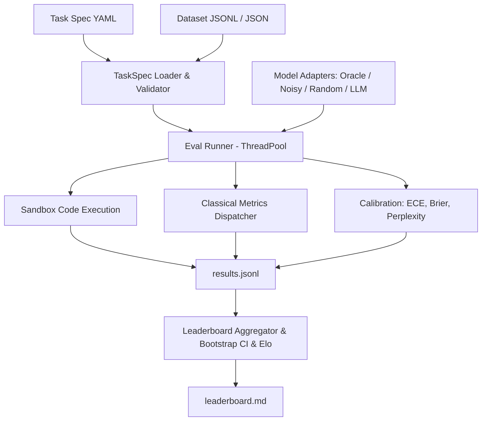

# evalkit

Evaluation runner and benchmark harness built from first principles (lessons 70–75).

## Problem

Evaluating LLMs accurately requires consistent metric definitions, reproducible sandboxed execution, statistical confidence estimation, and standardized task specifications. Without rigorous harnesses, benchmark results diverge across libraries due to hidden tokenization assumptions, uncalibrated confidence scores, and flawed aggregation.

`evalkit` provides an end-to-end evaluation runner with:
1. Pydantic v2 YAML task specifications with variable validation
2. Pure Python implementations of classical metrics (exact match, token F1, BLEU-4, ROUGE-L, chrF, accuracy)
3. Subprocess code execution sandbox with CPU/memory limits and unbiased Codex pass@k
4. Perplexity and Expected Calibration Error (ECE) with reliability diagrams
5. Bootstrap confidence intervals and deterministic Elo ratings (interleaved match order)
6. Resumable multi-threaded evaluation runner with automated markdown leaderboard generation

## Architecture



## Quickstart

```bash
# Run evaluations across bundled tasks
uv run evalkit run --tasks tasks --models oracle,noisy:0.3,random --out runs/demo

# View leaderboard
uv run evalkit leaderboard runs/demo

# Paired comparison of two models on the same examples
uv run evalkit compare runs/demo/results.jsonl --a noisy:0.3 --b random
```

## Results

Benchmark results on bundled evaluation tasks (35 arithmetic, 35 trivia MCQ, 10 HumanEval-style, 35 sentiment; 345 example×model pairs):

| Rank | Model | Macro Mean | 95% CI | Win Rate | Elo Rating | ECE (15 bins) | Brier Score |
|------|-------|------------|--------|----------|------------|---------------|-------------|
| 1 | oracle | 1.000 | [1.000, 1.000] | 0.772 | 1145.2 | 0.010 | 0.000 |
| 2 | noisy:0.3 | 0.714 | [0.614, 0.800] | 0.543 | 1044.5 | 0.098 | 0.210 |
| 3 | random | 0.179 | [0.129, 0.236] | 0.185 | 810.3 | 0.124 | 0.183 |

Per-task means:

| Model | arithmetic_qa | code_humaneval | sentiment | trivia_mcq |
|-------|---------------|----------------|-----------|------------|
| oracle | 1.000 | 1.000 | 1.000 | 1.000 |
| noisy:0.3 | 0.714 | 0.800 | 0.657 | 0.686 |
| random | 0.000 | 0.000 | 0.514 | 0.200 |

Random sits at chance on the 2-label sentiment task (0.514) and the 4-option MCQ (0.200). Rerunning the same command reports `Evaluated: 0, Skipped: 345` (full resume), and a fresh run reproduces `leaderboard.md` byte for byte.

Headline: **oracle macro mean = 1.000 > noisy:0.3 = 0.714 > random = 0.179**.

### Paired comparison

The leaderboard CIs are per model. Whether two models differ is a paired question: both answered the same examples, so `evalkit compare` resamples the per-example differences (10,000 resamples) and adds an exact two-sided sign test on wins/losses (ties dropped).

`evalkit compare runs/demo/results.jsonl --a noisy:0.3 --b random`:

| Task | n | A | B | A - B | 95% CI (paired bootstrap) | W / L / T | sign p |
|---|---|---|---|---|---|---|---|
| arithmetic_qa | 35 | 0.714 | 0.000 | +0.714 | [+0.571, +0.857] | 25 / 0 / 10 | 5.96e-08 |
| code_humaneval | 10 | 0.800 | 0.000 | +0.800 | [+0.500, +1.000] | 8 / 0 / 2 | 0.00781 |
| sentiment | 35 | 0.657 | 0.514 | +0.143 | [-0.086, +0.371] | 12 / 7 / 16 | 0.359 |
| trivia_mcq | 35 | 0.686 | 0.200 | +0.486 | [+0.257, +0.686] | 20 / 3 / 12 | 0.000488 |
| ALL | 115 | 0.696 | 0.217 | +0.478 | [+0.357, +0.591] | 65 / 10 / 40 | 5.15e-11 |

On sentiment the 0.14 gap between noisy:0.3 and random is not distinguishable from zero at n = 35 (CI crosses 0, p = 0.36), although the leaderboard shows 0.657 vs 0.514. p-values are not corrected for the four tasks.

## Design Decisions

- **Zero-Dependency Core Metrics**: Metrics are implemented directly with NumPy and standard library to ensure mathematical transparency and prevent external library drift.
- **Subprocess Isolation**: Code execution runs with `python -I` under temporary working directories with POSIX CPU limits (5s) and address space limits (512MB) set by the child process itself before it runs candidate code (not via `preexec_fn`, which is unsafe in the threaded runner).
- **Unbiased pass@k**: Implemented using Chen et al. (2021) unbiased combinatoric formulation to prevent finite-sample estimation bias.
- **Strict Spec Invariants**: Template variables declared in prompt templates are strictly validated against dataset rows upon loading to eliminate runtime format errors.
- **Classification as constrained choice**: the label set is every distinct target in the dataset, and models pick from it the same way they pick MCQ options.
- **Per-prompt RNG in mock models**: each prediction seeds its own `random.Random(f"{seed}:{prompt}")`, so results don't depend on thread scheduling under the 4-worker pool.
- **CI matches the statistic**: the 95% CI is a stratified bootstrap of the macro mean (resample within each task, then average), not a pooled micro mean.
- **Elo over interleaved matches**: games are played in example order. Grouping them by model pair let `noisy` out-rate `oracle` purely because of the order the games were played.
